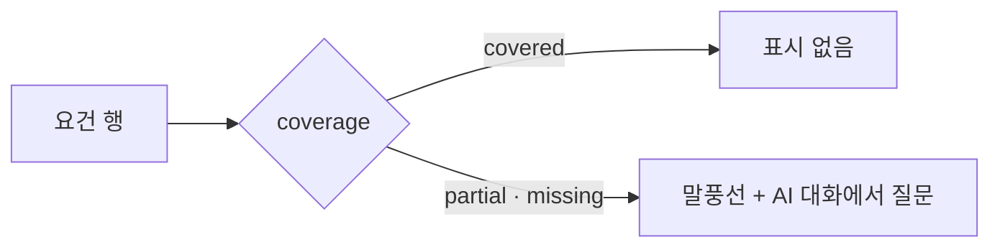

# 공고 분석 요건 행의 AI 대화 표시 — 명세

## 요구사항

1. `CoverageMap`의 `gapSlot`은 `coverage !== "covered"`일 때 `chat-teardrop-dots` 아이콘(13px)과 「AI 대화에서 질문」 글자를 함께 그린다. `aria-label` · `title`은 쓰지 않는다(글자가 그 역할).
2. `.gapSlot`은 `.evidence`와 같은 크기 · 색(`--ex-text-2xs`, `--ex-fg-subtle`)이고, 행 그리드 마지막 열은 `18px` → `auto`.

## 설계

## Open questions

없음.
