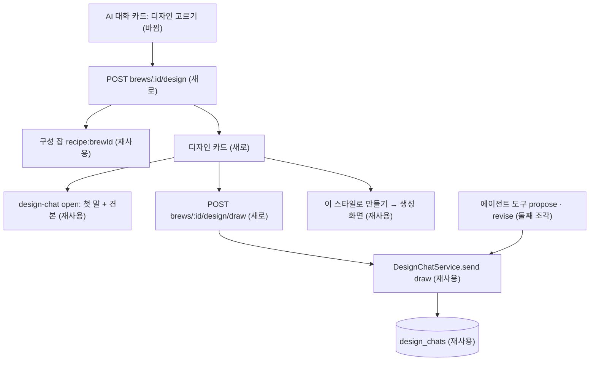

# Spec — 대화에서 디자인 고르기

## 요구사항

### 첫 조각 — 카드로 고르고 만들기

1. `POST /v1/agent/conversations/:id/brews/:brewId/design`은 이 대화가 만든 제작의 디자인을 대화에서 연다. 구성 잡을 맡기고(지금의 키 `recipe:<brewId>`, 이미 있으면 그 잡), 「디자인」 카드를 든 답변(`brewDesign: { brewId, jobPostingId, designMessageId: null }`)을 서버가 붙인다. 실행을 시작하지 않는다. 같은 제작의 카드가 있으면 대화만 돌려준다. 실행 중이면 409, 재료 단계면 409다.
2. 「디자인」 카드는 구성이 생길 때까지 구성 대기를 보이고, 생기면 지금의 디자인 대화를 연다(`POST /api/brews/:id/design-chat/open`). 디자인 대화의 첫 답(말 + 견본)을 카드에 그린다. 구성 잡이 실패하면 사유와 「다시 맡기기」를 보인다.
3. `POST /v1/agent/conversations/:id/brews/:brewId/design/draw` `{ styleId, layoutId }`는 디자인 대화에 그리기(`draw`)를 보내고, 그 답의 ID를 든 카드 답변(`brewDesign.designMessageId`)을 서버가 붙인다. 디자인 대화의 실패(실행 중 · 크레딧 · 동의)는 그 문장 그대로 돌려준다.
4. 카드는 `designMessageId`가 가리키는 디자인 대화의 답(말 + 카드)을 그린다. 다시 그리기 · 고르기는 지금의 디자인 대화 경로(`retry` · `selection`)를 그대로 부른다. 고른 첫 화면이 그 카드에 있으면 「이 스타일로 만들기」(`startGenerationAction`)를 둔다.
5. 넓게 보기는 화면 전체를 덮는 무대로 연다. Esc와 「대화로 돌아가기」로 닫는다.
6. 모델에 넘기는 제작 상태에 디자인을 싣는다 — `design: { ready, busy, styles, layouts, screens, selected }`(이름만). 단계가 `design`이면 에이전트는 카드를 안내하고 이 값으로 답한다.
7. 「AI 대화」 카드의 「디자인 고르기」는 1을 부른다. 「포트폴리오 제작」 카드의 「이어서 만들기」는 디자인 단계에서 대화에 「디자인」 카드가 있으면 그 카드로 옮긴다. 대화에서 연 디자인이면 「AI 대화」 카드는 링크 없이 잠긴다.

### 둘째 조각 — 말로 다시 받고 고치기

8. 도구 `propose_design_options({ jobPostingId, request })` — 디자인 대화에 견본 제안 차례를 시작하고 그 답을 카드로 붙인다. 견본은 여는 호출과 같은 규칙(말하기 · 견본 · 사실)으로 만들고 사용자의 요청과 앞서 보인 견본을 함께 싣는다.
9. 도구 `revise_design_screen({ jobPostingId, instruction, screen })` — 디자인 대화의 고치기 차례(지금의 `reviseCall` · 청사진 자리 · 다시 그리기)를 시작하고 그 답을 카드로 붙인다. 고칠 첫 화면은 이름으로 가리키고, 비면 가장 최근 것이다.
10. 두 도구는 일을 맡기고 바로 돌아온다. 카드가 진행을 보인다. 모델은 보지 않은 첫 화면을 묘사하지 않는다.

## 설계

- **디자인 대화는 엔진으로 남는다.** 저장(`design_chats`), 실행(heartbeat · `interrupted`), 장별 실패, 청사진 자리, 다시 그리기는 그대로다. 에이전트 대화의 카드는 디자인 대화의 답 ID만 들고 그때그때 읽는다. 두 화면이 같은 대화를 보므로 지금의 디자인 화면에서도 대화에서 한 일이 보인다.
- **에이전트는 대화를 맡고, 그리기는 엔진이 맡는다.** 사용자의 말을 디자인 대화의 답하는 호출(`replyCall`)로 넘기지 않는다 — 넘기면 말 하나에 모델 호출이 둘이고 목소리가 둘이다. 에이전트가 무엇을 할지 정하고, 엔진에는 이미 정해진 차례(견본 · 그리기 · 고치기)만 맡긴다(둘째 조각에 엔진 진입점 `propose` · `revise`).
- **첫 말은 엔진의 것이다.** 디자인 대화의 여는 호출이 쓴 말과 견본을 카드에 그대로 그린다. 서버가 시작한 실행에서는 도구를 쓸 수 없고(`step`의 `input.event` 검사), 여는 호출의 말하기 규칙은 요청자와 다듬은 것이다. 그 내용(견본 이름)은 모델에 넘기는 디자인 상태로 에이전트가 안다.
- **화면 부품.** `DesignChat.tsx`의 견본 · 첫 화면 · 고친 결과 · 무대 · 고르기 부품과 그 상태(`View`)를 꺼내 `useDesignView`로 둔다. 지금의 디자인 화면과 대화의 카드가 같은 부품을 쓴다. 「첫 화면 보기」는 `View.draw`로 주입한다 — 디자인 화면은 디자인 대화에, 카드는 에이전트 대화의 경로에 보낸다.
- **여는 일과 읽는 일을 나눈다.** `useDesignChat`은 마운트하면 대화를 연다. 카드는 구성이 생긴 뒤 첫 카드만 연다(`autoOpen`).
- **구성 단계.** 구성 잡이 줄에 있거나 도는 동안은 3단계에서 정한 대로 디자인 단계다. 구성 잡이 실패하면 제작은 인터뷰 단계로 남고, 카드가 사유와 「다시 맡기기」를 보인다.

## 대안

- 사용자의 말을 디자인 대화의 답하는 호출로 넘기기: 엔진을 통째로 쓰지만 말 하나에 호출이 둘이고 목소리가 둘이다(B안을 중계하는 것과 같다).
- 에이전트가 견본(색 값 · 배치도)을 도구 입력으로 직접 쓰기: 호출 하나가 줄지만 견본 규칙과 사실 대조가 빠진다.

## 검증 기준

- 서비스 통합 테스트: 디자인 열기가 카드 한 번 · 구성 잡 한 번, 실행 중 409, 그리기가 엔진에 보내고 그 답의 ID로 카드를 붙임, 엔진의 실패 문장 전달, 제작 열기의 디자인 단계.
- 카드 테스트: 구성 대기 · 실패, 첫 답의 견본, 그리기 경로, 고른 첫 화면의 만들기.
- 실제 화면: 복사본 DB에서 「디자인 고르기」 → 구성 대기 → 첫 말과 견본 → 짝 → 첫 화면 → 고르기 → 만들기 → 생성 화면. (둘째 조각) 말로 견본 다시 받기 · 고치기와 청사진.
