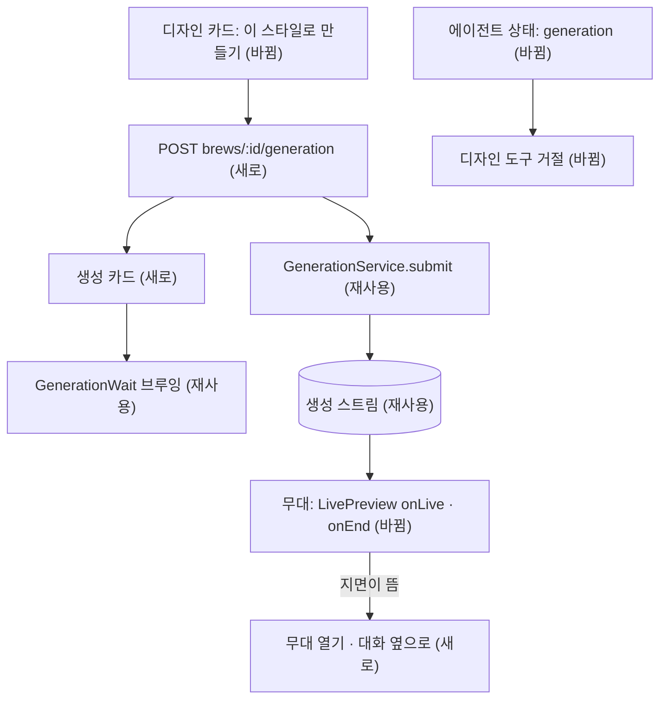

# Spec — 대화에서 포트폴리오 만들기

## 요구사항

1. `POST /v1/agent/conversations/:id/brews/:brewId/generation`은 디자인 대화에서 고른 첫 화면으로 생성을 시작하고 「생성」 카드(`brewGeneration: { brewId, jobPostingId, generationId }`)를 서버가 붙인다. 실행은 시작하지 않는다.
   - 고른 첫 화면이 없으면 409. 생성이 줄에 있거나 도는 중이면 새로 시작하지 않고 그 생성의 카드를 돌려준다(이미 있으면 대화만). 끝난 생성이 있으면 409.
   - 멱등 키는 제작 · 고른 첫 화면 · 직전 생성 ID에서 만든다 — 두 번 눌러도 하나, 실패 · 멈춤 뒤에는 새로.
   - 구성이 아직이면 `brewId`로 맡긴다(구성이 끝나는 대로 생성).
2. 「디자인」 카드와 넓게 보기 무대의 「이 스타일로 만들기」는 1을 부른다(화면을 넘기지 않는다).
3. 웹 `GET /api/brews/:brewId/generation`이 카드가 읽는 것을 낸다 — 최근 생성(ID · 상태 · 만든 시각 · 포트폴리오 · 실패 사유), 구성 대기 여부, 기다리는 동안 보일 입력 묶음(`WaitReading`), 지면 제목. 입력 묶음은 지금의 생성 화면과 같은 함수(`waitReading`, 공용 모듈로 꺼냄)로 만든다.
4. `BrewGenerationCard`
   - 지면이 뜨기 전: `GenerationWait`를 그대로 그린다(브루잉 → 입력 묶음). 높이를 고정한 자리에 둔다. 동작은 「생성 멈추기」.
   - 지면이 뜬 뒤: 「쓰는 중」 한 줄과 「생성 멈추기」 · 「지면 접기 / 지면 보기」.
   - 끝난 뒤: 「다듬기에서 열기」(`/edit/<id>`). 실패 · 멈춤: 사유와 「다시 만들기」(1).
5. 무대 — `LivePreview`를 생성마다 하나만, 처음부터 최종 자리에 둔다(보이지 않게). `onLive`가 오면 무대를 연다. `onEnd`가 오면 카드가 상태를 다시 읽는다(포트폴리오가 생길 때까지). 이 모드에서는 화면 새로 고침을 하지 않는다.
   - 공고 화면: 왼쪽 본문 자리(`JobChatStage`)에 무대가 덮이고 대화는 오른쪽 레일 그대로다. 무대에 「공고 보기」.
   - 독립 채팅 · 홈: 대화 창 안에 무대 자리를 두고, 무대가 열리면 무대가 가운데를 차지하고 대화가 오른쪽 폭(레일과 같은 범위)으로 옮긴다.
   - 1024px보다 좁으면 무대를 위에, 대화를 아래에 쌓는다.
   - 열고 닫을 때 화면 전환(`document.startViewTransition`)으로 잇는다. 움직임 줄이기 설정 · 지원하지 않는 브라우저는 바로 바꾼다.
6. 모델에 넘기는 제작 상태에 생성(`generation: { status } | null`)을 싣는다. 생성 중에는 디자인 도구(`propose_design_options` · `revise_design_screen`)와 「첫 화면 보기」를 거절한다. 끝난 뒤에는 다듬기로 안내한다.

## 설계

- **생성은 대화를 방해하지 않는다.** 지면 생성은 시작할 때 자료를 한 번 읽고(`PageService.generate`의 `#context`) 끝에 저장하며 판 검사를 하지 않는다. 그래서 생성 중의 기록 고침은 실패를 부르지 않고 이번 생성에 들어가지 않을 뿐이다. 결과에 닿지 않는 디자인 도구만 막는다.
- **스트림은 처음부터 다시 읽힌다(30분).** 무대가 다시 마운트되어도(새로 고침) 지면이 다시 그려진다. 그래서 무대를 옮기지 않고 자리마다 하나를 둔다. `LivePreview`의 틀은 `document.write`로 채워 옮기면 지워지므로, 지면이 뜨기 전부터 최종 자리에 둔다.
- **기다림은 짧다.** 고른 첫 화면이 스트림의 처음(`seed`)으로 오고 그때 지면이 뜬 것이 된다. 4단계 확인에서 누른 뒤 4초 안에 「지면을 쓰는 중」이었다. 브루잉은 그동안 돌고, 워커가 밀려 오래 걸리면 입력 묶음까지 간다.
- **제작별 상태.** 4단계의 `DesignBrews` 상태에 생성(최근 생성 · 지면 뜸 여부)을 더한다. 생성이 도는 동안 상태를 다시 읽고, 끝난 뒤에는 포트폴리오가 생길 때까지 읽는다(워커는 스트림에 완성을 쓴 뒤 잡 상태를 바꾼다).
- **모듈 경계.** 에이전트 대화는 `AgentBrewDeps.startGeneration`을 받는다. `main.ts`가 디자인 대화(고른 첫 화면) · 재료(구성 · 최근 생성) · 생성 서비스를 엮는다.

## 대안

- 기다리는 동안부터 무대를 가운데에 열기: 지금의 생성 화면과 같지만, 요청은 지면이 뜬 뒤 옮기는 것이다.
- 지면이 뜰 때 대화 카드 안의 지면 틀을 무대로 옮기기: 틀이 `document.write`로 채워져 옮기면 지워진다.

## 검증 기준

- 서비스 통합 테스트: 생성 시작이 카드 하나 · 생성 하나, 고른 첫 화면 없음 409, 도는 중이면 같은 생성, 끝난 생성 409, 실패 뒤 새 생성, 생성 중 디자인 도구 거절, 모델의 생성 상태.
- 카드 테스트: 기다림 · 쓰는 중 · 끝 · 실패 각각의 단추.
- 실제 화면: 복사본 DB에서 공고 화면 · 독립 채팅 각각 — 만들기 → 브루잉 → 지면이 가운데로 · 대화 옆으로(프레임 측정) → 생성 중 대화 한 번 → 끝 → 「다듬기에서 열기」.
