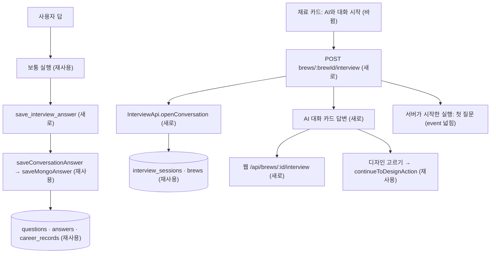

# Spec — 대화에서 AI 인터뷰

## 요구사항

1. `POST /v1/agent/conversations/:id/brews/:brewId/interview`는 이 대화가 만든 제작의 인터뷰를 대화에서 연다. 동의 · 크레딧 · 실행 중 여부를 보통의 보내기처럼 먼저 본 뒤, 인터뷰 세션을 열고(`brews.status` → `interviewing`), 「AI 대화」 카드를 든 답변과 에이전트의 첫 질문을 쓸 답변을 붙이고 서버가 시작한 실행(`event.kind = "brew_interview_start"`)을 돌린다. 같은 제작의 카드가 이미 있으면 대화만 돌려준다. 재료 · 인터뷰 단계가 아니면 409다.
2. 인터뷰 세션을 여는 일은 질문 잡 없이 인터뷰 모듈의 `openConversation`이 한다. 질문 0개의 세션을 만든다. 이미 세션이 있으면(지금의 화면에서 질문을 만든 제작) 그 세션을 쓴다.
3. 모델에 넘기는 제작 상태에 인터뷰가 붙는다 — `interview: { bases: [{ index, kind, coverage, label, evidence }], saved: [{ basis, question }], limit: 6 }`. 근거는 `InterviewApi.questionBases`(AI 없음)이고 evidence는 300자로 자른다.
4. 새 도구 `save_interview_answer({ jobPostingId, basis, question, messageIds })`. 서버는
   - 제작이 `interviewing`이 아니면 거절한다.
   - `messageIds`가 이 대화의 사용자 메시지인지 보고, 같은 근거로 앞서 저장한 메시지와 합쳐 대화 순서대로 원문을 이어 붙인 글을 답으로 쓴다(모델이 쓴 글은 답이 되지 않는다).
   - 인터뷰 모듈의 `saveConversationAnswer`가 같은 근거의 질문이 있으면 그 질문에, 없으면 새 질문(`basis` · `question`)을 만들어 지금의 답 저장(`saveMongoAnswer`)으로 저장한다. 기록 생성과 정리 작업(`record.cleanup`)은 지금과 같다.
   - 질문이 이미 6개고 새 근거면 거절한다.
   - 멱등 키는 근거와 메시지 ID 묶음에서 만든다 — 다시 보내기로 같은 호출이 와도 한 번이다.
5. 세션 계약 `InterviewSessionSchema`의 `questionCount` · `questions` 하한을 3에서 0으로, 답 결과의 `progress.total` 하한을 3에서 0으로 내린다. DB 검증 규칙은 이미 0을 받는다.
6. 웹 `GET /api/brews/:brewId/interview`가 카드 데이터 `{ bases: [{ kind, label, answered }], saved, limit, locked, resumePath }`를 낸다. 지금의 백엔드 경로(`brews.get` · `interviewBases` · `interview.session`)를 그대로 쓴다.
7. `BrewInterviewCard`가 근거 목록과 답한 표시, 「디자인 고르기」(`continueToDesignAction`)를 그린다. 대화의 판(`version`)이 바뀌면 다시 읽는다. 제작이 디자인 단계로 넘어가면 잠기고 「이어서 만들기」(`/design`)만 남는다.
8. 재료 카드의 「AI와 대화 시작」 · 「기록 없이 계속」은 1의 경로를 부른다. 인터뷰 단계로 간 제작의 재료 카드는 잠기되 링크를 두지 않는다(대화 아래의 「AI 대화」 카드가 이어 간다). 질문 잡이 도는 제작(지금의 화면에서 시작)은 지금처럼 `/counter`다.
9. 「포트폴리오 제작」 카드의 「이어서 만들기」는 인터뷰 단계에서 대화에 「AI 대화」 카드가 있으면 그 카드로 대화를 옮긴다. 없으면 지금처럼 `/counter`다.

## 설계

- **서버가 시작한 실행의 계기.** 분석 완료 알림(`brewAnnounced`)과 같은 방식으로 대화 문서에 `brewInterviews: 제작 ID → 첫 질문 답변 ID`를 적는다. 다시 보내기는 `announceEvent`를 넓힌 `serverEvent`로 두 계기를 모두 알아본다. 서버가 시작한 실행에서는 도구를 쓸 수 없으므로(`step`의 `input.event` 검사) 첫 질문은 프롬프트의 근거만으로 한다.
- **원문 보존.** 답의 글은 서버가 사용자 메시지에서 만든다. 지금의 답 저장은 재답변 때 기록 본문을 덮어쓰므로, 같은 근거의 메시지 ID를 대화 문서(`brewInterviewMessages: "제작 ID:근거 키" → 메시지 ID[]`)에 모아 매번 전체를 보낸다.
- **질문 검사 규칙.** 의문사 · 물음표 하나 규칙(`interviewQuestionProblems`)은 저장을 거절하는 대신 지침으로 둔다. 질문은 이미 대화에서 사용자에게 보였고, 저장 때 고쳐 쓰게 하면 저장된 질문이 실제로 한 질문과 달라진다.
- **모듈 경계.** 에이전트 대화는 `AgentBrewDeps`에 `openInterview` · `interview`(근거와 저장한 질문) · `saveInterviewAnswer`를 받는다. 출처는 `InterviewApi`의 진입점이다.
- **세션 진행.** `refreshMongoInterviewProgress`가 다 답한 세션을 `done`으로 두는 것은 그대로다. 새 질문을 넣을 때 `questionCount`를 같이 올린다.

## 대안

- 미리 만든 질문을 에이전트가 하나씩 묻기: 질문 검사 규칙과 질문 생성을 그대로 쓰지만, 질문이 답을 보고 바뀌지 않는다. 요청자의 C안은 미리 만든 질문이 없는 쪽이다.
- 모델이 답 글을 도구 입력에 쓰기: 단순하지만 하지 않은 말이 기록에 섞일 수 있다.

## 검증 기준

- 인터뷰 통합 테스트: 질문 0개의 세션 열기와 상태 변경, 새 근거의 질문 · 답 저장, 같은 근거의 다시 저장(본문 갱신), 7번째 근거 거절, 근거 목록에 없는 근거 거절.
- 에이전트 서비스 통합 테스트: 인터뷰 열기가 카드와 첫 질문 실행을 한 번만 붙임, 실행 중 409, 서버가 시작한 실행의 다시 보내기, 저장 도구가 원문을 합쳐 보냄, 디자인 단계에서 거절.
- 카드 테스트: 근거와 답한 표시, 잠긴 카드.
- 실제 화면: 복사본 DB에서 재료 카드 → 「AI와 대화 시작」 → 첫 질문 → 답 → 카드 체크와 기록 생성 → 꼬리 답 → 「디자인 고르기」.
