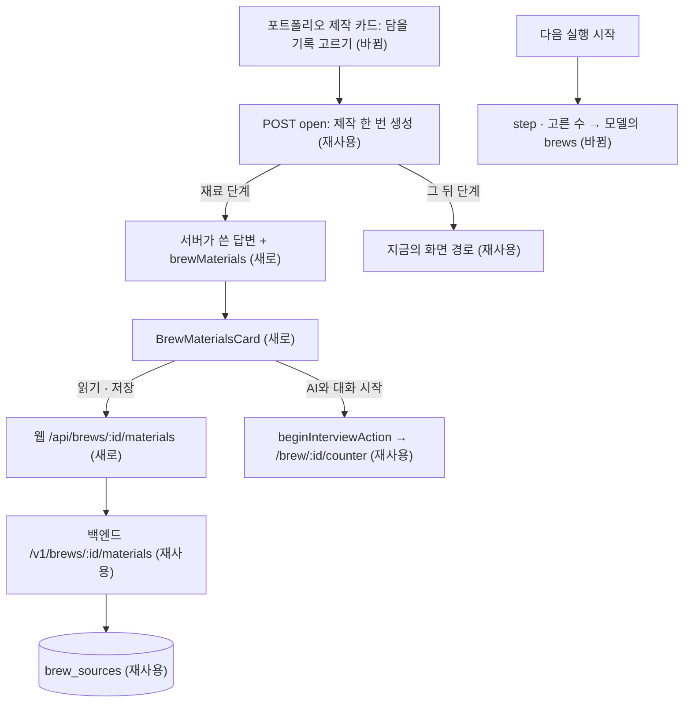

# Spec — 대화에서 재료 고르기

## 요구사항

1. `POST /v1/agent/conversations/:id/brew-starts/:startId/open`은 제작을 한 번만 만든 뒤, 제작이 재료 단계(`draft`)면 대화에 「재료 고르기」 카드를 든 답변을 붙이고 `{ brewId, path: null, conversation }`을 낸다. 그 뒤의 단계면 지금처럼 `{ brewId, path, conversation: null }`을 낸다.
2. 카드를 든 답변은 AI를 부르지 않고 서버가 쓴다 — 글 없이 도구 결과 하나(`brewMaterials: { brewId, jobPostingId }`)만 있다. 같은 제작의 카드가 이미 있으면 붙이지 않는다. 실행 중이면 409다.
3. 제작의 지금 상태(`AgentBrewStartState`)에 `step`(재료 · AI 대화 · 디자인, 제작이 없으면 null)을, 모델에 넘기는 상태에 고른 기록 수를 더한다.
4. 웹의 `GET · PUT /api/brews/:brewId/materials`가 재료 목록과 제작 상태를 읽고, 고른 목록을 통째로 저장한다. 백엔드의 기존 `/v1/brews/:id/materials`를 그대로 쓴다.
5. `BrewMaterialsCard`가 줄 세운 기록을 체크 목록으로 그리고, 누를 때마다 고른 목록 전체를 저장한다. 한도는 서버가 준 `selectionLimit`이다.
6. 카드의 「AI와 대화 시작」은 지금의 서버 액션 `beginInterviewAction`을 부른다. 질문이 이미 있거나 만드는 중이면 `/brew/:id/counter` 링크다. 지금의 재료 화면과 카드가 판정 하나(`interviewEntry`)를 쓴다.
7. 제작이 재료 단계를 지나면(`status`가 `draft`가 아님) 대화에 남은 카드는 고른 것을 보이기만 한다(`locked`) — 체크 칸이 꺼지고 「AI 대화 이어가기」 링크만 남는다. 웹의 `PUT`은 409로 거절한다.
8. 카드가 이미 있을 때 「담을 기록 고르기」를 다시 누르면 그 카드가 보이게 대화를 옮긴다.

## 설계

- **서버가 쓴 답변.** 대화에 카드를 붙이는 일은 실행이 아니다. `run`을 건드리지 않고 답변 하나를 덧붙인다. 실행 중에는 마지막 답변을 실행이 다시 쓰므로 409로 막는다 — 초안의 승인 · 거절과 같은 규칙이다.
- **상태가 사는 곳.** 카드에는 제작 ID만 둔다. 재료 목록과 고른 것은 `brew_sources`가 출처이고 카드가 그때그때 읽는다. 지금의 재료 화면과 같은 API를 쓰므로 두 화면에서 고른 것이 서로 보인다.
- **모듈 경계.** 에이전트 대화 서비스가 받는 `brewStatus`를 `brewState`(상태 + 고른 수)로 넓힌다. 출처는 그대로 `MaterialsApi.getState`다.
- **다음 화면.** 지금의 서버 액션과 멱등 키(`brewJobKey`)를 그대로 쓴다. 질문 잡을 두 번 맡기지 않도록, 카드는 제작 상태(`interviewSessionId` · `latestJob`)로 단추와 링크를 가른다.
- **스크롤.** 서버가 붙인 답변은 1단계의 알림과 같은 길(답변 뒤에 답변)로 화면이 끝까지 내려간다.
- **지나간 단계의 카드.** 백엔드의 재료 저장(`updateSelection`)은 단계를 보지 않고 `referenceVersion`을 올린다. 지금의 재료 화면은 뒤로 돌아가 고치는 길로 그 동작을 쓰므로 백엔드는 그대로 두고, 대화의 카드가 쓰는 웹 경로에서만 막는다.

## 대안

- 「포트폴리오 제작」 카드 안에서 재료 목록을 펼치기: 대화에 쓰지 않아 단순하지만, 단계가 늘수록 카드 하나가 모든 단계를 품는다. 단계마다 카드가 쌓이는 쪽이 대화를 읽기 쉽다.
- 에이전트가 도구로 카드를 세우기(B안): 말로 고를 수 있지만 들어설 때마다 실행이 돈다. 요청자가 A안을 골랐다.

## 검증 기준

- 서비스 통합 테스트: 재료 단계의 `open`이 카드를 든 답변을 한 번만 붙임, 실행 중 409, 그 뒤 단계의 제작은 경로만 냄, 상태의 `step`, 모델의 고른 수.
- 카드 테스트: 목록과 고른 수, 체크하면 전체 목록 저장, 한도 안내, 질문이 있으면 링크, 다음 단계로 간 제작의 카드는 읽기 전용.
- 실제 화면: 복사본 DB에서 「담을 기록 고르기」 → 카드 → 체크 해제 → 새로 고침 → 「AI와 대화 시작」 → 질문 만들기. 다음 단계로 간 제작의 대화에서 잠긴 카드와 「이어서 만들기」.
