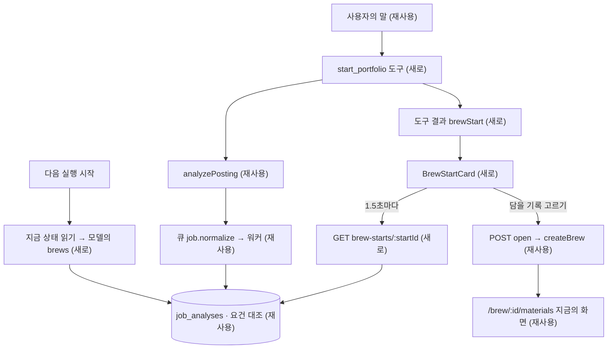

# Spec — 대화에서 포트폴리오 제작 시작과 공고 분석

## 요구사항

1. 에이전트 도구 `start_portfolio`가 대화에 연결된 공고 하나로 공고 분석을 맡기고, 도구 결과에 `brewStart`(시작 ID · 공고 ID · 분석 ID · 공고 제목 · 회사 · 제작 ID)를 남긴다.
2. 공고 ID는 대화의 `contexts`에 있는 것만 받는다. 없으면 검증 실패로 돌려보낸다.
3. 같은 공고로 다시 부르면 같은 분석을 돌려준다. 그 대화에서 이미 만든 제작이 있으면 그 제작 ID를 이어받는다.
4. `GET /v1/agent/conversations/:id/brew-starts/:startId`가 지금 상태를 낸다 — 분석의 상태 · 단계 · 실패, 끝났으면 요건의 확인 수, 제작 ID.
5. `POST .../brew-starts/:startId/open`이 제작을 한 번만 만들고 다음 화면의 경로를 낸다. 분석이 끝나지 않았으면 409다.
6. `POST .../brew-starts/:startId/retry`가 다시 해 볼 수 있는 실패를 다시 큐에 넣는다.
7. 실행을 시작할 때 서비스가 이 대화의 제작들의 지금 상태를 읽어 모델에 넘긴다(`brews`).
8. 화면은 `brewStart`가 든 도구 결과를 「포트폴리오 제작」 카드로 그린다. 끝나지 않은 동안 1.5초마다 상태를 읽는다.

## 설계

- **상태가 사는 곳.** 대화에는 ID만 둔다. 진행과 결과의 출처는 `job_analyses`와 `brews`다. 대화는 메시지 100개 · 도구 30개의 상한이 있고, 모델에 넘길 때는 요약만 싣기 때문이다.
- **끝난 작업이 대화에 닿는 길.** 큐 작업의 결과를 대화에 쓰지 않는다. 카드가 상태를 읽고(탭이 닫혀도 분석은 워커에서 돈다), 다음 실행은 시작할 때 서버가 지금 상태를 읽어 모델에 넘긴다. 실행 중에는 마지막 메시지를 실행이 통째로 다시 쓰므로, 대화에 쓰는 일(제작 ID 기록)은 실행 중에 409로 막는다 — 초안의 승인 · 거절과 같은 규칙이다.
- **한 번만.** 분석은 `analyzePosting`이 사용자와 공고마다 하나로 모은다. 제작은 `open`에서 만들고 대화마다 한 번에 하나씩 처리한다(프로세스 안의 줄 세우기 + 도구 ID 조건을 건 쓰기). 다시 보내기로 카드가 지워졌다 다시 생겨도, 같은 분석 ID의 앞선 카드가 가진 제작 ID를 이어받는다.
- **동의.** 도구는 공고 분석 동의(`job_analysis`)를 검사한다. 없으면 검증 실패로 돌려, 에이전트가 설정에서 켜 달라고 안내한다.
- **모듈 경계.** 에이전트 대화 서비스는 `JobMarketApi.analyzePosting` · `JobAnalysisApi.getResult` · `MaterialsApi.createBrew`를 생성자에서 받는다. 받지 않은 서비스는 도구가 "설정되지 않았다"고 돌려준다.
- **계약.** `AgentToolResultSchema`에 `brewStart`(선택)를 더한다. 대화 컬렉션의 검증 규칙은 메시지 안을 보지 않아 마이그레이션이 없다.
- **화면.** `BrewStartCard`가 기존 카드의 틀(`RecordDraftCard.module.css`)과 분석 단계의 말 · 막대 값(`lib/analysis-stage.ts`)을 그대로 쓴다.

## 대안

- 분석이 끝나면 서버가 대화에 새 답을 시작하기: 대화가 스스로 이어지지만 실행마다 크레딧이 들고, 사용자가 없는 동안에도 돈다. 열린 질문으로 남긴다.
- 도구 호출을 분석이 끝날 때까지 붙잡기: 도구 호출의 시간 상한을 재지 않았고, 실행 하나가 CLI 프로세스를 몇 분씩 잡는다.
- 제작을 도구가 바로 만들기: 분석이 끝나야 재료 순위를 매길 수 있어 만들 수 없다.

## 검증 기준

- 런타임 테스트: 도구가 MCP 목록에 실리고, 결과가 `brewStart`로 남는다.
- 서비스 통합 테스트: 연결되지 않은 공고는 거절, 같은 공고로 두 번 시작하면 같은 분석, `open`을 두 번 불러도 `createBrew`는 한 번, 분석 중의 `open`은 409, 실행 중의 `open`은 409, 상태의 확인 수.
- 실제 화면: 복사본 DB와 AI를 켠 워커에서 공고 상세의 채팅 레일로 시작 → 진행 → 결과 → 재료 고르기 화면.
