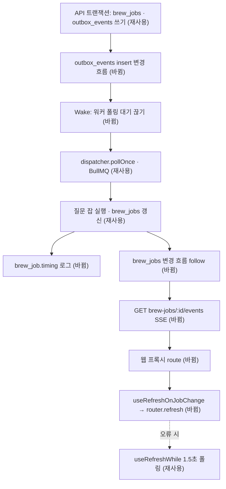

# 질문 생성 완료 즉시 알림 · 큐 발행 대기 제거 — 명세

## 요구사항

- [ ] `GET /v1/brew-jobs/:id/events`가 SSE로 잡 상태를 보낸다. 연결 즉시 지금 상태 한 번, 이후 바뀔 때마다 한 번. `succeeded` · `failed`에서 끝낸다. 남의 잡 · 없는 잡은 SSE를 열기 전에 404, 인증 없으면 401.
- [ ] 상태를 읽은 뒤 끝난 변경도 놓치지 않는다(읽기 직전 시각부터 변경 흐름을 연다).
- [ ] 워커는 `outbox_events`에 행이 들어오면 1초 대기를 끊고 바로 발행한다. 변경 흐름이 끊기면 같은 간격(`OUTBOX_POLL_INTERVAL_MS`)으로 다시 연다. 그동안 1초 폴링은 그대로 돈다.
- [ ] 웹 `/api/brew-jobs/[jobId]/events`가 세션 쿠키로 백엔드 SSE를 이어 준다.
- [ ] 대화 화면 대기 카드는 SSE에서 렌더된 것과 다른 상태 · 단계를 받으면 화면을 다시 읽는다. SSE가 오류로 끊기면 1.5초 폴링으로 돌아간다.
- [ ] 워커가 질문 · 구성 잡을 끝내면 `{"event":"brew_job.timing","type","queueWaitMs","runMs"}`를 남긴다.

## 설계

변경 감지는 **MongoDB change stream**으로 한다. 운영 · 로컬 · 테스트 DB 모두 replica set(`rs0`)이고(트랜잭션이 이미 그것을 요구한다), 쓰는 쪽(API 트랜잭션 · 워커)을 고치지 않고 커밋된 변경만 받는다.

- `BrewJobService.follow(userId, jobId, signal)`(새, async generator): `ping`의 `operationTime`을 잡고 → 지금 문서를 읽어 소유 확인 · 첫 상태 → `brewJobs.watch([{ $match: { "documentKey._id": jobId } }], { fullDocument: "updateLookup", startAtOperationTime })`. 상태 변환은 `brewJobStatus`(재사용). `BrewJobApi`에 교차 타입으로 더한다(interview와 같은 방식).
- 라우트는 첫 `next()`를 hijack 전에 받아 404를 JSON으로 낸다. 헤더는 `writePageStream`처럼 `flushHeaders`로 바로 보낸다.
- `worker/outbox-wake.ts`(새): `Wake`(notify · sleep) + `watchOutboxInserts`(insert만 듣고 오류 시 다시 연다). `runPollLoop`는 `wake`가 있으면 `delay` 대신 `wake.sleep`을 쓴다. 폴링 중에 들어온 알림은 다음 대기를 건너뛴다.
- 웹: `api/generation-jobs/[jobId]/page-stream/route.ts`를 그대로 따른 프록시. `use-refresh-on-job-change.ts`(새)가 `EventSource`를 열고, 오류면 `useRefreshWhile`(재사용)로 돌아간다. `Waiting`만 새 훅을 쓴다.
- 타이밍 로그: `createBrewJobProcessor`가 BullMQ `job.timestamp` · `processedOn`으로 계산한다.

## 버린 대안

- Redis pub/sub으로 깨우기: 커밋 뒤에 발행해야 해서 API 라우트마다 손이 간다. 변경 흐름은 커밋된 것만 준다.
- 서버 쪽에서 DB를 0.5초마다 읽는 SSE(에이전트 채팅 방식): 새 간격 상수가 생기고 지연이 0이 아니다.
- `OUTBOX_POLL_INTERVAL_MS`만 낮추기: 지연은 남고 빈 폴링이 늘어난다.

## 함정

- change stream은 Mongo 재시작 때 끊긴다. 워커는 다시 열고, 웹은 폴링으로 돌아간다. 워커 폴링 루프는 이 오류로 멈추지 않는다.
- `watch()`는 첫 `next()` 전까지 서버에 열리지 않는다. `startAtOperationTime` 없이 "열고 → 읽기"만 하면 그 사이 끝난 잡을 놓친다.
- 프록시(nginx) 유휴 시간 초과로 끊기면 `EventSource`가 오류를 내고 폴링으로 돌아간다. 하트비트 상수를 두지 않는다.

## 완료 기준

- `pnpm --filter @expresso/backend test` · `pnpm --filter @expresso/web test` 통과, `pnpm test:infra brew-jobs poll-loop security-gate` 통과.
- 브라우저: 워커를 멈춘 채 시작 → 워커 켜기 → 질문 화면으로 바뀌는 시점이 잡 `updatedAt` 직후. 로컬 `publishedAt − createdAt`이 수십 ms.
