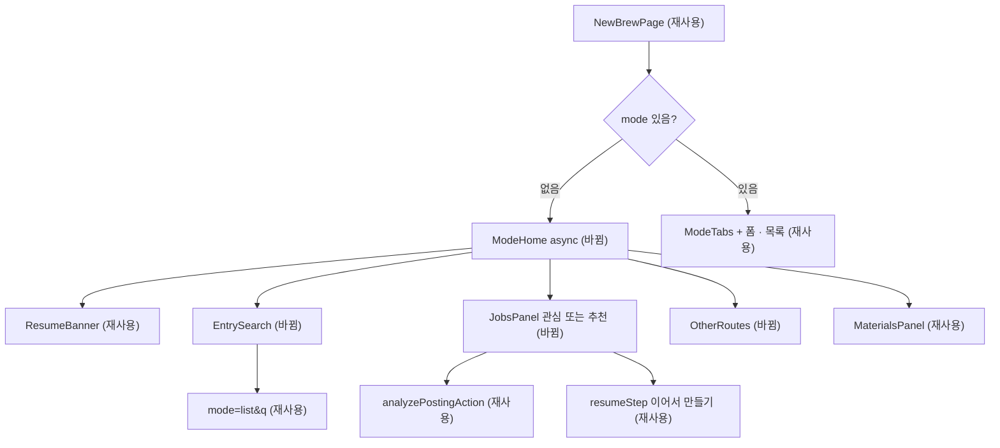

# 새 포트폴리오 첫 화면 공고 우선 재구성 — 명세

## 요구사항

- [ ] `mode`가 없을 때 `ModeHome`이 검색 칸 → (공고 줄 | 다른 갈래 · 내 재료) 순서로 선다.
- [ ] 검색 칸은 GET `/brew/new`에 `mode=list`와 `q`를 보낸다. 칸에 `jobs.postings` 전체 건수를 보인다.
- [ ] 공고 줄의 출처는 관심 공고(`watchedJobs`)가 1건 이상이면 관심 공고, 아니면 `homeEngagement.recommendedJobs` 상위 다섯 건이다. 둘 다 없으면 공고 칸은 서지 않고 다른 갈래 칸이 전체 폭을 쓴다.
- [ ] 관심 공고 줄은 `brew`가 있고 `status !== "done"`이면 `resumeStep(status)` 단계로 가는 링크를, 아니면 `analyzePostingAction` 폼 버튼을 낸다. 마감은 `daysLeft`(D-n) 또는 `deadlineNote`로 보인다.
- [ ] 배치는 서버에서 정한다. 공고 칸 유무로 격자가 바뀌므로 `ModeHome`이 데이터를 `await`한 뒤 그린다(Suspense 뒤 null로 배치가 튀지 않게).
- [ ] 카드 발치 경로(`path`, `.cardPath`, `.cardStop`)를 지운다.
- [ ] 모드 탭(`ModeTabs`)과 고른 뒤 화면은 그대로다.

## 설계

재사용: `AppHeader` · `WizardSteps` · `AppBody`, `ResumeBanner`, `CompanyAvatar`, `Icon`, `analyzePostingAction`, `resumeStep`, `watchedJobs`, `homeEngagement`, 기존 `.panel` · `.quickRow` · `.materialsChip` · `.rowGo` 스타일.

`page.tsx`
- `ModeHome`을 async로 바꿔 `watchedJobs`, `homeEngagement`, `jobs.postings({ limit: 1 })`를 `Promise.all`로 받는다. 앞 둘은 `cache`라 사이드바와 같은 요청을 공유한다.
- 새 조각 `EntrySearch`(검색 칸), `JobsPanel`(관심 또는 추천 줄), `OtherRoutes`(붙여넣기 · 주소 · 공고 없이). `QuickStart`와 `ModeCards`는 이 둘로 대체돼 지운다.
- `MODES`에서 `path`를 지운다. 탭 라벨은 그대로 둔다.

`page.module.css`
- `.cards` · `.card*` · `.below` · `.quickRows` 계열을 새 배치(`.split`: 공고 칸 3fr / 옆 칸 2fr, 720px 아래 한 열)로 바꾼다. 검색 칸은 화면의 강조점 하나로, 높이와 글자를 키우고 포커스 때 `--ex-accent` 테두리를 쓴다.

## 버린 대안

- 검색 칸에 URL을 넣으면 주소 읽기로 보내는 판별: 입력 하나가 세 가지 뜻을 갖게 되고 주소 읽기 화면을 고쳐야 한다. 이번 범위에서 뺀다.
- 관심 · 추천을 둘 다 펴기: 같은 공고가 두 번 서고 칸이 길어진다.

## 함정

- `watchedJobs`는 `interested: true`라 닫힌 관심(`stage: closed`)도 섞일 수 있다. 줄에 `daysLeft < 0`이면 마감으로 보인다.
- 공고 칸이 없을 때 옆 칸이 홀로 남으므로 `.split`이 한 열이 되도록 서버에서 클래스를 바꾼다.

## 완료 기준

- `pnpm --filter @expresso/web typecheck`, `pnpm --filter @expresso/web test` 통과.
- 브라우저에서 dev01로 `/brew/new` 관심 공고 있음 · 기록 있음 상태 스크린샷, 375px 스크린샷.
