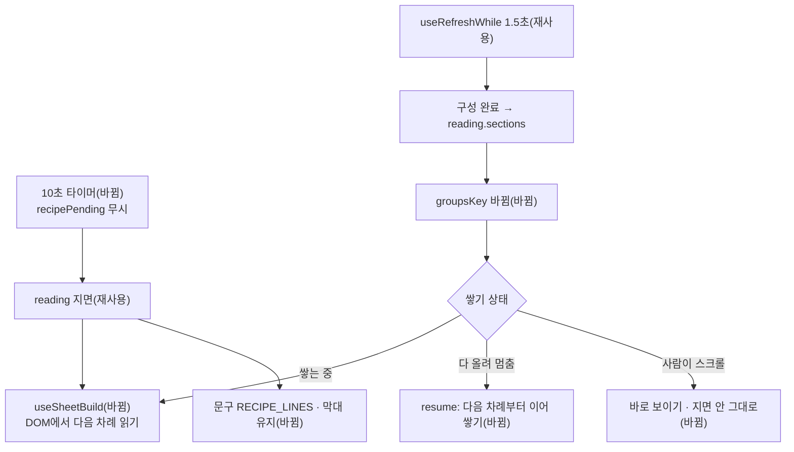

# 생성 기다림 10초 뒤 지면 전환과 섹션 늦게 올리기 — 명세

## 요구사항

- [ ] `GenerationWait`은 `recipePending`과 상관없이 `brewingLeftMs`가 지나면 `reading`으로 넘어간다. 처음 값도 `brewingLeftMs > 0`만 본다.
- [ ] `recipePending`인 동안 `useRefreshWhile`로 1.5초마다 다시 읽는다(지금과 같음).
- [ ] `reading`에서 `recipePending`이면 잔 아래 문구는 `RECIPE_LINES`, 아니면 `READING_LINES`다.
- [ ] 진행 막대는 `phase === "reading" && !recipePending`일 때 끝까지 차고 접힌다.
- [ ] 섹션 구역은 순서 채용 공고 · 디자인 · 섹션 · 기록의 제자리에 들어온다.
- [ ] 쌓는 중이거나 쌓기를 마친 뒤 새 구역이 들어오면 다음 차례로 올리고, 칸 밖이면 보이는 자리로 지면 안을 옮긴다.
- [ ] 사람이 스크롤한 뒤(손으로 멈춘 뒤)에 들어온 구역은 바로 보이게만 하고 지면 안을 옮기지 않는다.
- [ ] 동작 줄이기 설정에서는 들어온 구역이 바로 보인다.

## 설계

`useSheetBuild`의 상태를 개수가 아니라 DOM에서 읽는다.

- 구역 목록은 `step()`마다 `[data-feed-group]`을 다시 찾는다. 올린 구역은 `data-shown`이 있는 것, 다음 차례는 `data-shown`이 없는 첫 구역이다. 가운데에 끼어든 구역도 그대로 다음 차례가 된다.
- `--j`(제목 · 카드 순번)는 구역을 올릴 때 매긴다.
- 쌓기를 마친 상태를 둘로 나눈다: 다 올려서 멈춘 것(`done`)과 사람이 스크롤해 멈춘 것(`manual`). `data-settled`는 둘 다에 붙는다.
- 훅에 구역 구성 키(`groupsKey`, 그리는 구역 이름을 이은 문자열)를 넘긴다. 키가 바뀌면 별도 효과가 훅 안의 `resume()`을 부른다. `done`이면 `data-settled`를 떼고 다음 차례부터 다시 쌓는다. `manual`이거나 동작 줄이기면 남은 구역을 바로 보인다.
- 다시 이을 때 `written`을 지금 `scrollTop`으로 맞춘다. 위에 구역이 끼어들면 브라우저 스크롤 고정(scroll anchoring)이 `scrollTop`을 옮기는데, 이것을 사람의 스크롤로 읽지 않기 위해서다.
- 새 구역이 칸 위에 있으면 위 끝에, 아래로 넘치면 아래 끝에 맞춘다(칸보다 길면 위 끝).

재사용: `move` · `view` · `feedSnaps` · `nextSnap` · `Caption` · `BrewProgress` · `useRefreshWhile` · 기존 CSS(`data-building` · `data-shown` · `data-settled`).

## 버린 대안

- 섹션 구역을 맨 아래에 붙이기 — 끼어들 때 자리 이동은 없지만 구성이 이미 끝난 경우와 순서가 달라지고, 사용자가 보낸 화면의 순서와도 다르다.
- 구역이 바뀌면 효과를 처음부터 다시 돌리기 — `shown = 0`으로 돌아가 보이던 구역이 깜빡이고 다시 쌓인다.

## 함정

- 개수로 올린 구역을 세면 가운데 끼어든 섹션 때문에 `reveal(3)`이 기록을 감춘다.
- 스크롤 고정이 바꾼 `scrollTop`을 사람의 스크롤로 오인하면 쌓기가 `manual`로 멈춘다.
- jsdom은 레이아웃이 없어 `offsetHeight`가 0이다. 이동 검증은 브라우저에서 한다.

## 완료 기준

- `pnpm --filter @expresso/web test -- GenerationWait` 통과, `pnpm --filter @expresso/web typecheck` 통과.
- 브라우저에서 구성 대기 중 생성 → 10초 뒤 세 구역 → 구성 완료 뒤 섹션 구역이 디자인 아래에 나타난다.
