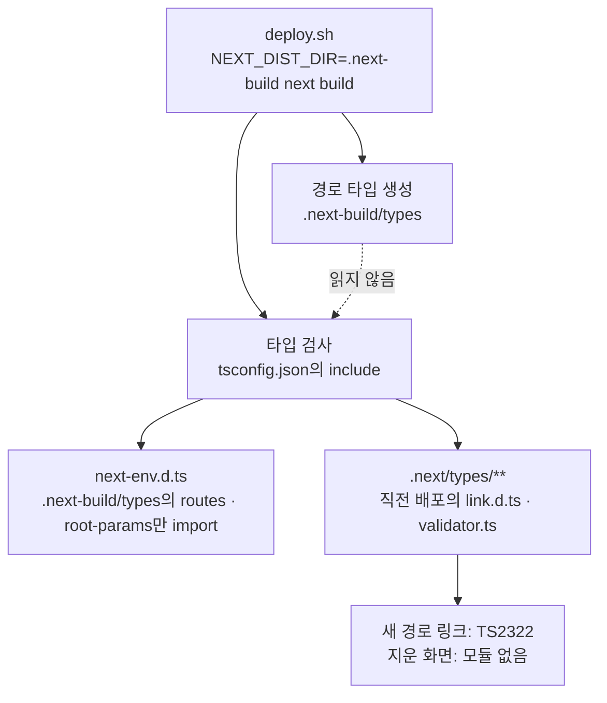
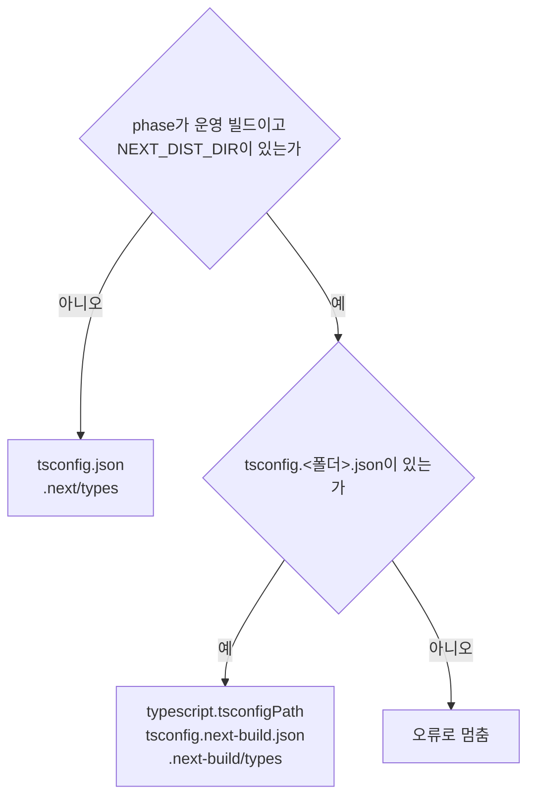

# 운영 빌드의 경로 타입 검사 — 명세

## 요구사항

1. `NEXT_DIST_DIR`을 준 운영 빌드(`next build` · `next typegen`)의 타입 검사는 `<distDir>/types`의 파일만 읽고 `.next/types`를 읽지 않는다.
2. `NEXT_DIST_DIR`이 없는 빌드(CI · 로컬)는 지금처럼 `tsconfig.json`으로 검사한다.
3. `NEXT_DIST_DIR`을 준 운영 빌드에 맞는 tsconfig가 없으면 설정을 읽는 단계에서 오류로 멈춘다. `tsconfig.json`으로 넘어가지 않는다.
4. `next dev` · `next start`에서는 tsconfig를 바꾸지 않는다.
5. 두 tsconfig의 `include`는 타입 폴더만 다르다.

## 원인

- `tsconfig.json`에 `extends`가 있으면 Next는 `include`에 `<distDir>/types/**`를 더하지 않는다(`next/dist/lib/typescript/writeConfigurationDefaults.js`의 「Bail automatic setup」).
- `next-env.d.ts`는 `routes.d.ts`와 `root-params.d.ts`만 가져온다(`writeAppTypeDeclarations.js`). `<Link href>`의 타입인 `link.d.ts`와 화면 검사인 `validator.ts`는 `include`의 글롭으로만 들어온다.
- CI의 빌드는 `.next`에 지어 방금 만든 타입을 읽는다. 서버가 더 엄격했던 것이 아니라 옛 타입을 읽었다.

## 설계

- **`services/web/next.config.ts`**: 설정을 phase를 받는 함수로 바꾼다. phase가 `PHASE_PRODUCTION_BUILD`이고 `NEXT_DIST_DIR`이 있으면 `typescript.tsconfigPath`를 `tsconfig.<앞의 점을 뗀 폴더 이름>.json`으로 둔다. 파일이 없으면 던진다. 근거: `next/dist/docs/01-app/03-api-reference/05-config/02-typescript.md` 「Custom tsconfig path」.
- **`services/web/tsconfig.next-build.json`**: `./tsconfig.json`을 `extends`하고 `include`만 다시 적는다 — `.next/types/**/*.ts` 자리에 `.next-build/types/**/*.ts`.
- **`services/web/tsconfig.test.ts`**: `tsconfig.next-build.json`의 `include`가 `tsconfig.json`의 것과 타입 폴더만 다른지, `deploy.sh`가 주는 `NEXT_DIST_DIR`에 맞는 tsconfig가 있는지 본다.
- **`ProposalFeed.tsx`**: `/goal` 링크 두 곳의 `as Route`를 뗀다.
- **`docs/operations/DEPLOYMENT.md`**: `.next-build`에 짓는 문단에 타입 검사가 읽는 폴더를 적는다.

## 버린 대안

- `experimental.strictRouteTypes`: `next-env.d.ts`가 `link.d.ts`까지 distDir에서 가져오게 하지만, Next 문서에 없고 화면의 props · 반환값 검사도 함께 켠다.
- `tsconfig.json`의 `include`에 `.next-build/types/**`를 더함: 직전 배포의 타입과 이번 타입이 함께 들어온다.
- 배포 전에 운영 `.next/types`를 지움: 링크 타입이 아예 빠져 검사가 꺼진다.
- 서버 빌드의 타입 검사를 끔: `main`은 최신 상태를 요구하지 않아, 따로 통과한 두 PR이 합쳐져 깨진 경우를 서버가 마지막으로 잡는다.

## 함정

- 고친 뒤 빌드가 통과하는 것만으로는 "방금 만든 타입을 읽음"과 "링크 타입을 읽지 않음"을 가를 수 없다. 없는 경로의 링크가 실패하는지 함께 본다.
- `extends`한 tsconfig의 `include`는 통째로 바뀐다. `tsconfig.json`에 `include`를 더하면 `tsconfig.next-build.json`에도 더해야 한다 — 테스트가 잡는다.
- Playwright의 웹 서버는 `NEXT_DIST_DIR=.next-e2e-v2 next dev`다. phase로 가르지 않으면 E2E가 설정 단계에서 멈춘다.

## 완료 기준

- 재현 장면(#240으로 지은 `.next` + #242 + 수정)이 배포 절차의 웹 빌드 구간 그대로 통과한다.
- 같은 상태에서 없는 경로의 링크는 실패한다.
- `pnpm typecheck` · `pnpm test`가 통과한다.
