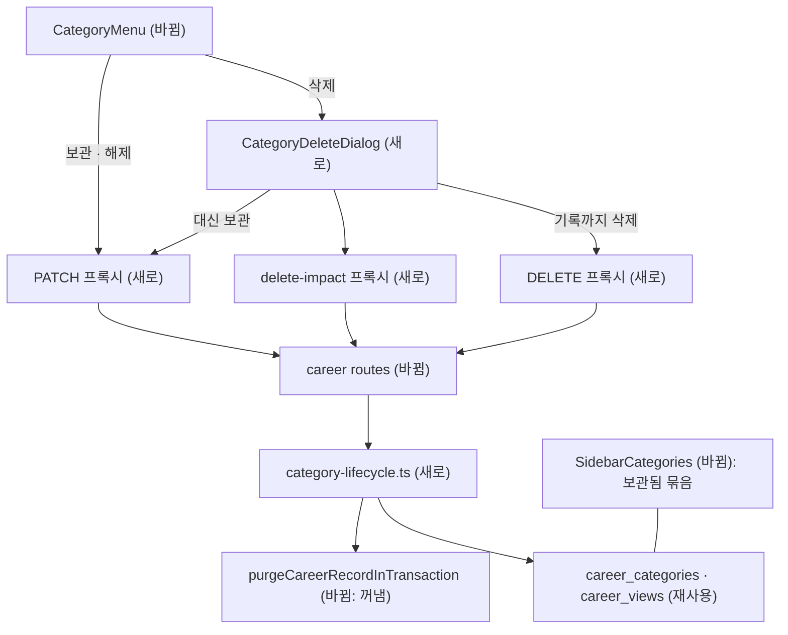

# 커리어 카테고리 보관 · 삭제 — 명세

## 요구사항

- [ ] `CareerCategorySchema`에 `archivedAt: Timestamp | null`과 `builtIn: boolean`이 있다. `builtIn`은 키가 `CAREER_CATEGORY_TEMPLATES`에 있을 때 참이다.
- [ ] `PATCH /v1/career/categories/:id` `{ archived: boolean }`가 `archivedAt`을 바꾼다. 기본 카테고리도 된다. `version`은 올리지 않고 `If-Match`도 받지 않는다 — `version`은 속성 스키마 변경의 `If-Match`가 보는 값이라, 올리면 열린 화면의 다음 속성 변경이 412로 막힌다(구현 중 변경).
- [ ] `GET /v1/career/categories/:id/delete-impact`가 `recordCount`(활성) · `trashedRecordCount` · `quotedRecordCount`(포트폴리오 인용, `recordUsages`) · `blockingProperties`(다른 카테고리의 살아 있는 관계 속성 중 `targetCategoryId`가 이 카테고리인 것: 카테고리 · 속성 이름)를 준다.
- [ ] `DELETE /v1/career/categories/:id?deleteRecords=true|false`(같은 이유로 `If-Match` 없음. 막는 조건은 트랜잭션 안에서 다시 센다):
  - 기본 카테고리면 409 `built-in career category cannot be deleted`.
  - `blockingProperties`나 `quotedRecordCount`가 있으면 409.
  - 기록(활성 + 휴지통)이 있는데 `deleteRecords`가 참이 아니면 409 `career category has records`.
  - 통과하면 한 트랜잭션에서 기록 전부를 영구 삭제(기존 정리 절차)하고, `careerViews`와 카테고리 문서를 지운 뒤 204.
- [ ] `listCategories`는 보관한 카테고리도 돌려준다(`archivedAt` 포함). 화면이 나눠 보여 준다.
- [ ] 웹: 사이드바는 보관하지 않은 카테고리를 지금처럼 보이고, 보관한 것은 목록 끝 「보관됨 N」을 펼쳐 보인다. 보관한 카테고리를 보고 있으면 처음부터 펼쳐진다.
- [ ] 웹: `CategoryMenu`에 「보관」/「보관 해제」와(`builtIn`이 거짓일 때만) 「카테고리 삭제」가 있다. 삭제는 영향 조회 뒤 확인 창을 연다.
- [ ] 웹: `/career`는 보관하지 않은 첫 카테고리로 보낸다. 「카테고리 이동」과 관계 대상 선택지에서 보관한 카테고리를 뺀다.
- [ ] `archivedAt`은 마이그레이션 0031이 `career_categories` 검증 규칙에 `date | null`로 넣는다.

## 설계

재사용:
- 기록 영구 삭제: `mongo-record-guard.ts`의 `purgeTrashedCareerRecord` 본문을 트랜잭션 안 함수 `purgeCareerRecordInTransaction(tx, userId, recordId, coDeleted)`로 꺼낸다. 기존 함수는 휴지통 · 보관 기간 조건을 검사한 뒤 그것을 부른다. 카테고리 삭제는 조건 없이 부르고, 「삭제 제한」 관계 검사에서 같이 지워지는 기록(`coDeleted`)은 원천으로 세지 않는다.
- 인용 수 셈: `recordUsages`(`purgeTrashedCareerRecord`가 RESTRICT 판단에 쓰는 컬렉션).
- 라우트: `routes.ts`의 `expectedVersion` · `parseParams(CareerCategoryIdParamsSchema)` · `formatResourceEtag`.
- 웹 확인 창: `TrashDialog`와 같은 `Dialog` · `DialogContent` · `views.module.css`. 메뉴는 `CategoryMenu`의 `AnchoredMenu`.
- 웹 프록시: `app/api/career/categories/[categoryId]/trash/route.ts`와 같은 모양.

새로 만드는 것:
- 백엔드 `career/category-lifecycle.ts`: `archiveCareerCategory` · `careerCategoryDeleteImpact` · `deleteCareerCategory`. `CareerService`가 이것을 위임한다.
- 계약 `UpdateCareerCategorySchema` · `DeleteCareerCategoryQuerySchema` · `CareerCategoryDeleteImpactSchema`(+ 응답 래퍼).
- 웹 `CategoryDeleteDialog.tsx` · `category-archive.ts`(메뉴와 확인 창이 함께 쓰는 보관 호출), 프록시 `[categoryId]/route.ts`(PATCH · DELETE) · `[categoryId]/delete-impact/route.ts`.

## 버린 대안

- 카테고리를 지울 때 기록을 휴지통으로 보내기: 휴지통 목록이 카테고리별이라 카테고리가 사라지면 복원할 화면이 없다.
- 다른 카테고리의 관계 속성을 자동 삭제: 그 카테고리 사용자의 데이터를 말없이 바꾼다. 이번에는 막고 이름을 알려 준다.
- 보관 기록을 추천 · 검색에서 빼기: 요청 범위를 넘고, 보관을 「목록 정리」 이상의 의미로 만든다.

## 함정

- 인터뷰(`interview/mongo-answers.ts`)와 경력 기간(`record-period.ts`)이 키 `experience`로 카테고리를 찾는다. 기본 카테고리 삭제 금지가 이것을 지킨다. 보관된 `experience`에도 인터뷰 답변은 계속 쌓인다.
- `CareerCategorySchema`는 `strictObject`라 필드를 더하면 테스트 픽스처를 모두 고쳐야 한다. 타입 검사가 찾아 준다.
- 사이드바 목록은 레이아웃이 세션에서 읽으므로 변경 뒤 `router.refresh()`가 필요하다.
- 같은 카테고리 안의 「삭제 제한」 관계(자기 참조)는 함께 지워지므로 막지 않는다.

## 완료 기준

- `pnpm typecheck` · `pnpm test` · `pnpm test:infra` 통과.
- 통합 테스트: 기본 카테고리 삭제 409, 기록 있는데 `deleteRecords` 없음 409, 인용 중 409, 관계 속성 409, 기록 포함 삭제 204 뒤 `career_records` · `career_views` · `career_categories`에 남은 행 0, 보관 · 해제 왕복.
- 브라우저: 개발 서버에서 개발 목표 네 장면을 확인한다.
