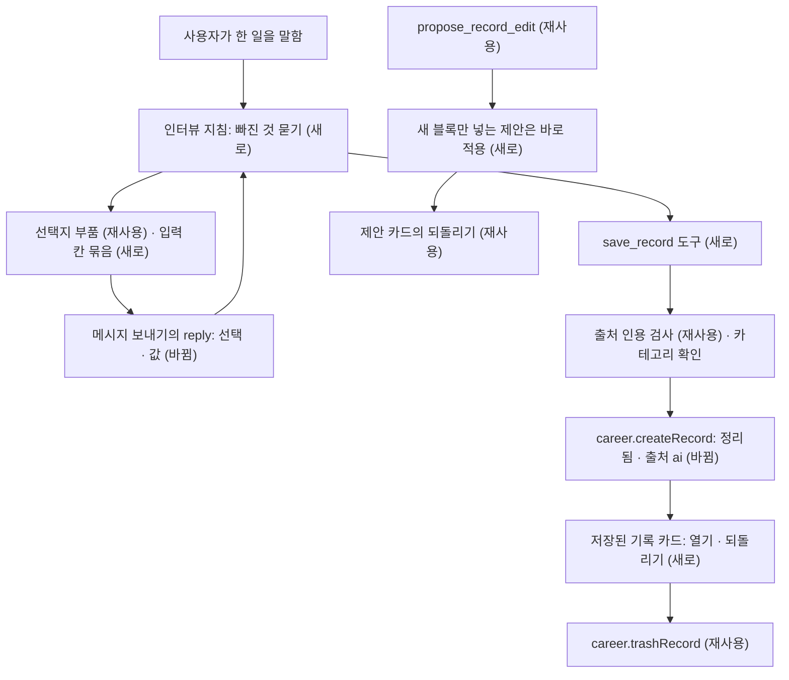

# Spec — 대화로 기록 — 인터뷰와 자동 저장

## 요구사항

1. 에이전트 도구 `save_record`를 더하고 `propose_new_record`를 지운다. 입력은 지금 초안 입력과 같다(`title`, `categoryId`, `bodyMd`, `sources`). 서버는 아래를 확인하고 어긋나면 그 항목을 돌려보낸다.
   - 출처는 이 대화의 사용자 메시지이고, 인용이 그 메시지에 그대로 있다(지금의 `draftIssues`).
   - `categoryId`가 사용자의 카테고리다. 없으면 고를 수 있는 카테고리를 함께 돌려준다.
2. 확인을 지나면 기록을 만든다. 상태는 `organized`, 출처는 `ai`다. 같은 도구 호출이 다시 와도 기록은 하나다(도구 호출 id를 중복 방지 키로 쓴다).
3. 도구 결과에 `savedRecord`(기록 id, 제목, 카테고리 이름, 본문, 출처, 되돌림 여부)를 싣는다.
4. `POST /v1/agent/conversations/:id/saved-records/:recordId/undo`는 그 기록을 휴지통으로 옮기고 `undone`을 참으로 적는다. 이미 되돌렸으면 그대로 돌려준다. 실행 중에는 409다.
5. 실행에 사용자의 카테고리 목록(`recordCategories`: id와 이름)을 프롬프트 자료로 싣는다.
6. 입력 칸 묶음 부품을 더한다(`kind: "form"`): `prompt`, `fields`(1~4개, 각 `id` · `label` · 선택 `placeholder` · `optional`), `answer`(값 목록과 답한 메시지 id). 도구는 `ask_form`이다. 부품을 내면 실행을 끝낸다(선택지와 같다).
7. 메시지 보내기의 `reply`가 값 목록(`values`)을 받는다. 서버는 부품이 마지막 답변의 답 없는 부품인지, 칸 id가 맞는지, 필수 칸이 비지 않았는지 확인한다. 대화에 남는 글은 「칸 이름: 값」을 줄마다 적은 것이다. 빈 선택 칸은 적지 않는다.
8. 기록 변경 제안(`propose_record_edit`)이 새 블록을 넣는 명령(`insertBlocks`)만 담고 속성 변경이 없으면, 만든 직후 서버가 적용한다. 그 밖의 제안은 지금처럼 승인을 기다린다.
9. 시스템 프롬프트에 인터뷰와 저장 지침을 더한다: 사용자가 한 일을 말하면 빠진 것을 묻고, 질문은 네 번 안에 끝내고, 내용이 모이면 묻지 않고 `save_record`로 저장하고, 저장한 것을 한 문장으로 알린다.
10. 지난 대화의 요지에 저장한 기록을 넣는다(되돌린 것은 뺀다).

## 설계

- **저장은 `career` 모듈의 진입점으로 한다.** `createRecord`에 선택 인자(`as: { status, origin }`)를 더한다. 지금은 상태 `draft` · 출처 `manual`로 고정이다. 면접 모듈은 같은 일을 컬렉션에 직접 써서 한다(`interview/service.ts`). 여기서는 진입점을 넓혀 쓴다.
- **되돌리기는 휴지통이다.** `career.trashRecord`를 쓴다. 지우지 않으므로 사용자가 휴지통에서 되살릴 수 있다.
- **카테고리를 프롬프트에 싣는다.** 지금은 카테고리를 알려면 `list_career_records`를 불러야 해서 모델 호출이 한 번 더 든다(호출마다 캐시 읽기 약 2만 토큰).
- **부품의 답은 종류마다 모양이 다르다.** 선택지는 고른 id, 입력 칸 묶음은 칸마다의 값이다. `reply`는 두 모양의 합집합이고, 답 확인(`checkReply`)이 부품의 종류와 답의 모양이 맞는지 본다.
- **저장된 기록 카드와 입력 칸 묶음은 답변 글 아래에 그린다.** 등록표에 `below` 항목으로 더한다.
- **새 블록만 넣는 제안의 자동 적용.** 지금 승인 경로(`documents.applyAiProposal`)를 서버가 대신 부른다. 카드는 적용된 상태로 뜨고 지금의 「되돌리기」가 그대로 동작한다. 적용에 실패하면(그 사이 문서가 바뀜) 승인을 기다리는 제안으로 남는다.
- 마이그레이션은 없다.

## 대안

- 초안 카드를 두고 「자동 승인」만 더하기: 카드의 편집 칸(제목 · 카테고리 · 본문)이 저장 뒤에는 뜻이 없다. 저장된 기록은 기록 화면에서 고친다.
- 기존 기록에 더할 때 본문(`bodyMd`)을 이어 붙여 저장하기: 기록의 본문은 문서(블록)가 원본이다. 본문 글을 덮어쓰면 그 사이 문서에서 고친 내용이 사라질 수 있다.
- 입력 칸 묶음 대신 입력창으로 답하게 두기: 여러 값을 한 번에 받을 수 없어 질문마다 실행이 든다.

## 검증 기준

- 계약 테스트: 저장된 기록, 입력 칸 묶음 부품(칸 1~4개), 두 모양의 `reply`.
- 부품 단위 테스트: 입력 칸 묶음의 답 확인(없는 칸, 빈 필수 칸, 선택지 부품에 값으로 답함).
- 실행부 테스트: `save_record` · `ask_form`이 도구 목록에 있고 `propose_new_record`가 없다. 입력 칸 묶음을 낸 실행도 멈춘다. 프롬프트에 `recordCategories`가 실린다.
- 대화 서비스 통합 테스트: 저장하면 상태 `organized` · 출처 `ai`인 기록이 하나 생기고, 같은 호출이 다시 와도 하나다. 말하지 않은 인용과 남의 카테고리는 돌려보내진다. 되돌리면 휴지통으로 간다. 값으로 한 답이 「칸 이름: 값」 글로 남는다. 새 블록만 넣는 제안은 적용된 채로 저장되고, 문장을 바꾸는 제안은 승인을 기다린다.
- 웹 테스트: 저장된 기록 카드(열기 링크, 되돌리기, 되돌린 뒤), 입력 칸 묶음(필수 칸, 보내기, 답한 뒤 잠김), 등록표 항목.
- 실제 화면: 한 일을 말하고 질문에 답해 기록이 저장되는 것을 본다. 카드에서 열고 되돌린다.
