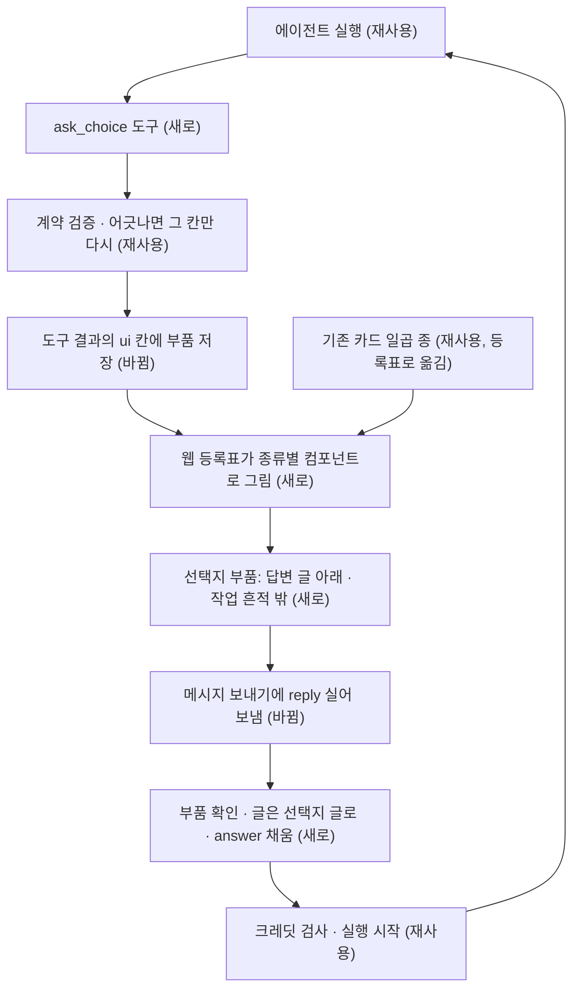

# Spec — 대화 속 화면의 토대와 선택지 부품

## 요구사항

1. 계약에 UI 부품(`AgentUiPartSchema`, `kind`로 가르는 합집합)을 둔다. 첫 종류는 `choice`다: `partId`, `prompt`, `multiple`, `options`(2~8개, 각 `id` · `label` · 선택 `description`), `answer`(없으면 `null`, 있으면 고른 `optionIds`와 답한 메시지 id).
2. 도구 결과(`AgentToolResultSchema`)에 `ui` 칸을 더한다. 사용자 메시지(`AgentMessageSchema`)에 `reply` 칸(`partId`, `optionIds`)을 더한다.
3. 에이전트 도구 `ask_choice`를 더한다. 입력은 `prompt`, `multiple`, `options`(`label`, 선택 `description`)다. 서버가 `partId`와 선택지 `id`를 붙인다. 선택지 글이 겹치면 어긋난 항목으로 돌려보내고, 모델은 고쳐 다시 부른다. 한 실행이 내는 부품은 하나다. 부품을 이미 낸 실행의 다음 호출은 돌려보낸다.
4. `POST /v1/agent/conversations/:id/messages`가 `reply`를 받는다. `reply`가 있으면 `text`는 없어도 된다. 같은 `requestId`가 이미 대화에 있으면 지금처럼 그 대화를 그대로 돌려준다(다시 도착한 답이 409가 되지 않게 이 확인이 먼저다). 그다음 서버는 아래를 확인하고 어긋나면 409를 낸다.
   - 부품이 이 대화의 마지막 답변에 있다.
   - 부품에 아직 답이 없다.
   - 고른 `optionIds`가 부품의 선택지에 있고 겹치지 않는다. `multiple`이 거짓이면 하나, 참이면 하나 이상이다.
5. `reply`가 지나가면 사용자 메시지의 글은 서버가 고른 선택지의 `label`을 `, `로 이어 만든다. 같은 갱신에서 부품의 `answer`를 채운다. 메시지 배열에 덧붙이기와 배열 안의 칸 고치기를 한 갱신에 함께 쓸 수 없으므로, `reply`가 있는 보내기는 버전 조건 아래에서 메시지 배열 전체를 새 값으로 쓴다. 그 뒤는 보통의 보내기와 같다(실행 시작).
6. 모델에 넘기는 대화(`conversationForModel`)에 부품(질문, 선택지 글, 고른 글)과 사용자 메시지의 `reply`(고른 글)를 싣는다.
7. 시스템 프롬프트에 선택지 지침을 더한다: 고를 답이 정해진 질문은 `ask_choice`로 내고 본문에 같은 선택지를 되풀이하지 않는다. 낸 뒤에는 답을 기다린다. 자유롭게 답할 질문은 글로 묻는다. 초안 카드(구직 목표 · 기록 · 계획)가 확인을 맡는 자리에서는 선택지로 다시 확인하지 않는다.
8. 웹은 도구 결과를 그리는 분기를 등록표(`tool-parts.tsx`)로 옮긴다. 지금 카드의 모양과 동작은 바꾸지 않는다.
9. 선택지 부품은 작업 흔적 묶음 밖, 답변 글 아래에 그린다. 자리는 부품의 유무가 아니라 도구 이름으로 정한다. 입력을 쓰는 중이거나 돌려보내진 호출도 같은 자리에 준비 중 · 실패 상태로 그려, 부품이 생길 때 자리가 바뀌지 않는다. 마지막 답변의 답 없는 부품이고 실행 중이 아니며 보낼 수 있는 상태일 때만 눌린다.

## 설계

- **부품을 내는 도구는 종류마다 하나다.** MCP 도구의 입력은 객체 하나의 모양이어야 해서(`registerTool`의 `inputSchema`는 `.shape`를 받는다) 합집합을 한 도구에 담지 못한다. 종류마다 도구를 두면 설명도 그 부품에 맞게 쓸 수 있다. 뒤의 마일스톤은 `ask_input`, `ask_date`, `show_list`처럼 더한다.
- **검증은 지금 도구의 방식을 쓴다.** 어긋난 입력은 `AgentToolRejection`으로 돌려보내고 모델이 그 칸만 고쳐 다시 부른다. 출력 전체를 다시 쓰게 하지 않는다(AGENTS.md).
- **답은 메시지 보내기에 싣는다.** 새 경로를 만들지 않는다. 보내기가 이미 하는 일(중복 요청 거르기, 길이 한도, 크레딧 검사, 실행 시작, 버전 충돌)을 그대로 지난다. 지금 사용자 메시지가 지면 요소 선택(`selection`)을 싣는 것과 같은 자리다.
- **답의 글은 서버가 만든다.** 화면이 보낸 글을 믿지 않는다. 대화에 남는 글과 부품의 선택지가 어긋나지 않는다.
- **부품의 답은 부품에도 적는다.** 화면은 부품만 보고 고른 것을 표시한다. 메시지를 거슬러 찾지 않는다.
- **작업 흔적 밖에 그리는 방법.** assistant-ui(`@assistant-ui/react` 0.15.18)는 도구 UI를 `display: "standalone"`으로 등록하면 그 도구 호출을 묶음 밖에 그린다(`@assistant-ui/core`의 `groupParts.d.ts`, `useAssistantToolUI.d.ts`). 선택지 도구의 이름으로 등록하고, 메시지를 바꿀 때(`convertMessage`) 부품이 있는 도구 호출을 글 뒤에 둔다.
- **등록표.** 항목은 `match(tool)`, `render(tool, ctx)`, 자리(`placement`: 작업 흔적 안 · 답변 글 아래)다. 위에서부터 처음 맞는 항목이 그린다. `RecordTool`의 분기문이 이 표를 부르는 한 줄이 된다. 답변 글 아래에 그리는 항목은 도구 이름을 함께 갖고, 묶음 밖 표시 등록과 메시지 안의 순서가 모두 이 표에서 나온다. 뒤에 오는 목록 · 진행 상태 부품도 같은 칸을 쓴다.
- 마이그레이션은 없다. 대화 문서는 계약으로 읽을 때 검증하고, 새 칸은 모두 선택 칸이다.

## 대안

- 부품 하나를 내는 범용 도구(`show_ui`)에 `kind`로 가르기: 도구가 하나라 프롬프트가 짧다. 그러나 MCP 입력 모양에 합집합을 담지 못해 모든 칸을 선택 칸으로 풀어야 하고, 검증이 느슨해진다.
- 답을 받는 전용 경로(`POST .../parts/:partId/answer`): 보내기와 실행 시작을 다시 구현해야 한다. 답도 사용자의 말이므로 보내기에 싣는다.
- 부품을 도구 결과가 아닌 메시지의 새 배열에 두기: 실행 중 저장과 재연결이 도구 결과 단위로 돌아가고 있어, 같은 일을 한 벌 더 만들게 된다.

## 검증 기준

- 계약 테스트: 선택지 부품과 `reply`가 있는 메시지가 통과하고, 선택지가 하나뿐이거나 아홉 개인 부품은 거절된다. `text`와 `reply`가 모두 없는 보내기는 거절된다.
- 실행부 테스트: `ask_choice`가 허용 도구 목록과 이름표에 있다. 한 실행의 두 번째 호출과 겹치는 선택지 글이 어긋난 항목으로 돌아간다. 모델에 넘기는 대화에 부품과 고른 글이 실린다.
- 서비스 통합 테스트: 맞는 `reply`는 선택지 글의 사용자 메시지를 만들고 `answer`를 채우며 실행을 시작한다. 지난 답변의 부품, 이미 답한 부품, 없는 선택지, 하나만 고르는 질문에 둘은 409이고 대화가 바뀌지 않는다.
- 웹 테스트: 등록표가 기존 카드 일곱 종을 변경 전과 같은 컴포넌트로 그린다. 선택지 부품은 누를 수 있는 상태와 잠긴 상태를 구분해 그리고, 누르면 `reply`를 보낸다.
- 실제 화면: 검증 서버에서 선택지를 유도해 단추가 뜨고, 누른 답으로 에이전트가 이어 가는 것을 본다. 구직 목표 대화(분명한 변경 → 카드, 암시 → 질문)가 변경 전처럼 동작하고 선택지로 이중 확인하지 않는지 본다. 그 실행의 토큰 내역(입력 · 출력 · 캐시 읽기 · 캐시 쓰기)과 크레딧을 사용량에서 읽는다.
