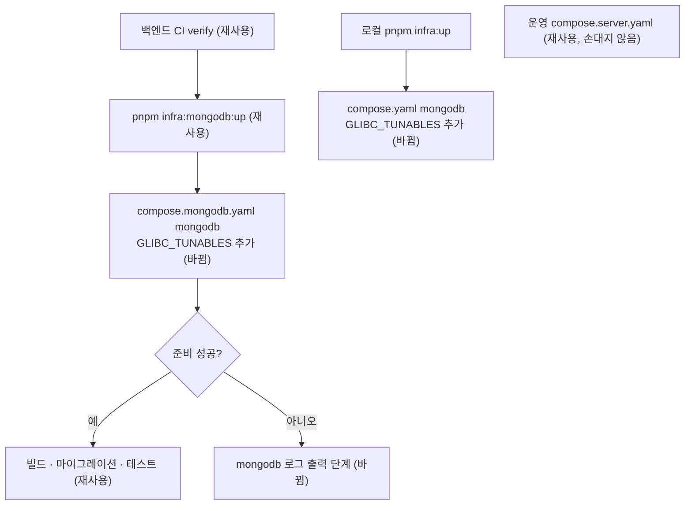

# 새 리눅스 커널에서 MongoDB가 뜨지 않아 백엔드 CI가 실패하는 문제 — 명세

## 요구사항

- [ ] `infra/compose.mongodb.yaml`과 `infra/compose.yaml`의 `mongodb` 서비스가 `GLIBC_TUNABLES=glibc.pthread.rseq=1`로 뜬다.
- [ ] 커널 7.0.0 러너에서 백엔드 CI `verify`가 통과한다.
- [ ] 커널 6.x 러너에서도 통과한다.
- [ ] MongoDB 준비 단계가 실패하면 CI가 `mongodb` 컨테이너 로그의 경고 · 오류 줄을 찍는다.
- [ ] `pnpm infra:up` 뒤 `pnpm test:infra`가 로컬에서 통과한다.
- [ ] `infra/compose.server.yaml`은 바뀌지 않는다.

## 확인한 원인

- 실패한 작업의 `mongod` 로그 — `"s":"F"` `id 12257600` "MongoDB cannot start: Linux kernel versions 6.19 and newer has a known incompatibility with this version of MongoDB" (SERVER-121912). 컨테이너는 `Restarting (1)`이고, Compose는 이것을 `unhealthy`로 보고한다.
- MongoDB 운영 문서(Production Notes)의 경고 — "running MongoDB with a Linux kernel version from 6.19 through 7.0.13 can cause MongoDB to crash … MongoDB detects these kernel versions and stops during startup". 원인은 MongoDB가 내장한 TCMalloc과 커널의 rseq 사이의 비호환이다.
- 진단 실행(브랜치 `diag/ci-mongodb-logs`, 2026-10-27)의 결과:

| 러너 커널 | 설정 | 결과 |
|---|---|---|
| 7.0.0-1017-azure (이미지 20261026.354.1) | 없음 | 6/6 실패 |
| 7.0.0-1017-azure | rseq 설정 | 1/1 통과, 2,000건 쓰기 · 세기 성공 |
| 6.17.0-1022-azure (이미지 20261023.334.3) | 없음 · rseq 설정 | 모두 통과 |
| 6.8.0 (ubuntu-22.04) | 없음 | 2/2 통과 |

## 설계

`GLIBC_TUNABLES=glibc.pthread.rseq=1`은 glibc가 rseq를 쥐게 한다. 그러면 TCMalloc은 rseq를 쓰는 CPU별 캐시 대신 스레드별 캐시로 돌고, 커널과 부딪치는 경로를 타지 않는다. `mongod`의 시작 검사도 이 상태에서는 멈추지 않는다(위 표의 7.0 커널 통과). 이 설정의 근거는 실제 러너에서 돌린 결과다. MongoDB 문서는 이 설정을 권하지 않는다. 문서의 해법은 커널 7.0.14 이상으로 올리는 것이고, GitHub 호스트 러너에서는 우리가 커널을 고를 수 없다.

로그 단계는 `if: failure()`로 둔다. 성공한 실행에는 출력이 없다. `"s":"I"`(정보) 줄은 걸러서 경고 · 오류 · 치명 줄만 남긴다.

## 버린 대안

- **러너를 `ubuntu-22.04`로 고정** — 지금은 커널 6.8이라 통과한다. 그러나 문제를 피할 뿐이고, 로컬 개발 환경은 그대로 남으며, 22.04 러너가 내려가면 다시 깨진다.
- **MongoDB 버전 올리기** — 문제를 고친 8.0 릴리스가 확인되지 않는다. SERVER-121912는 고친 버전 없이 닫혔다.
- **재시도 늘리기** — `mongod`가 매번 같은 이유로 멈추므로 시도를 늘려도 통과하지 않는다.

## 함정

- `GLIBC_TUNABLES`는 컨테이너 안 `mongod` 프로세스에만 닿아야 한다. `mongodb` 서비스의 `environment`에 넣는다. CI 작업 전체의 `env`에 넣으면 Node 프로세스에도 들어간다.
- 7.0 커널 러너는 무작위로 배정된다. PR 실행 하나가 6.x 러너에 걸리면 이 수정을 확인하지 못한다. 확인 실행에서 러너 커널을 함께 본다.
- 성능 — TCMalloc이 스레드별 캐시로 돌면 메모리 할당이 조금 느려질 수 있다. CI와 로컬 개발에서는 문제 되지 않는다. 운영에 넣을지는 intent의 열린 질문이다.
