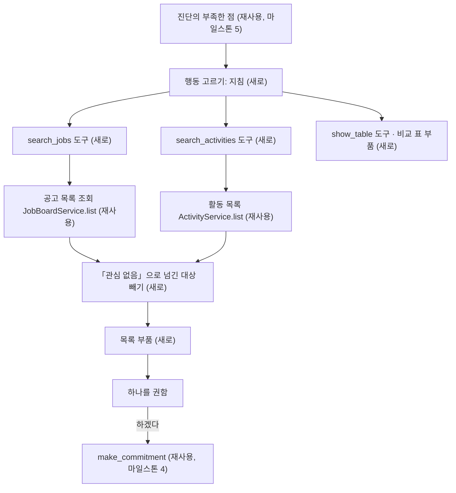

# Spec — 행동 제안

## 요구사항

1. 에이전트 도구 `search_jobs`: 입력은 글(`query`), 기술, 직군, 지역, 내 경력 연수(`experience`), 관심 공고만(`interested`), 건수(1~8, 기본 5). 지금 있는 공고 목록 조회(`JobBoardService.list`)로 열린 공고를 찾는다. 결과를 목록 부품으로 답변 글 아래에 그리고, 모델에는 id · 제목 · 회사 · 지역 · 경력 · 남은 날을 돌려준다.
2. 에이전트 도구 `search_activities`: 입력은 종류(공모전 · 해커톤), 글(제목 · 주최 · 분야에서 찾는다), 건수(1~8, 기본 5). 접수 중인 활동을 마감이 이른 순서로 낸다. 같은 목록 부품으로 그린다.
3. 두 도구는 사용자가 능동 제안에서 「관심 없음」으로 넘긴 대상(`job:<id>` · `activity:<id>`)을 결과에서 뺀다.
4. 에이전트 도구 `show_table`: 제목, 열 이름 2~5개, 줄 1~8개(줄마다 칸의 글)를 받아 비교 표 부품을 그린다. 줄의 칸 수는 열 수와 같아야 한다.
5. 목록의 줄은 공고면 앱의 공고 화면(`/jobs/<id>`)으로, 활동이면 출처 주소로 간다(새 창).
6. 지침: 부족한 점마다 맞는 행동을 고른다(해 본 일 → 인터뷰, 경험이 필요 → 활동이나 프로젝트, 준비가 됨 → 공고). 찾은 것 가운데 하나를 권하고 까닭을 한두 문장으로 댄다. 사용자가 하겠다고 하면 `make_commitment`로 저장하고, 약속의 덧붙임에 무엇을 어디서 하는지 적는다. 기억의 피하는 조건에 걸리는 것은 권하지 않는다. 찾은 것이 없으면 없다고 말하고 조건을 넓힐지 묻는다.
7. 찾은 결과는 같은 대화의 다음 실행에서 모델이 다시 볼 수 있다(id · 제목 · 회사).
8. 진단의 경력 연차 항목은 공고가 받는 경력의 분포라 상태를 매기지 않는다. 서버는 그 항목의 대조를 저장하지 않고, 카드는 「참고」로 보이며 상태별 수에 넣지 않는다. 실제 대화에서 「신입 지원 가능」이 「부족」으로 저장된 것을 고친다.

## 설계

- **새 저장은 없다.** 목록과 표는 도구 결과에 실려 대화에 남는다. 약속은 마일스톤 4의 것을 쓴다.
- **검색은 `jobs` · `activities` 모듈의 지금 있는 함수를 부른다.** 대화 서비스는 결과를 목록의 줄로 옮기기만 한다.
- **목록 부품과 표 부품은 보여 주기만 한다.** 실행을 멈추지 않고, 사용자의 답을 받지 않는다. 표의 글은 컨설턴트가 채운 것이라 틀릴 수 있어, 표 아래에 「컨설턴트가 정리한 내용입니다」를 적는다.
- **한 실행에서 찾기는 네 번까지.** 도구 결과가 문맥에 쌓여 크레딧이 늘어나는 것을 막는다.

## 대안

- `agentic-chat` PR의 임베딩 검색 옮기기: 벡터 색인 컬렉션과 임베딩 호출, 색인 동기화가 함께 와야 한다. 지금의 필터 검색으로 직군 · 기술 · 지역 · 경력을 거를 수 있다.
- 목록을 모델이 글로 쓰게 두기: 링크와 마감일을 모델이 옮겨 적다 틀릴 수 있다. 목록은 서버의 결과를 그대로 그린다.

## 검증 기준

- 대화 서비스 통합 테스트: 공고 찾기(필터 전달, 줄로 옮기기, 넘긴 대상 빼기, 건수), 활동 찾기(종류 · 글), 연결되지 않은 환경에서 돌려보내기.
- 실행부 테스트: 세 도구의 결과 모양과 요약, 표의 칸 수 확인, 찾기 횟수 상한.
- 웹 테스트: 목록 부품(안쪽 링크와 바깥 링크, 남은 날), 표 부품, 등록표.
- 실제 대화: 진단 뒤 "뭐부터 할까요?" → 목록과 권유 → "그걸로 할게요" → 약속 카드.
