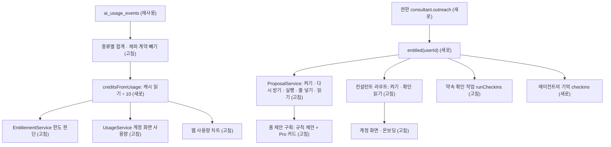

# Spec — 크레딧 계산과 먼저 연락하기의 요금제

## 요구사항

1. 크레딧 = ⌈(입력 + 출력 + 캐시 읽기 ÷ 10) ÷ 10,000⌉. 기간 전체를 더한 뒤 한 번만 올린다. 셈은 `@expresso/contracts`의 함수 하나(`creditsFromUsage`)가 하고, 한도 판단(`EntitlementService`) · 계정 화면의 사용량(`UsageService`) · 웹의 차트가 모두 그 함수와 무게 표를 쓴다.
2. 무게의 출처는 Anthropic 가격표다: "Cache read (hit): 0.1x base input price on most models"(https://platform.claude.com/docs/en/about-claude/pricing, 2026-11-20 확인). 에이전트가 쓰는 `claude-sonnet-5`는 입력 $2 · 캐시 읽기 $0.20이다.
3. 크레딧에 넣지 않는 계약의 목록(`UNMETERED_CONTRACTS = ["proposal_briefing"]`)을 둔다. 한도 판단과 계정 화면의 사용량(합계 · 날짜별 · 기능별 · 모델별) 모두 이 계약을 뺀다. `ai_usage_events`에는 그대로 남긴다.
4. 권한 `consultant.outreach`를 더한다: free 꺼짐, pro · team 켜짐. 요금제 문서의 `features`로 덮어쓸 수 있다(지금 있는 구조).
5. 서버는 권한이 없는 사용자에게 다음을 한다.
   - `PUT /consultant/outreach`(켜기)와 `POST /proposals/enable` · `/proposals/refresh`: 403.
   - `GET /proposals`: `available: false`, `enabled: false`, 제안 없음. 저장된 켜짐과 제안은 지우지 않는다.
   - `GET /consultant/checkins`: `available: false`, 확인할 약속 없음, 안부 없음.
   - 제안 실행(`ProposalService.run`): `plan_required`로 건너뛴다. 하루 한 번 · 새 소식의 줄 넣기도 건너뛴다.
   - 약속 확인 작업(`runCheckins`): 건너뛴다.
   - 끄기는 요금제와 무관하게 된다.
6. 제안 실행 전의 남은 크레딧 확인을 없앤다. `no_credits`는 저장된 실행 기록이 쓰므로 계약에 남긴다.
7. 에이전트의 기억에 `checkins`(약속한 날에 먼저 묻는가)를 싣는다. 꺼져 있으면 약속을 저장한 뒤 먼저 묻겠다고 말하지 않는다.
8. 웹
   - 홈 제안 구획: `available`이 false면 규칙 제안(`fallback`)과 「먼저 연락받기 · Pro」 카드를 세운다. 카드는 계정 화면의 요금제 구획으로 간다.
   - 홈 확인 구획: `available`이 false면 그리지 않는다.
   - 계정 화면: 먼저 연락받기 줄은 권한이 없으면 켜기 버튼 대신 Pro부터라는 글과 요금제 링크를 둔다. 켜져 있으면 끄기는 남긴다. 크레딧 차감 문구를 지운다.
   - 온보딩 동의 화면: 먼저 연락하기 항목과 그 저장을 없앤다.
   - 켜기 안내 창: 크레딧 항목을 「이번 달 크레딧에서 빼지 않습니다」로 바꾼다.
   - 사용량 차트: 캐시 읽기 계열을 무게를 곱한 값으로 그린다.
   - 요금제 카드: `consultant.outreach`의 이름 「컨설턴트의 먼저 연락과 제안」.
9. 마이그레이션 번호: `consultant_profiles` 0036, 약속과 예약 작업 0037, `consultant_diagnoses` 0038. 번호는 그 마이그레이션을 들인 브랜치에서 바꾼다.

## 설계

- **셈은 정수로 한다.** 무게를 10분의 1 단위의 정수 표(`BILLABLE_TOKEN_TENTHS = { inputTokens: 10, outputTokens: 10, cacheReadTokens: 1 }`)로 두고, 크레딧은 ⌈Σ(토큰 × 표) ÷ (10 × 10,000)⌉로 구한다. MongoDB는 종류별 합계만 내고 무게는 코드가 한 번 곱한다. 집계에서 0.1을 곱하면 소수가 생겨 올림의 경계가 흔들린다.
- **권한의 판단은 한 곳이다.** `EntitlementService.check(userId, "consultant.outreach")`를 감싼 함수 하나(`entitled(userId)`)를 제안 서비스 · 컨설턴트 라우트 · 약속 확인 작업 · 대화 서비스에 넘긴다.
- **저장된 설정은 지우지 않는다.** 무료가 된 사용자의 `enabled: true`는 남는다. 요금제가 올라가면 다시 켜지 않아도 동작한다.
- **새 저장과 새 마이그레이션은 없다.** `plans.features`는 키를 검사하지 않는다(0022).

## 대안

- 모델마다 다른 무게(0.05 · 0.025): 가격표와 정확히 맞지만 모델이 바뀔 때마다 표를 고쳐야 하고, 사용자가 보는 크레딧이 모델에 따라 달라진다. 0.1은 가격표의 가장 높은 비율이라 어느 모델에서도 덜 받지 않는다.
- 무료 한도만 올리기: 대화가 길어질수록 실행당 크레딧이 커지는 문제가 남는다(사용자가 고르지 않은 안).
- 능동 제안을 무료에도 두고 크레딧만 빼지 않기: 비용에 상한이 없다.

## 검증 기준

- 계약 테스트: 크레딧 셈(경계, 캐시 읽기만 있을 때, 정수 셈), 무게 표, 제외 계약.
- 통합 테스트: 한도 판단과 사용량이 같은 값을 내고 `proposal_briefing`을 뺀다. 권한 없는 사용자의 켜기 403, 읽기 `available: false`, 실행 `plan_required`, 줄 넣기와 약속 확인 건너뜀. 권한 있는 사용자는 지금과 같다.
- 웹 테스트: 홈 제안 구획의 잠긴 상태, 계정 화면의 줄, 차트의 캐시 읽기 값.
- 실제 서버: 계정 B 83 → 12, 계정 A 102 → 13. 무료 계정의 켜기가 거절된다. 검증 DB에서 한 계정을 Pro로 바꿔 제안을 한 번 실행하고, `proposal_briefing` 호출이 생겼는데 크레딧이 같음을 확인한다.
- 마이그레이션: `origin/feat/activity-sources`와 스택 끝을 임시 워크트리에서 합쳐(푸시하지 않는다) 빈 DB에 마이그레이션과 `pnpm test:infra`를 돌린다.
