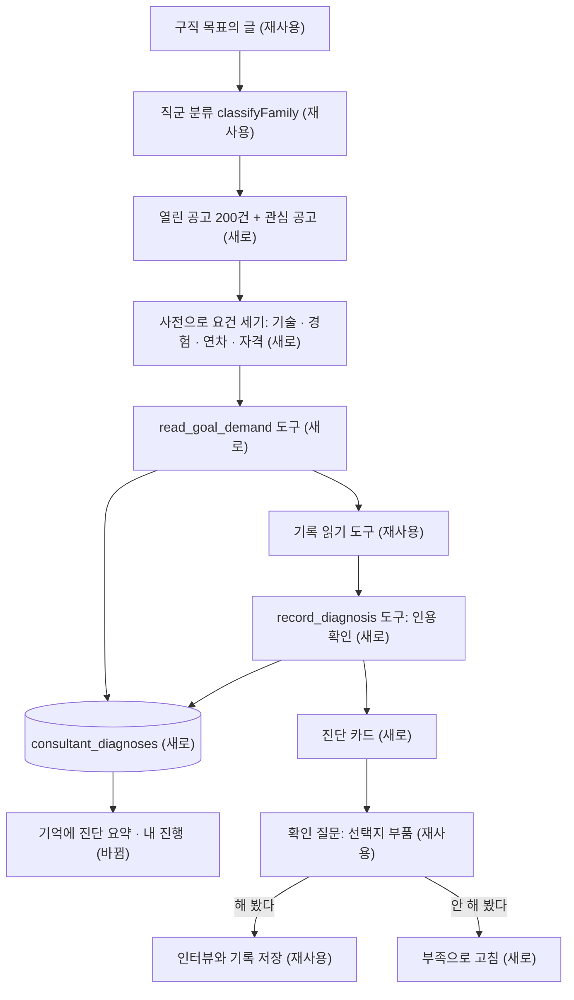

# Spec — 진단 — 목표가 요구하는 것과 내 기록의 대조

## 요구사항

1. `jobs` 모듈에 목표의 요건 집계를 더한다(`goalDemand(userId, work)`).
   - 직군: 목표의 글을 수집 단계의 `classifyFamily`로 분류하고, 그 규칙이 놓치는 목표의 말(「ML 엔지니어」 · 「서버」)은 따로 둔 표로 받는다. 분류되면 그 직군의 열린 공고를 최근 순으로 200건까지 모은다. 분류되지 않으면 목표의 글로 제목 · 원문을 찾는다.
   - 한 회사의 공고는 10건까지만 표본에 넣는다. 실제 데이터에서 백엔드 공고 137건 가운데 72건이 한 회사였다.
   - 신입 · 주니어를 향한 목표(목표의 일과 시기의 글에서 읽는다)는 경력 2년 이하이거나 연차를 적지 않은 공고로 좁힌다. 목표에 기술 이름이 있으면 그 기술이 나온 공고로 좁힌다. 좁힌 뒤 5건이 안 되면 좁히지 않는다.
   - 관심 표시한 공고 중 같은 직군(또는 같은 글 검색)에 드는 것은 마감했어도 표본에 넣는다.
   - 공고마다 제목과 원문에서 사전의 표현을 찾아 한 번씩 센다. 종류는 기술, 경험, 경력 연차, 자격이다. 정리된 기술(`requirements.technologies`)이 있으면 함께 쓴다. 경력 연차는 `experienceMinYears`로 나눈다.
   - 표본의 10% 이상(적어도 2건)에 나온 항목을 빈도 순으로 14개까지 낸다(기술 7 · 경험 4 · 자격 2 · 경력 연차 1까지). 표본이 5건보다 적으면 `small`을 참으로 낸다.
2. 진단을 저장한다(`consultant_diagnoses`, 사용자마다 하나): 진단할 때의 목표, 직군, 표본 수, 관심 공고 수, 항목(종류, 이름, 건수, 상태, 근거 기록, 메모), 집계한 때, 대조한 때.
3. 에이전트 도구 `read_goal_demand`: 지금 목표로 집계해 저장하고 목록을 돌려준다. 목표가 없으면 돌려보낸다. 같은 항목의 앞선 상태(특히 「부족」)는 이어받는다.
4. 에이전트 도구 `record_diagnosis`: 항목 id마다 상태(확인됨 · 일부 확인됨 · 미확인 · 부족)와 근거(기록 id와 인용), 메모를 받는다. 적지 않은 항목은 앞선 상태를 둔다.
   - 확인됨 · 일부 확인됨은 근거가 하나 이상이어야 하고, 인용은 그 기록의 글에 그대로 있어야 한다. 미확인 · 부족은 근거를 받지 않는다.
   - 부족은 그 항목이 미확인으로 저장된 뒤에 사용자의 말이 있을 때만 받는다. 첫 대조에서 모든 항목을 부족으로 적는 것을 막는다.
   - 집계가 없거나 목표가 집계 뒤에 바뀌었으면 돌려보낸다.
   - 결과로 진단 전체를 돌려주고, 답변 글 아래에 진단 카드를 그린다.
5. 실행에 넘기는 기억에 진단의 요약을 싣는다: 대조한 날, 직군, 표본 수, 부족 · 미확인 항목의 이름, 다시 진단이 필요한 까닭(목표 바뀜 · 기록 바뀜).
6. `GET /v1/consultant/memory`에 진단을 싣고, 「내 진행」에 진단 카드를 보인다.
7. 지침: 공고 없이 부족한 점을 물으면 집계 → 기록 읽기 → 대조 순서로 진단한다. 미확인 항목은 해 본 적이 있는지 선택지(여럿)로 묻고, 고른 항목은 인터뷰로, 고르지 않은 항목은 부족으로 고친다. 근거를 말할 때 표본 수와 건수를 함께 말한다. 표본이 적으면 적다고 밝힌다.
8. 홈의 추천 프롬프트에 「목표 진단」을 더한다.
9. 에이전트 도구 `append_to_record`: 이미 있는 기록의 끝에 사용자가 한 말을 더한다. 대화에 연결되지 않은 기록에도 된다. 출처 규칙은 새 기록 저장과 같고, 바로 적용하며 카드에서 되돌린다. 기록 변경 제안(`propose_record_edit`)은 대화에 연결된 기록에서만 동작해, 확인 질문 뒤의 인터뷰에서 기존 기록에 내용을 더할 길이 없었다(실제 대화에서 두 번 실패함).

## 설계

- **집계는 `jobs`가, 진단의 저장은 `consultant`가, 근거 확인은 `agent-chat`이 한다.** 근거 확인은 요건 대조와 같은 글(`recordText`)과 같은 비교(`normalize`)를 쓴다.
- **집계는 AI를 부르지 않는다.** 사전은 검색 해석기의 기술 사전(`TECHNOLOGIES`)에 화면 · 모바일 · 인프라 기술을 더한 것과, 경험 · 자격 표현의 규칙이다. 짧은 이름은 낱말 경계로 찾는다. `go`는 영어 문장의 낱말과 겹쳐 `golang`이나 기술 나열 속의 `Go`만 센다.
- **표본의 수는 공고 수 그대로다.** 관심 공고는 표본에 넣되 두 번 세지 않는다. 기획서의 「무게를 더 둔다」는 표본에 넣는 것으로 구현한다 — 건수가 실제 공고 수와 같아야 「40건 중 28건」이라고 말할 수 있다.
- **다시 진단이 필요한지는 읽을 때 판단한다.** 저장된 목표의 글이 지금 목표와 다르면 「목표 바뀜」, 대조한 뒤에 고쳐진 기록이 있으면 「기록 바뀜」이다.
- **카드는 도구 결과의 진단을 그린다.** 대조를 다시 하면 새 카드가 생긴다. 「내 진행」은 저장된 진단을 같은 컴포넌트로 그린다.
- 마이그레이션 0038: `consultant_diagnoses` 만들기.

## 대안

- 자연어 검색 해석(AI)으로 목표를 검색 조건으로 바꾸기: 직군으로 옮기는 범위가 둘뿐이고, 호출마다 크레딧과 동의가 필요하다. 수집 단계의 분류 규칙은 공고에 직군을 매긴 바로 그 규칙이다.
- 공고마다 `job-analysis`로 요건 뽑기: 공고 한 건에 상위 모델 호출 한 번이 사용자에게 청구된다. 40건이면 진단 한 번에 수백 크레딧이다.
- 에이전트가 공고 원문을 읽어 요건을 정리하기: 원문 수십 건이 실행의 문맥에 실려 크레딧이 크게 든다.

## 검증 기준

- `jobs` 단위 · 통합 테스트: 사전 찾기(낱말 경계, `go`), 직군 분류와 글 검색, 관심 공고 포함, 10% 기준, 표본 적음.
- `consultant` 통합 테스트: 진단 저장, 상태 이어받기, 부분 갱신, 남의 진단에 닿지 않음.
- 대화 서비스 통합 테스트: 집계 → 대조, 없는 인용과 근거 없는 「확인됨」 돌려보내기, 목표가 바뀐 뒤의 대조 돌려보내기, 기억의 진단 요약과 다시 진단 표시.
- 웹 테스트: 진단 카드, 등록표, 「내 진행」.
- 실제 대화: 공고 없이 진단을 요청해 카드가 표본과 함께 뜨고, 확인 질문에 답하면 상태가 바뀐다.
- 실제 데이터: 로컬 개발 DB의 공고 480건으로 직군별 집계 결과를 뽑아 사전이 틀리게 잡는 표현을 고친다.
