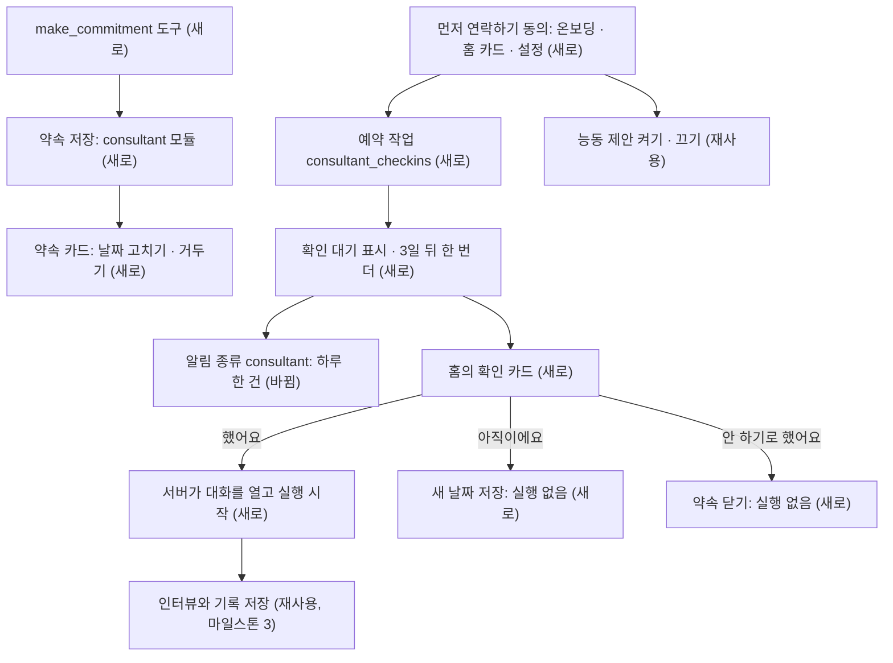

# Spec — 챙기기 — 약속과 먼저 연락하기

## 요구사항

1. 약속을 저장한다(`consultant_commitments`): 할 일(`title`), 덧붙임(`detail`), 날짜(`dueOn`, 서울 날짜), 상태(`open` · `done` · `dropped`), 만든 대화, 확인 이력(`checks`), 다음 확인 날짜(`nextCheckOn`), 확인 대기 여부.
2. 에이전트 도구 `make_commitment`(할 일 · 날짜)와 `update_commitment`(id · 상태 · 날짜)를 더한다. 저장은 바로 일어난다. 날짜는 오늘 이후여야 하고, 열린 약속은 20개까지다.
3. 실행에 넘기는 기억에 열린 약속(id · 할 일 · 날짜 · 지났는지)과 오늘 날짜(서울)를 싣는다.
4. 약속 카드는 답변 글 아래에 그린다. `GET /v1/consultant/commitments/:id`로 지금 상태를 읽고, `PATCH /v1/consultant/commitments/:id`로 날짜를 고치거나 약속을 거둔다. 날짜를 미루면 새 날짜에 다시 한 번 묻고 3일 뒤에 한 번 더 묻는다.
5. 예약 작업 `consultant_checkins`(하루 한 번)가 먼저 연락하기를 켠 사용자에 대해 아래를 한다.
   - `nextCheckOn`이 오늘이거나 지난 열린 약속을 확인 대기로 표시하고 확인 이력에 적는다. 첫 확인이면 `nextCheckOn`을 3일 뒤로, 두 번째면 비운다.
   - 마지막 대화가 14일 넘게 전이고 마지막으로 그 일로 연락한 지 14일이 넘었으면 「대화 없음」 연락을 적는다.
   - 사용자마다 컨설턴트 알림을 하루 한 건까지 만든다(`notify`, 종류 `consultant`).
6. `GET /v1/consultant/checkins`는 확인 대기인 약속과 「대화 없음」 연락, 동의를 아직 묻지 않았는지를 낸다.
7. `POST /v1/consultant/commitments/:id/checkin`은 답을 받는다.
   - `done`: 약속을 `done`으로 닫고, 컨설턴트의 질문과 사용자의 답이 든 새 대화를 만들어 실행을 시작한다. 대화 id를 돌려준다. 이미 닫힌 약속에 같은 답이 다시 오면 대화를 열지 않는다.
   - `not_yet`(새 날짜 포함): 날짜와 `nextCheckOn`을 새 날짜로 고치고 확인 대기를 푼다. 실행은 없다.
   - `dropped`: 약속을 `dropped`로 닫는다. 실행은 없다.
8. 먼저 연락하기 동의를 컨설턴트 프로필에 둔다(`outreach`: 켬 여부 · 정한 때). `PUT /v1/consultant/outreach`가 고치고, 켜고 끌 때 능동 제안도 함께 켜고 끈다. 능동 제안에 필요한 동의가 없으면 능동 제안은 켜지 않고 그 사실을 응답에 담는다. 요청의 `proposals`가 거짓이면 능동 제안을 건드리지 않는다 — 제안을 이미 켠 사용자에게 약속 확인만 따로 물을 때 쓴다.
9. 온보딩의 동의 화면에 먼저 연락하기 항목(기본 선택)을 더한다. 계정 설정에 켜고 끄는 줄을 더한다. 홈의 제안 구획에 있던 「켜기」 · 「끄기」는 약속 확인과 능동 제안을 함께 켜고 끈다. 능동 제안은 켰는데 약속 확인을 정하지 않은 사용자에게는 홈에 묻는 카드를 둔다.
10. 알림 종류에 `consultant`를 더한다(계약, DB 검증 규칙, 알림 목록의 문장).
11. 입력 칸 묶음의 칸에 종류(`text` · `date`)를 더한다. 날짜 칸의 값은 `YYYY-MM-DD`여야 한다.
12. 「내 진행」에 열린 약속을 보인다.

## 설계

- **약속은 `consultant` 모듈이 맡는다.** 확인 작업도 그 모듈의 함수이고, 예약 서비스(`scheduling`)는 키가 왔을 때 그 함수를 부른다. 마지막 대화 시각은 대화를 가진 `agent-chat`이 준다(배선에서 함수로 넘긴다).
- **「했어요」의 대화는 서버가 연다.** 컨설턴트의 질문(답한 선택지 부품이 딸린 메시지)과 사용자의 답을 대화에 넣고 실행을 시작한다. 질문 글은 정해진 문구라 모델을 부르지 않는다. 그 뒤 실행 한 번이 인터뷰의 첫 질문이다.
- **예약 작업의 키는 코드와 DB에 함께 넣는다.** 코드의 목록(`SCHEDULED_JOB_KEYS`)과 DB의 검증 규칙 · 정의를 같은 PR에서 넣는다. 워커는 모르는 키를 집지 않는다(#243).
- **새 정의의 첫 실행 시각은 다음 날 0시(UTC) 뒤로 둔다.** 0032는 `nextRunAt`을 지금으로 넣어 배포 중 옛 워커가 집었다. #243 뒤로는 옛 워커가 모르는 키를 집지 않지만, 배포 순간에 실행이 몰리지 않게 뒤로 둔다.
- **약속 카드는 지금 상태를 읽는다.** 대화에 남는 것은 그때의 약속이다. 상태는 약속에 쌓이므로(홈의 확인, 에이전트의 갱신) 카드가 열릴 때와 대화가 바뀔 때 웹의 프록시(`/api/consultant/commitments/:id`)로 다시 읽는다.
- **알림은 앱 안에만 남는다.** 워커의 발송 수단이 로그 출력뿐이라 메일을 보내지 않는다.
- **알림은 하루 한 건.** 확인 작업이 사용자마다 알릴 것을 모은 뒤 가장 이른 약속 하나로 알림을 만든다. `notify`의 중복 방지 키는 사용자와 날짜다.
- **동의를 정하지 않은 사용자에게는 연락하지 않는다.** 확인 작업은 `outreach.enabled`가 참인 사용자만 본다.
- 마이그레이션 0037: `consultant_commitments` 만들기, `consultant_profiles`에 `outreach` 칸, `notifications.kind`와 `users.notificationPreferences`에 `consultant`, 예약 작업의 키와 정의.

## 대안

- 확인 카드를 능동 제안의 피드(`proposal_feeds`)에 넣기: 제안의 계약은 대상(공고 · 활동 · 기록)이 있어야 하고 버튼이 하나다. 확인 카드는 답이 셋이고 대상이 약속이다. 같은 틀로 그리되 자료는 따로 둔다.
- 「했어요」에서도 모델을 부르지 않고 정해진 질문만 보이기: 인터뷰의 첫 질문은 약속의 내용에 따라 달라야 한다.
- 준비 계획의 작업을 약속으로 복사하기: 같은 일정이 두 곳에 생긴다. 계획의 작업은 뒤에 참조로 잇는다.

## 검증 기준

- 계약 테스트: 약속, 확인, 동의, 날짜 칸.
- `consultant` 통합 테스트: 약속 만들기 · 고치기 · 한도, 확인 작업(첫 확인 → 3일 뒤 → 멈춤, 동의 없는 사용자 제외, 하루 한 건, 대화 없음 14일), 답 처리(완료 · 미룸 · 닫음), 남의 약속에 닿지 않음.
- 예약 통합 테스트: 새 키가 목록과 DB에 함께 있고 실행된다.
- 대화 서비스 통합 테스트: 「했어요」가 질문과 답이 든 대화를 만들고 실행을 시작한다. 실행에 넘기는 기억에 열린 약속이 있다.
- 웹 테스트: 약속 카드, 확인 카드의 세 답, 동의 카드, 날짜 칸.
- 실제 화면: 대화에서 약속을 만들고, 날짜를 오늘로 당겨 확인 작업을 돌린 뒤 홈의 카드에서 답한다.
