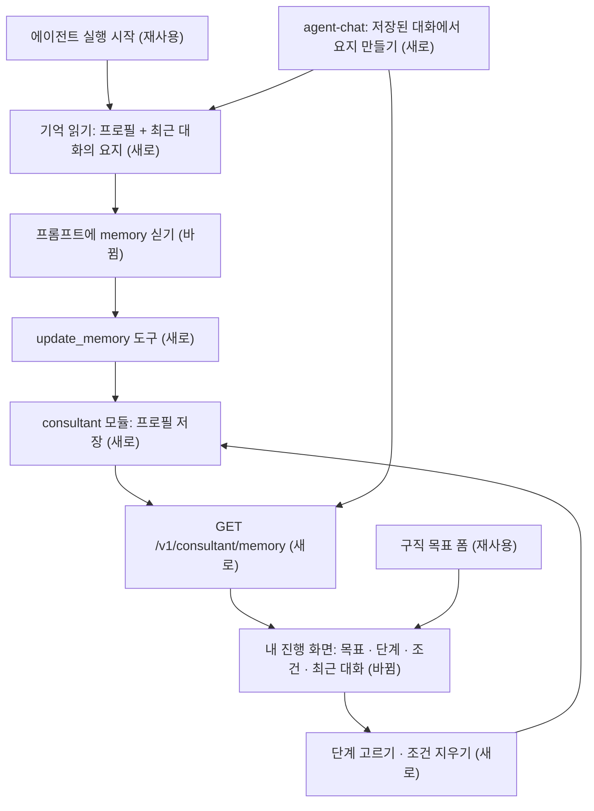

# Spec — 컨설턴트의 기억과 내 진행 화면

## 요구사항

1. 컨설턴트 프로필을 사용자당 한 문서로 저장한다(`consultant_profiles`): 단계(`exploring` · `preparing` · `applying`, 모르면 `null`), 단계를 정한 쪽(`agent` · `user`), 조건 목록(종류 `prefer` · `avoid`, 글 200자, 출처 `chat` · `user`, 30개까지).
2. 대화의 요지(`ConversationDigest`)를 저장된 대화에서 규칙으로 만든다: 제목, 마지막으로 바뀐 때, 사용자가 한 말(처음 두 마디와 마지막 한 마디, 각 200자), 결과(완료한 도구 결과에서 뽑은 줄, 최근 8개), 마지막 답변의 앞 300자.
3. 실행을 시작할 때 서버가 기억(`memory`)을 읽어 프롬프트에 싣는다: 프로필과, 지금 대화를 뺀 최근 대화 다섯 개의 요지.
4. 에이전트 도구 `update_memory`를 더한다. 입력은 `stage`(선택), `remember`(조건 5개까지), `forget`(조건 id 5개까지)이고 셋 중 하나는 있어야 한다. 저장은 바로 일어난다. 글이 같은 조건은 다시 넣지 않는다. 조건이 30개를 넘으면 어긋난 항목으로 돌려보낸다.
5. `GET /v1/consultant/memory`는 프로필과 최근 대화 다섯 개의 요지를 낸다. `PUT /v1/consultant/stage`는 단계를 사용자가 정한 것으로 저장한다. `DELETE /v1/consultant/preferences/:id`는 조건을 지운다.
6. 구직 목표 화면(`/goal`)의 머리 제목을 「내 진행」으로 바꾸고, 구직 목표 아래에 지금 단계, 컨설턴트가 기억하는 조건, 최근 대화를 둔다. 단계를 고르면 바로 저장하고, 조건의 「지우기」는 바로 지운다. 최근 대화는 그 대화로 가는 링크다.
7. 계정을 지우면 프로필도 지운다(`PURGED_COLLECTIONS`).

## 설계

- **모듈.** 프로필은 새 모듈 `consultant`가 맡는다. 대화의 요지는 대화를 가진 `agent-chat`이 만든다(`digest.ts`, 순수 함수). `agent-chat`은 `consultant`의 진입점으로 프로필을 읽고 고친다. 「내 진행」의 조회는 `consultant`의 라우트가 내고, 요지는 배선(`api/main.ts`)에서 넘겨받은 함수로 읽는다.
- **요지는 저장하지 않는다.** 읽을 때 최근 대화 다섯 개에서 만든다. 대화는 100개 메시지와 160,000자 한도가 있어 읽는 양이 정해져 있다. 저장하면 대화가 바뀔 때마다 맞춰야 하는 값이 하나 더 생긴다.
- **기억의 변경은 승인을 받지 않는다.** 기억은 컨설턴트의 작업 메모이고 사용자의 자료(기록, 목표)를 바꾸지 않는다. 대신 답변에서 알리고 「내 진행」에서 고칠 수 있게 한다. 사용자가 직접 정한 단계는 에이전트가 덮어쓸 수 있되, 대화에서 분명히 드러났을 때만 고치라고 지침에 적는다.
- **도구는 하나로 둔다.** 모델 호출마다 도구의 입력 모양이 캐시 읽기 토큰으로 든다(마일스톤 1 실측). 단계와 조건을 한 도구로 받는다.
- **도구 결과에 카드를 두지 않는다.** 작업 흔적에 「기억 갱신」 한 줄과 요약(예: 「단계: 준비 · 조건 1개 기억」)만 남는다.
- 프로필 문서는 처음 고칠 때 만든다. 없는 사용자의 기억은 단계 `null`, 조건 없음이다.

## 대안

- 요지를 가장 낮은 단계의 모델로 요약해 저장하기: 글이 더 자연스럽지만 예약 작업과 AI 계약, 크레딧 차감이 따른다. 예약 작업은 「챙기기」가 들이므로 그 뒤에 다시 본다.
- 에이전트가 답변 끝마다 요지를 도구로 적게 하기: 모델이 빠뜨릴 수 있고 출력 토큰이 든다.
- 조건을 능동 제안의 `dismissed`와 합치기: `dismissed`는 대상의 id이고 조건은 사용자의 말이라 모양이 다르다. 「행동 제안」에서 함께 읽는다.

## 검증 기준

- 계약 테스트: 기억과 요지, 도구 입력의 한도.
- 요지 단위 테스트: 저장한 기록, 바꾼 목표, 승인한 계획, 고른 선택지가 결과 줄로 나오고, 승인하지 않은 초안은 나오지 않는다.
- `consultant` 통합 테스트: 단계 저장, 조건 더하기 · 겹침 거르기 · 지우기, 30개 한도, 남의 프로필에 닿지 않음.
- 실행부 테스트: `update_memory`가 도구 목록에 있고, 프롬프트에 `memory`가 실린다.
- 대화 서비스 통합 테스트: 실행에 넘기는 기억에 다른 대화의 요지가 있고 지금 대화는 없다. 도구로 고친 단계가 프로필에 저장된다.
- 계정 삭제 통합 테스트(기존): 새 컬렉션이 삭제 목록과 맞는다.
- 실제 화면: 한 대화에서 정한 것을 새 대화의 에이전트가 답한다. 단계와 조건이 「내 진행」에 보이고 고쳐진다.
