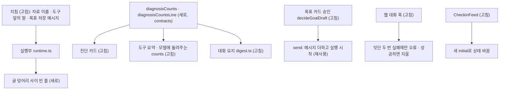

# Spec — 운영 완주에서 드러난 컨설턴트 대화의 문제 여섯 건

## 요구사항

1. 지침에 한 줄을 더한다: 프롬프트의 자료 이름(`jobGoal` · `memory` · `context` · `recordCategories`와 그 칸의 이름)을 답변에 쓰지 않고 화면의 말(구직 목표, 지난 대화, 하기로 한 일)로 부른다.
2. 지침에 한 줄을 더한다: 도구를 부르기 전에 무엇을 하겠다거나 왜 그렇게 판단했는지 적지 않는다. 답변은 사용자에게 하는 말만 쓰고 사용자를 「사용자」라고 부르지 않는다.
3. 실행부는 글 덩어리가 새로 시작될 때 앞서 내보낸 글이 있으면 빈 줄 하나를 먼저 내보낸다. 도구 앞의 말이 남더라도 마지막 답변과 붙지 않는다.
4. 진단의 상태별 수를 세는 함수(`diagnosisCounts`)와 한 줄 글(`diagnosisCountsLine`: 「확인 N · 일부 N · 미확인 N · 부족 N」)을 `@expresso/contracts`에 둔다. 경력 연차 항목(`kind === "career"`)은 세지 않는다. 진단 카드, 도구 결과의 요약, 대화 요지가 이 함수를 쓴다.
5. `record_diagnosis`가 모델에 돌려주는 값에 `counts`를 넣고, `unconfirmed` · `gaps` 목록에서 경력 연차를 뺀다. 대화를 모델에 넘길 때 경력 연차 항목의 상태는 `reference`로 싣는다. 도구 입력의 `summary` 설명에 「상태별 수는 적지 않는다 — 카드가 센다」를 더한다.
6. 목표 카드 승인(`decideGoalDraft`의 approve): 그 카드가 대화의 마지막 답변에 있고 실행 중이 아니면, 사용자 메시지 「구직 목표를 저장했습니다.」를 더하고 실행을 시작한다. 보내기와 같은 확인(동의 · 크레딧 · 대화 길이)을 거치고, 그 확인에 걸리면 저장만 한 채 끝낸다(오류를 내지 않는다).
7. 지침: 사용자 메시지가 「구직 목표를 저장했습니다.」이면 목표 때문에 멈춘 요청을 이어서 하고, 그런 요청이 없으면 한 문장으로 확인만 한다.
8. 웹 대화 훅: 3초마다의 다시 읽기가 한 번 실패하면 오류를 띄우지 않고, 두 번 잇달아 실패하면 띄운다. 다시 읽기에 성공하면 다시 읽기가 띄운 오류를 지운다. 사용자가 누른 동작의 오류는 그대로 남긴다.
9. 홈의 확인 구획(`CheckinFeed`)은 서버가 새 `initial`을 내려 주면 그 값으로 상태를 바꾼다.

## 설계

- **지침과 코드 둘 다로 막는다.** 내부 이름과 도구 앞의 말은 지침으로 줄이고, 글이 붙는 것은 실행부가 막는다. 지침만으로는 모델이 가끔 어긴다.
- **수는 서버와 화면이 같은 함수로 센다.** 모델이 수를 직접 세어 말하지 않도록 도구가 수를 돌려주고, 요약 글에는 수를 적지 않게 한다.
- **목표 승인의 이어 가기는 `send`를 다시 쓴다.** 새 실행 경로를 만들지 않는다. 메시지의 글은 서버가 정한다.

## 대안

- 도구 앞의 글을 실행부가 버리기: 도구 없이 끝나는 답변과 구분하려면 글을 모아 두었다가 내보내야 해서 글이 흐르듯 나오는 것이 멈춘다.
- 목표 카드에 「이어서 진행」 버튼 두기: 한 번 더 눌러야 한다. 대화만 하면 이어지는 것이 이 제품의 방향이다.

## 검증 기준

- 계약 테스트: 수 세기(경력 연차 제외)와 한 줄 글.
- 실행부 테스트: 글 덩어리 사이의 빈 줄, `record_diagnosis`의 요약과 돌려주는 값, 지침의 새 문장.
- 대화 서비스 통합 테스트: 마지막 답변의 목표 카드를 승인하면 메시지가 더해지고 실행이 시작됨, 지난 답변의 카드는 저장만, 크레딧이 없으면 저장만.
- 대화 요지 테스트: 요지의 수가 카드와 같음.
- 웹 테스트: 다시 읽기 한 번 실패는 오류 없음 · 두 번은 오류 · 성공하면 지움, `CheckinFeed`가 새 `initial`을 받음, 진단 카드의 수.
- 검증 서버: 목표 없는 계정으로 진단 요청 → 목표 저장 → 바로 진단이 이어지는지, 답변과 요지의 수가 카드와 같은지.
