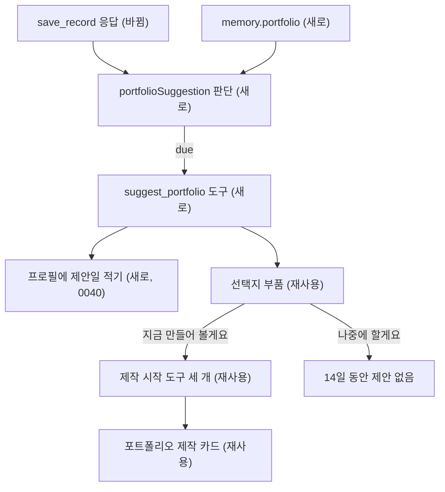

# 포트폴리오 잇기 — 기록이 쌓이면 컨설턴트가 먼저 제안 — 명세

## 요구사항

- [ ] `portfolioSuggestion()`(순수 함수)이 다섯 상태 가운데 하나를 낸다: `due` · `few_records` · `has_portfolio` · `in_progress` · `recently_suggested`. `due`는 포트폴리오 0건, 이 대화의 제작 0건, 내용이 있는 기록 `PORTFOLIO_SUGGESTION_MIN_RECORDS`(3)건 이상, 마지막 제안일에서 `QUIET_DAYS`(14)일이 지났거나 제안한 적이 없을 때다.
- [ ] 실행을 시작할 때 서버가 `memory.portfolio`(`records` · `suggest`)를 싣는다. 컨설턴트 프로필이 연결되지 않은 서비스에서는 `memory`가 null이라 제안도 없다.
- [ ] 새 도구 `suggest_portfolio`(입력 없음)는 부른 시점에 조건을 다시 본다. `due`가 아니면 `AgentToolRejection`으로 까닭을 돌려주고 아무것도 적지 않는다. `due`면 정해진 질문과 두 선택지(「지금 만들어 볼게요」 · 「나중에 할게요」)의 선택지 부품을 낸다. 제안일(서울 날짜)은 그 실행이 끝까지 간 뒤에 적는다 — 실패하거나 끊긴 실행의 제안은 사용자가 보지 못했을 수 있고, 다시 보내면 다시 낼 수 있어야 한다.
- [ ] `save_record`의 응답에 저장 직후의 판단을 싣는다(`portfolio: { records, suggest }`, `AgentInput.portfolioNow()`). 같은 실행에서 문턱을 넘은 경우에도 그 답변에서 제안이 나온다.
- [ ] 웹의 등록표(`tool-parts.tsx`)가 도구 이름 「포트폴리오 제안」을 선택지 부품으로 그린다.
- [ ] `suggest_portfolio`는 `ask_choice` · `ask_form`과 같은 "한 답변에 부품 하나" 규칙과 부품 뒤 실행 종료(`PostToolUse` 훅)를 따른다.
- [ ] 제안한 뒤 14일 안에는 `memory.portfolio.suggest`가 false이고 `suggest_portfolio`가 돌려보낸다.
- [ ] 지침: 제안을 내는 답변에서는 참고 링크 질문을 하지 않는다. 진단의 확인 질문이나 인터뷰가 이어지는 중이면 그 흐름을 마친 뒤에 제안한다. 사용자가 받아들이면 지금 있는 제작 시작 문단(세 갈래)을 따른다. 미루면 한 문장으로 받고 다시 권하지 않는다.
- [ ] 마이그레이션 0040이 `consultant_profiles` 검증 규칙에 `portfolioSuggestion`(`lastSuggestedOn`)을 더한다. 기존 문서는 바꾸지 않는다.

## 설계

**재사용.** 선택지 부품과 답의 경로(`buildChoice`, `AgentUiPart`, 메시지 보내기의 `reply`, 웹의 `ChoicePart`)는 그대로 쓴다. 웹은 부품을 도구 이름으로 고르므로 등록표의 선택지 항목에 「포트폴리오 제안」 이름만 더한다. 제작 시작은 `start_portfolio` · `start_free_portfolio` · `import_job_posting`(PR #268)이 맡는다. 간격은 `consultant/commitments.ts`의 `QUIET_DAYS`와 `addDays` · `seoulDay`를 쓴다.

**새로 만드는 것.**

- `consultant/portfolio-suggestion.ts`: 문턱 상수와 순수 함수 `portfolioSuggestion({ records, portfolios, brewing, lastSuggestedOn, today })`.
- `ConsultantService.portfolioSuggestedOn(userId)` · `markPortfolioSuggested(userId, at)`: 프로필의 `portfolioSuggestion.lastSuggestedOn`을 읽고 쓴다. `profile()`의 모양은 바꾸지 않는다(「내 진행」 응답이 `strictObject`다).
- `AgentChatService.portfolioSuggestionState(row)`: 기록(`career.listRecords`, 최근 100건 가운데 `isEmpty`가 아닌 것), 포트폴리오(`portfolios.list`, 1건), 이 대화의 제작(`row.brewIds`), 제안일을 읽어 순수 함수에 넘긴다.
- `AgentInput.suggestPortfolio()` · `portfolioNow()`와 도구 `suggest_portfolio`, `AgentMemory.portfolio`, 지침 한 문단.

**상태가 사는 곳.** 제안일은 사용자당 하나라 컨설턴트 프로필에 둔다. 대화가 바뀌어도 이어져야 하기 때문이다.



## 버린 대안

- 모델이 `ask_choice`로 자유롭게 제안하게 두는 것. 서버가 제안한 사실을 알 수 없어 되풀이를 막지 못한다.
- 제안일을 대화 문서에서 도구 이름으로 찾아 내는 것. 마이그레이션은 없지만 도구 이름이 식별자가 되고 실행마다 대화의 메시지를 훑는다.
- 홈의 확인 구획에 카드를 함께 넣는 것. 먼저 연락하기는 유료 요금제의 기능이라는 결정(2026-11-20)에 걸리고 계약 · 화면 · 라우트가 함께 바뀐다. 대화 안 제안을 먼저 끝낸다.

## 함정

- 기억은 실행을 시작할 때 읽는다. 같은 실행에서 세 번째 기록을 저장하면 `memory.portfolio`는 낡은 값이다. 그래서 `save_record` 응답과 도구 처리기가 다시 판단한다.
- 다른 대화에서 시작해 아직 생성하지 않은 제작은 보지 않는다. 사용자의 제작을 나열하는 진입점이 `materials` 모듈에 없다. 그 경우 제안이 한 번 나올 수 있다.
- 서버가 시작한 실행(`event`)에서는 도구를 쓸 수 없다(`step`의 거절). 제안도 그 실행에서는 나오지 않는다.
- `consultant_profiles`의 검증 규칙은 `additionalProperties: false`다. 0040 없이 새 칸을 쓰면 쓰기가 실패한다. 로컬 Mongo는 워크트리들이 함께 쓰지만 0040은 허용 칸을 더하기만 한다.
- 도구가 하나라도 빠지면 실행이 실패한다(`AGENT_ALLOWED_TOOLS` 검사). `TOOL_NAMES` · `TOOL_LABELS` · 등록을 함께 넣는다.
- 새 마이그레이션은 `mongo-migrations.ts`의 목록, `mongo-build.mjs`의 복사 목록, `schema.test.ts`의 이름 목록 세 곳에 함께 넣는다. 복사 목록에서 빠지면 통합 테스트가 `dist`에서 원본을 찾지 못한다.
- 로컬의 `expresso` DB는 다른 계보의 마이그레이션(0006 · 0009의 이름이 다름)이 적용되어 있어 `main`의 마이그레이션을 받지 못한다. 로컬 확인은 작업마다 따로 둔 DB(`expresso_<주제>`)에서 한다.

## 완료 기준

```
pnpm --filter @expresso/backend typecheck
pnpm --filter @expresso/backend test
pnpm test:infra
pnpm --filter @expresso/web typecheck
pnpm --filter @expresso/web test
```

모두 종료 코드 0. 로컬 개발 서버에서 기록 3건 · 포트폴리오 0건인 계정의 대화에 제안이 뜨고, 받아들인 뒤 「포트폴리오 제작」 카드가 선다.
