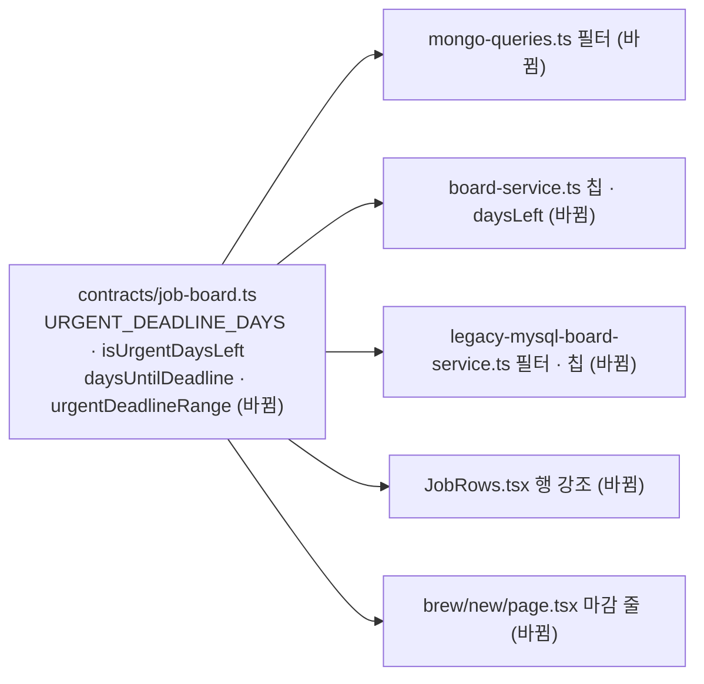

# 마감 임박 경계 통일 — 명세

## 요구사항

- [ ] 마감 임박 ⇔ `daysLeft`가 0 이상 7 이하. `daysLeft`는 마감일과 지금의 날짜(UTC) 차이다.
- [ ] 목록 필터(`deadline=urgent`)와 탭 건수가 Mongo와 레거시 MySQL 양쪽에서 같은 기준이다.
- [ ] 행 강조(`JobRows`)와 `brew/new` 마감 줄 강조가 같은 판정 함수를 쓴다.
- [ ] 7이라는 숫자가 `packages/contracts` 한 곳에만 있다.
- [ ] 마감일이 7일째 날 23:59(UTC)인 공고는 포함, 8일째 날 00:00(UTC)은 제외.

## 설계

`packages/contracts/src/job-board.ts`에 둔다.

- `URGENT_DEADLINE_DAYS = 7`
- `daysUntilDeadline(expiresAt: Date, at: Date): number` — 기존 `board-service.ts`의 `Math.floor(ms / 86_400_000)` 차이를 옮긴 것이다.
- `isUrgentDaysLeft(daysLeft: number | null): boolean` — `0 <= daysLeft <= 7`.
- `urgentDeadlineRange(at: Date): { from: Date; to: Date }` — `from`은 `at`이 속한 UTC 날짜의 0시, `to`는 그 7일 뒤 날짜의 다음 0시(반열린 구간). Mongo 쿼리가 쓴다.

사용처:
- `mongo-queries.ts`: `expiresAt: { $gte: from, $lt: to }`.
- `board-service.ts`: 칩 건수의 `urgent` 식이 같은 범위를 쓰고, `daysLeft` 계산이 `daysUntilDeadline`을 쓴다.
- `legacy-mysql-board-service.ts`: 필터와 칩이 `datediff(expires_at, now(6)) between 0 and ${URGENT_DEADLINE_DAYS}`. 같은 파일의 `days_left` 컬럼과 같은 식이다.
- `JobRows.tsx`, `brew/new/page.tsx`: 로컬 `<= 7`을 `isUrgentDaysLeft`로 바꾼다.

## 버린 대안

- 서버 기준(지금부터 7×24시간)에 화면을 맞추기: 화면이 현재 시각을 알아야 한다. `D-7`로 표시되는데 강조가 없는 경우가 남는다. 사용자가 판정 근거로 읽는 것은 `D-n`이다.
- 응답에 `urgent: boolean`을 추가하기: 계약과 두 서비스를 모두 바꿔야 하고 `daysLeft`로 이미 계산된다.

## 함정

- `daysLeft`는 Mongo에서 UTC 날짜 차이, MySQL에서 서버 시간대의 `datediff`다. 두 경로의 `D-n`이 시간대에 따라 하루 다를 수 있는 것은 기존 상태이고 이번에 바꾸지 않는다.
- `expiresAt`이 null이면 Mongo의 `$gte`/`$lt` 범위에 들어가지 않는다. MySQL `datediff(null, …)`도 null이라 `between`이 거짓이다.
- 테스트는 `dist`를 본다. `@expresso/contracts`를 먼저 빌드해야 backend·web 테스트가 새 export를 찾는다.

## 완료 기준

- `pnpm typecheck`, `pnpm test`가 통과한다.
- 백엔드 통합 테스트(`pnpm test:infra`)에서 7일째 날 포함, 8일째 날 제외, 어제 마감 제외가 확인된다.
