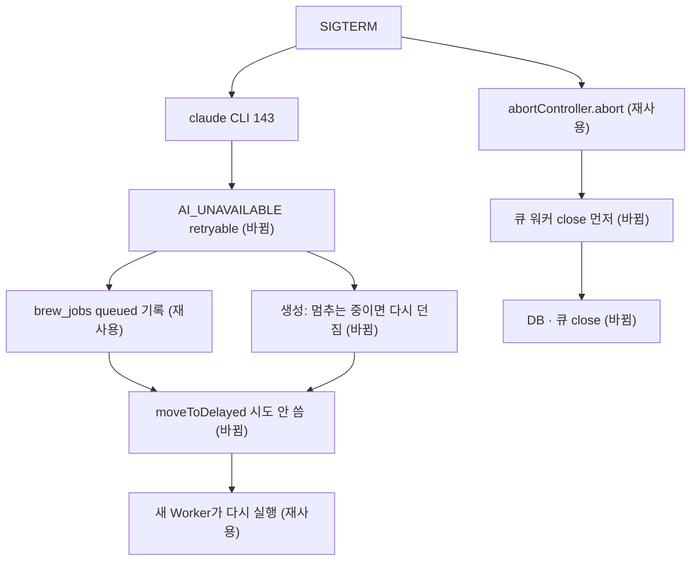

# 배포 재시작 시 진행 중 AI 잡 고착 해소 — 명세

## 요구사항

- [ ] Worker 종료 시 큐 워커 4개(`domain` · `generation` · `refine` · `career`)를 먼저 닫고, 그 뒤에 outbox 감시 · 큐 · DB · 측정기를 닫는다.
- [ ] 종료 신호를 받은 뒤 실패한 잡은 시도 횟수를 쓰지 않고 지연 큐로 옮겨진다. 단, `UnrecoverableError`는 그대로 실패한다.
- [ ] claude CLI가 신호로 끝나면(`signal` 있음, 종료 코드 143 · 130) `AiError("AI_UNAVAILABLE", { retryable: true })`를 던진다.
- [ ] 생성 처리기는 Worker가 멈추는 중이면 실패를 `failFreeHtml`로 확정하지 않고 오류를 다시 던진다.
- [ ] API(Fastify)는 `close()` 때 열린 연결을 모두 끊는다.

## 설계

재사용: `createQueueWorker`의 Mongo 장애 미루기(`job.moveToDelayed` + `DelayedError`), `BrewJobService.process`의 `retryable && !finalAttempt → queued` 기록, `prepareFreeHtml`의 `running` 재수령, Fastify `forceCloseConnections`.

- `worker/shutdown.ts`(새로 만듦): `closeWorkerRuntime({ workers, resources, force })`. `workers.close(force)`를 모두 기다린 뒤 `resources`의 `close()`를 부른다. `main.ts` 마지막 줄을 이 함수로 바꾼다. 종료 신호가 오면 바로 큐 워커를 닫기 시작해 새 잡을 받지 않는다.
- `create-queue-worker.ts`: 옵션 `stopping?: AbortSignal`. 처리기 오류가 났고 `stopping.aborted`이며 `UnrecoverableError`가 아니면 `job.moveToDelayed(Date.now(), token)` 뒤 `DelayedError`. 로그는 `queue.job_deferred`에 `reason: "worker_stopping"`.
- `claude-code.ts` `#run`: `close`의 `signal`을 함께 넘긴다. `#call`에서 신호 종료면 재시도 가능한 `AI_UNAVAILABLE`.
- `processors/generation.ts`: 마지막 인자 `stopping?: AbortSignal`. 두 `catch`에서 `stopping?.aborted`이면 `throw error`.
- `api/build-app.ts`: `Fastify({ forceCloseConnections: true })`. `server.closeAllConnections()`가 hijack한 SSE 소켓까지 끊는다.

## 버린 대안

- systemd `KillMode=mixed` + 긴 `TimeoutStopSec`: 서버 유닛은 `deploy.sh`가 설치하지 않아 손으로 반영해야 한다. 생성(3–5분)은 어차피 90초를 넘겨 SIGKILL되고, 그 뒤 stalled 재배달까지 30–60초를 더 기다린다.
- 오래된 `running` 회수: 리스 필드 없이 5분짜리 정상 생성과 구분할 수 없다.
- 새 `AiErrorCode`(`AI_INTERRUPTED`): 실패 코드가 화면 · 계약까지 번진다. 재시도 가능 여부만 다르면 된다.
- SSE마다 종료 신호 연결: SSE가 세 곳(brew-jobs · page stream · agent-chat)이다. 한 곳에서 끊는 편이 빠짐이 없다.

## 함정

- SIGTERM은 cgroup 전체에 가므로 CLI와 Worker가 동시에 받는다. CLI가 처리하고 끝나는 데 시간이 걸려 Worker의 신호 처리기가 먼저 돈다고 본다. 반대 순서여도 재시도 가능 오류라 BullMQ 일반 재시도(시도 1회 소모)로 이어진다.
- `forceCloseConnections: true`는 처리 중인 일반 요청도 끊는다. 배포 재시작에서만 생기는 일이고 nginx가 502를 낸다.
- BullMQ `maxStalledCount` 기본 1: SIGKILL로 두 번 끊긴 잡은 stalled 한도로 실패한다. 이번 범위 밖.

## 완료 기준

- `pnpm --filter @expresso/backend test` 통과. 새 시험: 종료 순서, 멈추는 중 미루기, CLI 신호 종료 재시도 가능, 생성 처리기 다시 던짐, API close가 열린 SSE에도 바로 끝남.
- `pnpm typecheck` · `pnpm test:infra` 통과.
- 운영 확인은 배포 뒤: 질문 생성 중 `sudo systemctl restart expresso-worker` → 잡이 `succeeded`로 끝남.
