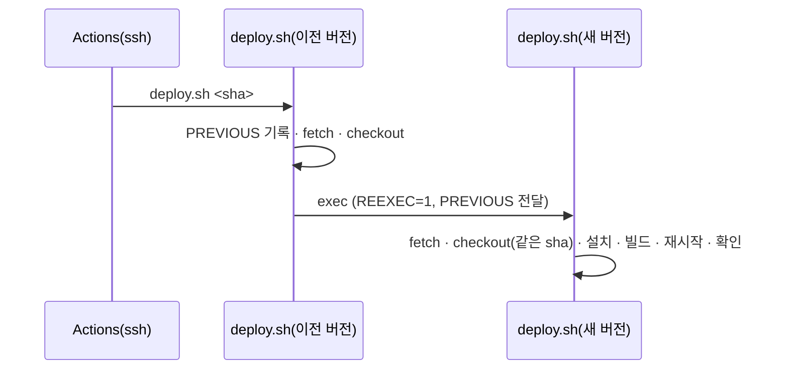

# Spec — 배포 스크립트 자기 교체 뒤 새 버전 실행

## 요구사항

1. `git fetch` · `git checkout --detach "$TARGET"` 뒤, 처음 실행이면 `exec bash "$ROOT/scripts/operations/deploy.sh" <해석한 커밋 SHA>`로 새 파일을 처음부터 다시 실행한다.
2. 재실행 여부는 환경 변수 `EXPRESSO_DEPLOY_REEXEC=1`로 표시한다. 재실행한 스크립트는 다시 exec하지 않는다.
3. 배포 전 커밋은 `EXPRESSO_DEPLOY_PREVIOUS`로 넘긴다. `PREVIOUS`는 이 값이 있으면 그 값을 쓴다. `.last-deployed-commit`도 이 값으로 쓴다.
4. git은 checkout할 때 파일을 지우고 새로 만든다. 돌고 있는 bash는 열어 둔 이전 파일을 끝까지 읽으므로, exec 줄을 묶음으로 감쌀 필요가 없다.
5. 재실행한 스크립트도 fetch · checkout을 한 번 더 한다. 대상이 같은 SHA이므로 결과는 같다. 이 중복은 허용한다.

## 설계

## 거부한 대안

- 스크립트 전체를 `main() { … }; main "$@"`로 감싸기 — 이전 버전으로 끝까지 도는 것은 지금과 같아서, 새 버전의 단계가 그 배포에서 돌지 않는다.
- 워크플로가 먼저 `git fetch` · checkout을 하고 스크립트를 부르기 — 사람이 서버에서 직접 `deploy.sh`를 부르는 경로에는 효과가 없다.

## 열린 질문

없음
