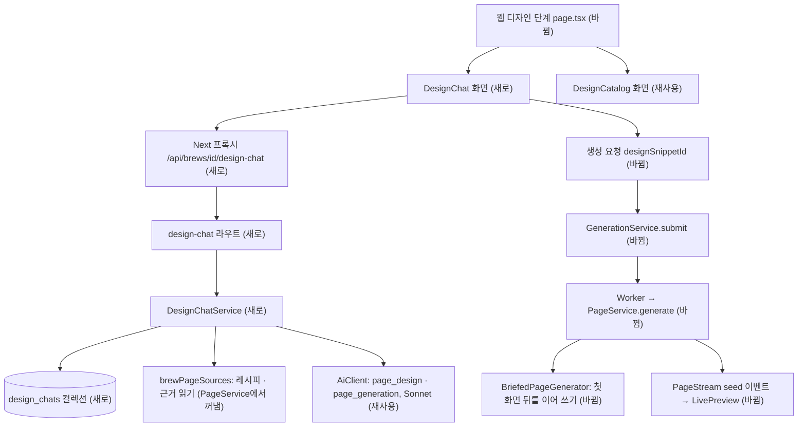

# 디자인 선택 단계의 채팅 전환 — 명세

## 요구사항

- [ ] `POST /v1/brews/:id/design-chat/open`은 대화가 없으면 만들고 첫 답(자료 머리 + 말 + 스타일 견본 셋 + 레이아웃 견본 셋)을 시작한다. 두 번 불러도 대화는 하나다.
- [ ] `POST …/design-chat/messages`는 세 가지를 받는다: 말(`say`, 대상 첫 화면 · 카탈로그 판을 붙일 수 있음), 고른 스타일 하나와 레이아웃 하나로 그리기(`draw`, `styleId` · `layoutId`), 카탈로그 판을 스타일로 삼아 그리기(`draw_catalog`, 고른 레이아웃이 있으면 `layoutId`). 202로 바로 답하고 답은 뒤에서 만든다.
- [ ] 말에는 에이전트가 무엇을 띄울지 정한다: 없음 · 견본(스타일만 · 레이아웃만 · 둘 다) · 첫 화면 · 고친 첫 화면.
- [ ] 스타일과 레이아웃은 따로 제안하고 따로 고른다. 스타일은 구성을, 레이아웃은 색 · 서체를 갖지 않는다.
- [ ] 에이전트에게 전하는 지시는 아래 「Do와 Do not」 목록으로 적는다. 첫 화면과 그 뒤를 잇는 지면이 같은 디자인 목록을 읽는다.
- [ ] 첫 화면 여러 장은 동시에 그리고, 끝난 장부터 대화에 놓인다. 한 장이 실패해도 나머지는 남는다.
- [ ] 모든 AI 호출은 사용자 ID를 실어 사용량에 남고, 답을 시작하기 전에 동의(`career_records`)와 이번 달 크레딧 한도를 본다.
- [ ] 답을 만드는 중에 API가 꺼지면 그 답은 `interrupted`로 남고 다시 시도할 수 있다.
- [ ] `POST …/design-chat/selection`으로 고른 첫 화면을 저장한다.
- [ ] `POST /v1/generation-jobs`가 `designSnippetId`를 받는다. 그 생성은 자유 생성이고, 완성 지면의 HTML은 고른 첫 화면의 HTML로 시작하며 CSS는 그 CSS로 시작한다(서버가 이어 붙인다).
- [ ] 생성 중 미리보기는 고른 첫 화면을 먼저 보이고 그 아래로 나머지가 쓰인다.
- [ ] AI가 꺼진 서버(`AI_PROVIDER=off`)에서 디자인 단계는 기존 카탈로그 화면을 연다.
- [ ] 기존 카탈로그 화면의 동작과 구조화 생성 경로는 그대로다(`?view=catalog`).

## 설계

**재사용하는 것**

- 화면: 제품 채팅의 `Thread`(`components/assistant-ui/elements/thread.aui`) + `useExternalStoreRuntime`, 시안의 카드 · 무대 · 전환 코드, `DesignThumb`, `BrewFrame`, `Dialog`.
- AI: `AiClient.complete` + `check`(걸린 칸만 고침), `briefedSystem`(디자인 지침), `sanitizePage`, `MeteredAiClient`(사용량).
- 실행: 에이전트 채팅의 방식 — API 프로세스에서 뒤로 돌리고, 1초마다 `heartbeatAt`, 읽을 때 60초 넘게 멎은 실행을 `interrupted`로, `preClose`에서 `close()`.
- 한도 · 동의: `MongoEntitlementService.check(userId, "portfolio.generate")`, `ConsentApi.require`.

**계약(`packages/contracts/src/design-chat.ts`)**

- `DesignTokens` — 바탕 · 글자 · 강조 색(#rrggbb), 서체 계열(`TemplateFontSchema`), 밀도.
- `DesignStyle`(스타일 견본) — `id · name · words · tokens`.
- `DesignLayout`(레이아웃 견본) — `id · name · words · blocks`. `blocks`는 배치도다: 첫 화면(1440×900)을 가로 16칸 · 세로 10칸으로 나눈 격자 위의 블록(`kind: title|text|figure|accent`, `x · y · w · h`). 견본이 이 값을 그림으로 그리고, 그리는 호출도 같은 값을 받는다.
- `DesignSnippet`(첫 화면) — `id · origin(agent|user|catalog|edit) · name · note · words · tokens · layout(이름 · 설명 · 배치도, 카탈로그만 골랐으면 null) · css · html · fromSnippetId`.
- 메시지 — 사용자 말(`text`, `subjects`: 스타일 · 레이아웃 · 첫 화면 · 카탈로그 판)과 에이전트 답(`text`, `status`, `card`). `card`는 `proposals`(`styles` · `layouts`, 한쪽은 비어 있을 수 있음) · `screens`(장마다 `drawing|done|failed`) · `revision`.
- `DesignChat` — `messages · snippets · selectedSnippetId · run · version`.
- `SubmitGenerationSchema`에 `designSnippetId`. `templateId` · `designSystemRevisionId` · `designSnippetId` 가운데 하나만 받는다.

**백엔드(`services/backend/src/modules/page/design-chat/`)**

- `../brew-sources.ts` — `PageService.#context`의 레시피 · 섹션 · 근거 · 공고 · 회사 조립을 `brewPageSources(db, userId, brewId)`로 꺼낸다. `#context`는 이 함수를 쓰고 포트폴리오에 딸린 것(스타일 · 그림)만 더한다. 디자인 단계에는 포트폴리오가 없어서 제작 ID로 읽어야 한다.
- `prompts.ts` — 호출 네 가지의 계약과 요청.
  - 여는 호출(`page_design`): 자료를 읽어 `head`(직무 · 한 줄 · 소개 · 다루는 것 · 앞세울 사실)와 말, 스타일 셋, 레이아웃 셋을 낸다. `head`와 말의 숫자는 출처와 대조하고, 배치도의 블록이 격자를 벗어나면 그 블록만 고쳐 받는다.
  - 답하는 호출(`page_design`): 대화 요약 · 대상 · 사용자의 말을 읽고 `say`와 `show`(none|proposals|screens|revision)를 낸다. `screens`는 스타일과 레이아웃의 짝이다. 사용자가 한쪽만 말하면 다른 쪽은 가장 최근 첫 화면의 것을 그대로 옮긴다. 어느 첫 화면을 고칠지는 말에서 읽는다(`reviseTarget`): 넓게 띄워 놓고 한 말이면 그 첫 화면, 말이 앞서 그린 것을 가리키면 그 이름(`target`), 둘 다 아니면 가장 최근에 그린 것. 대상을 붙이는 버튼은 두지 않는다.
  - 그리는 호출(`page_generation`): 원문 자료와, 따로 고른 스타일(색 · 서체 · 밀도) · 레이아웃(이름 · 설명 · 배치도)으로 지면이 시작하는 자리를 낸다(`name · note · tokens · css · html`). 카탈로그의 디자인만 골랐으면 레이아웃이 없고 구성은 그리는 쪽이 정한다. 소독기가 거절하는 CSS 구문은 검사에서 걸러 그 칸만 고쳐 받는다.
  - 고치는 호출(`page_generation`): 지금 첫 화면과 지시를 받아 **바뀌는 자리만** 조각(`edits`: 어디 · 지금 있는 글자 · 들어갈 글자)으로 낸다. 서버가 지금 첫 화면에 순서대로 적용한다(`applyEdits`). 지금 첫 화면에 없는 글자를 찾는 조각은 그 조각만 고쳐 받고, 적용한 결과는 그린 첫 화면과 같은 검사를 지난다. 디자인 지침은 싣지 않고 `effort: low`로 부른다. 건네는 말은 받지 않는다 — 고치겠다는 말은 답하는 호출이 한다.
  - 네 호출 모두 `modelTier: "sonnet"`을 명시한다. 두 계약의 기본은 Opus다.
  - 건네는 말(`say` · `note`)은 끝까지 쓴 문장인지와 세 문장을 넘지 않는지를 검사한다. 한 장을 그렸을 때의 말(`note`)은 대화 폭의 한 줄(60자)도 넘지 않아야 한다 — 배치를 글로 풀어 쓰지 않게 한다. 말투는 지시가 잡는다.
- `../design-rules.ts` — 디자인의 Do와 Do not. 그리는 호출과 `briefed-generator.ts`의 `seedPrompt`(고른 첫 화면 뒤를 잇는 지면)가 함께 읽는다.
- `service.ts` — `DesignChatService`. `get · open · send · select · retry · close`와 생성 쪽이 쓰는 `findDesignSnippet`.
- `routes.ts` — 위 라우트. AI가 없으면 등록하지 않는다(503).

**고른 첫 화면을 완성 지면으로**

- `generation_jobs` · `portfolios` 문서에 `designSnippetId`를 싣는다(두 컬렉션의 검증 규칙은 추가 필드를 막지 않는다). 템플릿은 Clarity, `styleOverrides`는 첫 화면의 색 · 서체 · 밀도, 방식은 `html`.
- `PageService.#context`가 `portfolio.designSnippetId`로 첫 화면을 읽어 `context.seed`에 넣는다.
- `BriefedPageGenerator`는 `seed`가 있으면 요청에 확정된 첫 화면을 보이고 **그 뒤만** 쓰게 한다. 결과는 서버가 `seed.html + html`, `seed.css + css`로 붙인다.
- `PageStream`에 `seed` 이벤트를 더한다. `LivePreview`는 `seed`를 받으면 그 첫 화면을 먼저 그리고 이후 조각을 그 뒤에 붙인다.

**데이터**

- 새 컬렉션 `design_chats`(마이그레이션 0033 — 0032는 `feat/home-agent-first`가 쓴다). `(userId, brewId)` 고유 인덱스. 계정 삭제 목록(`PURGED_COLLECTIONS`)에 넣는다.

**웹**

- `features/design-chat/` — `DesignChat.tsx`(시안에서 옮김), `useDesignChat.ts`(실행 중 1.5초마다 `since=<version>`으로 다시 읽음 — 제작 흐름의 `use-refresh-while`과 같은 주기), `thread.ts`(대화 → 스레드 메시지 변환).
- `app/api/brews/[brewId]/design-chat/[[...path]]/route.ts` — 쿠키의 토큰을 붙여 넘기는 프록시(에이전트 채팅 프록시와 같은 방식).
- `design/page.tsx` — 대화를 쓸 수 있으면 `DesignChat`, `?view=catalog`이거나 쓸 수 없으면 `DesignCatalog`.
- `thread.aui.tsx` — 런타임이 중단을 지원하지 않으면 멈춤 버튼 대신 꺼진 보내기 버튼을 둔다.

## 버린 대안

- **완성 지면에서 모델이 첫 화면을 다시 쓰게 하고 `check`로 대조**: 2026-11-17에 두 번 재서 두 번 다 같았지만, 한 글자가 달라지면 지면 전체를 다시 받거나 생성이 실패한다. 서버가 붙이면 어긋날 수 없고 출력도 짧아진다.
- **에이전트 채팅 모듈로 구현**: `main`에서는 서버 인증이 허용된 계정이 아니면 개인 API 키가 있어야 한다. 서버 인증 작업은 열린 PR에 있다.
- **SSE**: 에이전트 채팅의 SSE도 서버가 500ms마다 문서를 다시 읽어 보내는 방식이다. 답이 한 번에 오는 이 대화에서는 1.5초 폴링과 보이는 것이 같다.
- **새 AI 계약 이름**: 계약을 더하면 기본 모델 표 · 동의 표 · 사용량 이름표를 함께 고쳐야 한다. `page_design` · `page_generation`으로 충분하다.
- **그리는 호출에 `head`만 넘기기**: 처음에는 이렇게 했다. 요청은 짧지만 첫 화면에 놓을 수 있는 것이 이름 · 한 줄 소개 · 수치 하나뿐이라 일곱 장이 모두 같은 구도가 됐다. 원문을 넘겨도 한 장에 14–24초였다(2026-11-19).

## 함정

- 여는 호출을 페이지 렌더에서 시작하면 안 된다. `router.refresh()`와 프리페치가 렌더를 여러 번 일으킨다. 화면이 뜬 뒤 클라이언트가 `open`을 한 번 부른다.
- `AiCallOptions`에 중단 신호가 없다. 실행을 멈출 수 없으므로 멈춤 버튼을 보이지 않는다.
- `#context`는 고정폭(`mono`)을 고딕으로 내린다. 고른 첫 화면이 고정폭이면 완성 지면 요청의 스타일 문단이 첫 화면과 어긋난다. `seed`가 있을 때는 첫 화면의 서체 계열을 그대로 적는다.
- `usageSink`는 `userId`가 없으면 크레딧에 더하지 않는다. 측정 스크립트는 `userId: null`이었다.
- 모델이 쓴 HTML · CSS를 앱 안에 그린다. `sanitizePage`를 거친 것만 저장하고, 화면은 `sandbox=""` iframe으로 그린다(시안과 같다).
- 첫 화면이 `<main>`으로 감싸여 있으면 뒤에 붙는 섹션이 그 밖에 놓인다. 그리는 호출에 "첫 화면은 `<header>`나 `<section>` 하나로 쓰고 지면 전체를 감싸는 틀을 두지 않는다"를 적는다.
- 지시를 붙여 지금 지면을 고칠 때(`previous && instruction`)는 `seed`를 쓰지 않는다. 직전 지면에 첫 화면이 이미 있다.
- 새 컬렉션은 `migrations.test.ts`(20) · `schema.test.ts`(88)의 수와 계정 삭제 통합 테스트를 건드린다.
- 운영 서버는 `claude` CLI를 호출마다 띄운다. 세 장을 동시에 그리면 프로세스 셋이 함께 돈다(2026-11-17 로컬에서 다섯 개 동시 34초).

## Do와 Do not

2026-11-19에 요청자가 초안을 보고 확정한 목록이다. 프롬프트의 문구는 이 뜻을 지킨다.

| | Do | Do not |
|---|---|---|
| 말 | 사람에게 말하듯 쓴다("~해요"). 자료에서 본 것이나 사용자가 한 말을 먼저 받고 묻는다. 한 번에 한 가지만 묻는다. 한두 문장으로 끝낸다. | 보고서 문장으로 시작하지 않는다("가장 앞에 세울 사실은 ~입니다"). 카드의 내용을 글로 다시 설명하지 않는다. 선택지를 문장 안에 나열하지 않는다. 끊긴 문장을 쓰지 않는다. |
| 제안 | 스타일(색 · 서체 · 분위기)과 레이아웃(구성)을 따로 제안하고, 사용자는 각각에서 하나씩 고른다. 제안마다 한눈에 구분되게 낸다. 스타일은 이 사람의 일과 지원하는 곳에서 가져온다. 카드의 글은 이름과 한 줄까지다. | 스타일과 레이아웃을 한 카드에 묶지 않는다. 색만 다르고 구도가 같은 제안을 내지 않는다. 카드 아래에 여러 줄의 설명을 붙이지 않는다. |
| 디자인 | 포트폴리오를 디자인한다(구성 · 시각 위계 · 타이포그래피). 이 사람의 일을 그림으로 만든다(화면의 모습 · 전후 비교 · 구조도 · 차트를 CSS와 SVG로). 화면마다 주인공 하나를 세운다. 사람마다, 고른 것마다 구도가 달라지게 한다. 사실은 재료다. | 사실을 문단과 표로 나열하지 않는다(문서나 이력서처럼 보이면 실패). 「이름 + 한 줄 소개 + 수치판」 구도를 기본값으로 되풀이하지 않는다. 같은 모양의 카드를 쌓지 않는다. 내용 없는 꾸밈을 넣지 않는다. |
| 사실 | 이름, 수치, 기간은 자료에 적힌 그대로 쓴다. | 자료에 없는 수치, 경력, 연락처를 만들지 않는다. |

## 완료 기준

- `pnpm typecheck`와 `pnpm test` 통과, `pnpm test:infra`에서 새 통합 테스트(`design-chat.mongo.integration.test.ts`) 통과.
- 복사본 DB(`expresso_free_lab`)와 `AI_PROVIDER=claude-code`로 띄운 서버에서, 윤하린 제작의 디자인 단계를 열어 첫 질문 → 스타일과 레이아웃을 하나씩 골라 첫 화면 보기 → 말로 고치기 → 고르기 → 만들기를 끝까지 하고, 완성 지면의 맨 앞이 고른 첫 화면과 같은지 헤드리스 Chrome으로 확인한다.
- `AI_PROVIDER=off`로 띄우면 디자인 단계가 기존 카탈로그 화면을 연다.
