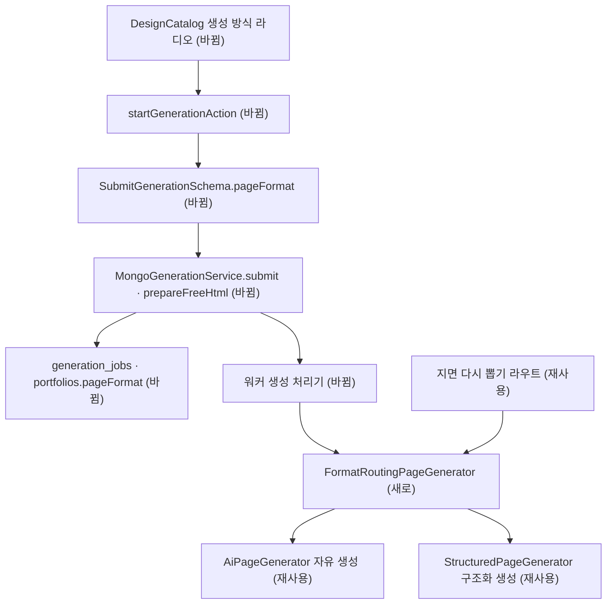

# 디자인 선택 단계 생성 방식 선택 — 명세

## 요구사항

- [ ] `packages/contracts`에 `PageGenerationFormatSchema = z.enum(["json-render", "html"])`를 두고, `SubmitGenerationSchema`에 `pageFormat` 선택 칸을 더한다. 값은 런타임 설정 `PAGE_GENERATION_FORMAT`과 같다.
- [ ] `MongoGenerationService.submit`이 `pageFormat`을 `generation_jobs`에 저장하고, 포트폴리오를 만들 때(`prepareFreeHtml` · 옛 경로 둘 다) 포트폴리오에 옮긴다. 보내지 않으면 `null`.
- [ ] `prepareFreeHtml`이 작업의 `pageFormat`을 돌려준다.
- [ ] 워커는 작업의 `pageFormat`으로 생성기를 고르고, `null`이면 `config.pageGenerationFormat`을 쓴다.
- [ ] API의 지면 다시 뽑기(`POST /v1/portfolios/:id/page`)는 직전 지면이 구조화 지면이면 구조화 생성기를, 아니면 자유 생성기를 쓴다. 직전 지면이 없으면 설정 값.
- [ ] 디자인 선택 화면에 「생성 방식」 라디오 둘. 자유 생성이면 짜임새 칸 `disabled`, 폼에 `archetype`을 싣지 않는다.
- [ ] `startGenerationAction`이 `pageFormat`을 파싱해 보낸다.

## 설계

재사용: `AiPageGenerator`(자유 생성) · `StructuredPageGenerator`(구조화 생성), `PageService.generate`, 짜임새 라디오의 스타일(`archetypeRow` · `archetypeOption`), `archetype` 칸이 지나는 길(계약 → 작업 → 포트폴리오).

- `services/backend/src/modules/page/format-router.ts`(새 파일): `FormatRoutingPageGenerator implements PageGenerator`. 생성기 둘과 기본 방식을 받고, `context.pageFormat` → 직전 지면(`context.previous.structured` 있으면 구조화) → 기본 방식 순으로 고른다.
- `PageGenerationContext.pageFormat` 선택 칸, `PageService.generate`의 `options.pageFormat`이 그대로 넘긴다.
- API · 워커 `main.ts`는 설정으로 하나를 고르던 자리에 이 라우터를 둔다. 워커는 `prepared.pageFormat`을 `generate` 옵션으로 넘긴다.
- DB 검증 규칙에 `additionalProperties: false`가 없어 마이그레이션이 필요 없다(`archetype`이 같은 방식으로 붙었다). 문서 타입(`GenerationJobDoc` · `PortfolioDoc`)에 칸만 더한다.

## 버린 대안

- 생성 방식을 브루에 저장: 같은 브루에서 두 방식을 번갈아 만들어 비교하는 것이 목적이라 생성마다 정해야 한다.
- 라우트와 워커에서 각각 분기: 고르는 규칙이 두 곳에 생긴다. 생성기 하나로 감싸 한 곳에 둔다.

## 함정

- `requestHash`가 입력 전체를 해시하므로 `pageFormat`이 달라지면 같은 멱등 키를 다시 쓸 수 없다. 화면은 매번 새 키를 쓰므로 문제없다.
- AI가 꺼져 있으면 생성기가 없다(`null`). 라우터도 만들지 않는다.
- 다시 뽑기 판단은 `PageService.generate`가 직전 지면의 `generationManifest.structured`를 `context.previous.structured`에 싣는 것에 기댄다.

## 완료 기준

- `pnpm typecheck` · `pnpm test` 통과, 새 단위 시험(라우터 · 워커 처리기 · 계약 · 액션) 통과.
- `pnpm test:infra`로 생성 통합 시험이 `pageFormat` 저장을 확인한다.
- 브라우저에서 디자인 선택 화면의 두 칸과 짜임새 비활성을 확인한다.
