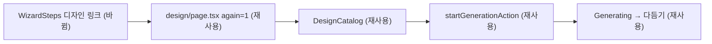

# 다듬기에서 디자인 선택으로 돌아가 다시 생성 — 명세

## 요구사항

- [ ] 완료 단계의 「디자인 선택」 링크가 `/brew/{brewId}/design?again=1`을 가리킨다.
- [ ] 다른 완료 단계 링크(`analyze`, `materials`, `counter`)는 그대로다.
- [ ] 디자인 선택 단계 자체(현재 단계)는 링크가 아니다.

## 설계

`design/page.tsx`는 끝난 생성을 `/edit/{id}`로 보내되 `again=1`이면 카탈로그를 연다. `startGenerationAction`은 제출 뒤 `again` 없는 주소로 이동시킨다. 두 곳이 이미 있으므로 단계 줄 링크만 `again=1`을 붙인다. `WizardSteps`에서 `step.key === "design"`일 때 쿼리를 더한다.

## 버린 대안

- 다듬기 툴바에 별도 「디자인 바꾸기」 버튼을 추가: 단계 줄이 이미 같은 목적지를 가리키므로 같은 이동 경로가 둘이 된다.
- `design/page.tsx`가 `again` 없이도 카탈로그를 열게 변경: 생성 직후 다듬기로 넘기는 현재 흐름이 깨진다.

## 함정

`brewId`가 없는 포트폴리오는 링크가 걸리지 않는다(기존 동작).

## 완료 기준

`pnpm --filter @expresso/web test -- WizardShell` 통과, `pnpm typecheck` 통과.
