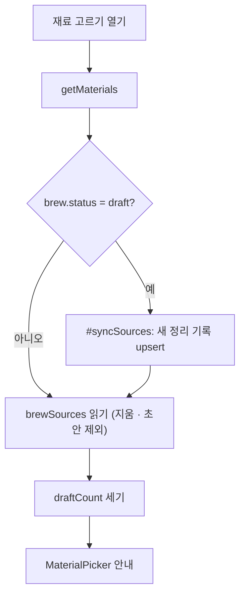

# 재료 고르기 후보 갱신과 초안 안내 — 명세

## 요구사항

1. `MaterialsService.getMaterials`는 `brew.status === "draft"`일 때 후보를 맞춘 뒤 읽는다.
   - 대상: `careerRecords`의 `organized` · `verified`, `deletedAt: null`이고 `brewSources`에 없는 기록.
   - 순위: 생성 때와 같은 요건 라벨(`jobPostingRequirements` 또는 `freeBrief`)로 `rankMaterials` 한 뒤 기존 최대 `rank` 뒤에 붙인다. 전체 50건을 넘기지 않는다.
   - 선택: 선택된 수가 `selectionLimit`(10) 미만이면 `isSelected: true, selectedBy: "auto"`, 아니면 `excludedReason: "AUTO_LIMIT"`.
   - `upsert` + `$setOnInsert`로 넣어 동시 요청에도 중복이 없다(유일 색인 `userId · brewId · recordId`). 하나라도 들어가면 `brews.referenceVersion`을 올린다.
2. 읽기 파이프라인은 `record.deletedAt: null`, `record.status ∈ {organized, verified}`인 줄만 낸다.
3. `BrewMaterialsSchema`에 `draftCount: z.number().int().nonnegative()`를 더한다. 값은 지우지 않은 `draft` 기록 수.
4. `MaterialPicker`는 `draftCount > 0`이면 소개 문단 아래에 안내 한 줄과 `/career` 링크를 둔다.

## 설계

## Open questions

없음.
