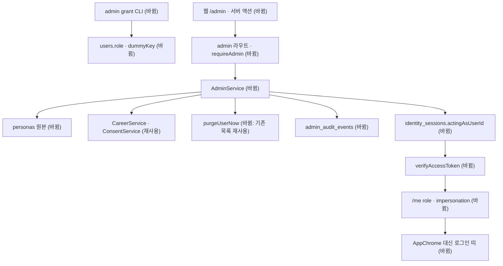

# 관리자 화면과 더미 개발자 계정 5종 — 명세

## 요구사항

- [ ] `users.role`이 `"admin"`인 계정만 `${API_PREFIX}/admin/*`를 부를 수 있다. 다른 계정은 404를 받는다.
- [ ] 관리자 지정 · 해제는 백엔드 CLI(`pnpm --filter @expresso/backend admin grant|revoke <email>`)로만 한다. HTTP 경로는 없다.
- [ ] 더미 계정은 `users.dummyKey`가 있는 계정이다. `passwordHash: null`이라 비밀번호 로그인이 401이다. 비밀번호 재설정 요청은 메일을 보내지 않는다.
- [ ] 만들기는 기본 카테고리 7종 · 프로필 · 동의 두 범위(현재 `CONSENT_POLICY_VERSION`) · `team` 요금제 · `emailVerifiedAt` · `termsVersion`을 갖춘 계정과 원본의 기록 전부를 만든다. 기록 수가 원본 파일과 같다(3 · 10 · 25 · 50 · 100).
- [ ] 다시 채우기는 그 계정의 사용자 데이터를 모두 지우고 같은 `_id`로 다시 만든다. 지우기는 사용자 문서까지 지운다.
- [ ] 대신 로그인은 관리자 본인의 세션 문서에 `actingAsUserId`를 적는다. 새 토큰을 만들지 않고 `ex_session` 쿠키도 바꾸지 않는다.
- [ ] `actingAsUserId`가 있는 세션의 `verifyAccessToken`은 대상 계정을 `principal.user`로 돌려준다. 세션 주인이 관리자가 아니게 되거나 대상이 더미가 아니게 되면 `actingAsUserId`를 지우고 주인으로 돌려준다.
- [ ] 더미가 아닌 계정을 대상으로 한 대신 로그인은 404다.
- [ ] `/me` 응답의 `AuthenticatedUser`에 `role`과 `impersonation: { adminUserId, adminDisplayName } | null`이 있다.
- [ ] 로그아웃과 세션 취소는 대신 로그인 중에도 세션 주인 기준으로 동작한다.
- [ ] 대신 로그인 시작 · 끝, 더미 만들기 · 다시 채우기 · 지우기, 관리자 지정 · 해제마다 `admin_audit_events`에 한 행이 남는다.
- [ ] 웹 `/admin`은 세션 주인이 관리자가 아니면 `notFound()`다. 주인은 `user.impersonation`이 있으면 관리자이고, 없으면 `user.role`로 판단한다. 대신 로그인 중에는 `AppChrome` 맨 위에 띠가 서고 「관리자로 돌아가기」가 `/admin`으로 돌아온다.

## 설계

**재사용하는 것**

- 세션 검증: `IdentityService.verifyAccessToken` · `createAuthenticateRequest` · `requireAuth`(`api/plugins/auth-context.ts`).
- 계정 데이터: `defaultCareerCategories`, `CareerService.createRecord` · `updateRecord`(상태를 `organized`로), `multiSelectValueByNames`, `CareerService.saveProfile`, `ConsentService.grant`.
- 삭제: `account-lifecycle/mongo-purge.ts`의 컬렉션 목록. `purgeUserNow(tx, userId)`를 내보내 같은 목록을 쓴다. 목록을 복사하지 않는다.
- 웹: `requireSession`, `AppChrome`, `Sidebar`, `components/ui`, `tokens.css`의 `--ex-*`.

**새로 만드는 것**

- `packages/database` 0022 `admin_dummy_accounts`
  - `users`: `role` enum `["user","admin"]`, `dummyKey` string. `dummyKey`에 unique partial index.
  - `identity_sessions`: `actingAsUserId` uuid|null, `actingSince` date|null.
  - `admin_audit_events` 컬렉션: `{_id, actorUserId, action, targetUserId|null, dummyKey|null, at}`. 인덱스 `{at:-1}`, `{dummyKey:1, at:-1}`.
- `packages/contracts/src/admin.ts`: 더미 계정 목록 · 관리 기록 응답 스키마. `identity.ts`의 `AuthenticatedUserSchema`에 `role` · `impersonation` 추가.
- `services/backend/src/modules/admin/`
  - `personas/*.ts`: 가상 인물 5명의 원본. 프로필, 기록(카테고리 키 · 제목 · 본문 · 템플릿 키로 쓴 속성 · 상태 · 관계 참조)만 담는다. 속성은 `CAREER_CATEGORY_TEMPLATES`에 있는 키만 쓴다. STAR 같은 서술은 본문에 쓴다.
  - `service.ts` `AdminService`: `listDummies` · `createDummy` · `refillDummy` · `deleteDummy` · `startImpersonation` · `endImpersonation` · `grant` · `revoke`. 원본 값을 V2 속성 값으로 바꾸는 일(선택지 이름 → ID, 관계 참조 → 레코드 ID)도 여기서 한다.
  - `routes.ts`: `requireAdmin` preHandler. 판단 기준은 `principal.owner`(세션 주인)다. 대신 로그인 중에도 관리 화면을 쓸 수 있고, 더미 A에서 B로 바로 옮길 수 있다.
  - `cli.ts`: `grant` · `revoke`. `package.json` 스크립트 `admin`.
- identity: `IdentityPrincipal`에 `owner: { userId, displayName }` 추가. 로그아웃 · 세션 삭제 라우트는 `owner.userId`로 취소한다.
- 웹: `app/(app)/admin/page.tsx` · `admin-actions.ts`(서버 액션), `components/shell/ImpersonationBar.tsx`, `lib/api/endpoints.ts`에 `admin` 묶음. 관리 화면 정의서가 없으므로 기존 설정 화면(`account/page.module.css`)의 표 · 버튼 형식을 따른다.



## 버린 대안

- 대신 로그인 때 더미 계정용 새 세션을 발급하고, 돌아갈 때 관리자 세션을 새로 발급하는 방식. 더미 세션 토큰을 가진 사람이 「돌아가기」를 부르면 관리자 세션을 얻는다.
- 관리자 토큰을 두 번째 쿠키에 보관하는 방식. AGENTS.md는 토큰을 `ex_session` 하나에만 둔다.
- 환경 변수 `ADMIN_EMAILS`로 관리자를 정하는 방식. 지정 · 해제가 관리 기록에 남지 않고, 그 주소로 먼저 가입한 사람이 관리자가 된다.
- 기록을 DB에 직접 넣는 방식. 카테고리 스키마 검증과 선택지 추가를 건너뛴다. dev01의 기록이 템플릿에 없는 속성 키를 갖게 된 원인이다.
- PR #122의 개발 로그인 경로를 넓히는 방식. 그 경로는 운영에서 방문자 누구나 누르는 버튼이고 계정 하나만 다룬다.

## 함정

- `createRecord`는 상태를 항상 `draft`로 만든다. 자료 순위(`materials/ranking.ts`)가 상태를 보므로 `updateRecord`로 원본의 상태를 다시 적는다.
- `multiSelectValueByNames`는 카테고리 `version`을 조건으로 건다. 기록마다 순서대로 부르고 병렬로 부르지 않는다.
- select 속성은 선택지 추가 도우미가 없다. 원본의 select 값은 템플릿 선택지 안에서만 고른다(예: `education_history.employmentType`은 「정규직」).
- 다시 채우기는 같은 `_id`를 다시 쓴다. 지우는 트랜잭션과 만드는 트랜잭션 사이에 그 계정으로 들어온 요청은 401을 받는다.
- `IdentityService`와 `legacy-mysql-service.ts`가 같은 인터페이스를 구현한다. `#user`의 반환 모양이 바뀌면 둘 다 고친다.
- 마이그레이션은 공유 체험 DB에 돌리지 않는다. 복사본 `expresso_dummy_accounts_trial`에서 시험한다. `$out` 복사는 검증 규칙과 인덱스를 옮기지 않으므로 `migration_locks`를 비우고 0001부터 맞는지 본다.
- 설계서 8.2 컬렉션 명세는 `scripts/dump-collection-spec.mjs`로 다시 만든다. 손으로 고치지 않는다.

## 완료 기준

```
pnpm typecheck                # 통과
pnpm test                     # 통과
pnpm test:infra               # admin.integration.test.ts 포함 통과
```

통합 테스트가 확인하는 것: 관리자 아님 → 404, 더미 아닌 대상 → 404, 만들기 후 기록 수 = 원본 수, 대신 로그인 중 `/me`가 더미를 돌려줌, 끝내기 후 주인으로 돌아옴, 대신 로그인 중 로그아웃이 세션을 취소함, 관리자 해제 · 더미 삭제 시 대신 로그인이 풀림, 각 동작마다 관리 기록 한 행.

화면: `dummy.localhost:3205`에서 관리자 로그인 → `/admin` → 다섯 계정 만들기 → 「이 계정으로 보기」 → 띠 확인 → 생성 시작 → 「관리자로 돌아가기」.
