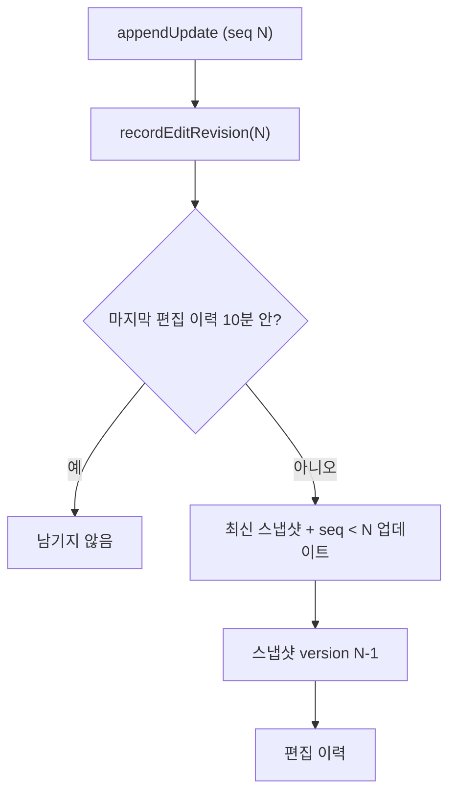

# 편집 이력 복원 지점을 편집 직전 본문으로 — 명세

## 요구사항

1. `recordEditRevision(userId, recordId, editSequence, now)` — 편집을 연 업데이트의 `serverSequence`를 받는다. `appendUpdate`가 `acknowledgement.serverSequence`를 넘긴다.
2. `captureBlockNoteSnapshotBefore(userId, recordId, sequence)` — 최신 스냅샷에 `serverSequence < sequence`인 업데이트만 적용한 본문을 스냅샷으로 남긴다. `version · documentVersion · serverSequence = sequence - 1`.
   - 최신 스냅샷이 이미 `sequence`를 담았으면(`serverSequence >= sequence`) null을 내고 이력을 남기지 않는다.
   - 이 스냅샷이 최신으로 골라져도 `sequence - 1` 뒤 업데이트를 다시 적용하므로 지금 본문과 같다.
3. 이력의 `beforeVersion · afterVersion`은 `sequence - 1`.
4. AI 제안이 쓰는 `captureBlockNoteSnapshot`(지금 상태)은 그대로다.

## 설계

## Open questions

없음.
