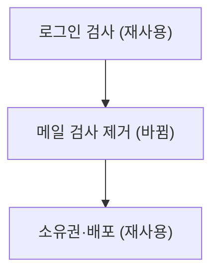

# 포트폴리오 배포 메일 인증 해제 명세
status: accepted

## 요구사항
- POST /v1/portfolios/:id/deployments에서 emailVerifiedAt을 배포 조건으로 검사하지 않는다.
- 기존 authenticateRequest, 요청 검증, publishing service의 소유권 검사를 재사용한다.
- 메일 미인증 상태에서도 최초 배포와 재배포가 성공한다.
- 메일 인증 API와 사용자 emailVerifiedAt 값은 유지한다.

## 설계
publishing/routes.ts의 메일 인증 게이트와 deploy-actions.ts의 전용 오류 안내를 제거한다.
기존 identity 통합 테스트를 새 정책으로 갱신하고 MongoDB 실제 발행 HTTP 검증을 보강한다.
아키텍처 문서의 배포 조건을 갱신한다.

