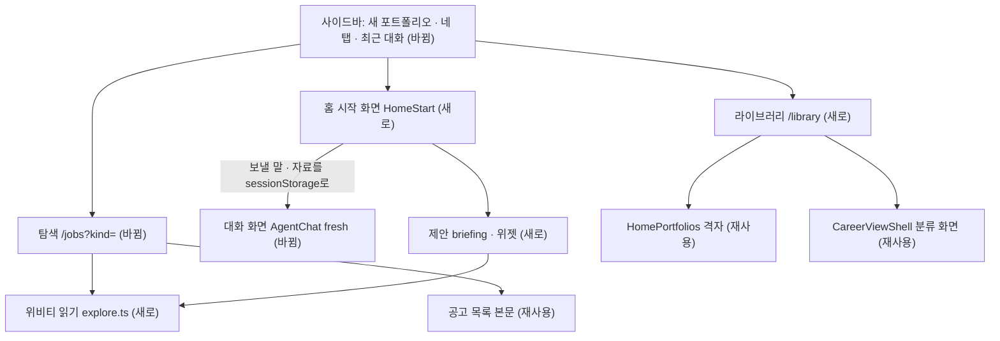

# 네 탭 구조와 홈 화면 — 명세

## 요구사항

- [ ] `SidebarNav` · `ShellTabBar`의 메뉴가 홈 · 라이브러리 · 탐색 · 분석이고, `sectionForPath`가 `/agent`를 홈, `/library` · `/career` · `/edit`를 라이브러리, `/jobs`를 탐색으로 돌려준다.
- [ ] 사이드바 맨 위에 `/brew/new`로 가는 버튼이 있고, 접힌 레일에서는 아이콘만 남는다.
- [ ] 사이드바의 「최근 대화」는 `/api/agent/conversations`의 앞 여덟 건이고 `/home?chat=<id>`로 간다. 대화가 없으면 묶음을 세우지 않는다.
- [ ] `/library`는 `s`가 없으면 포트폴리오, `s`가 분류 키면 그 분류의 `CareerViewShell`, `plans` · `files`면 빈 자리를 보인다.
- [ ] `/jobs`는 `kind`가 없으면 지금의 공고 목록, `intern`이면 제목에 「인턴」이 든 공고, `contest` · `hackathon`이면 위비티 항목, `bootcamp`면 빈 상태를 보인다.
- [ ] `/home`은 `chat` · `compose`가 없으면 시작 화면, 있으면 `AgentChat`을 보인다.
- [ ] 홈의 입력창은 보낼 말과 자료를 `sessionStorage`에 적고 `/home?compose=1`로 간다. 대화 화면이 그것을 꺼내 대화를 만들고 보낸다. 보낼 수 없으면(동의 · 키 없음) 입력창에 남긴다.
- [ ] 텍스트 입력의 `:focus*`에 테두리 · 링을 넣지 않는다(`tokens.test.ts`).

## 설계

재사용하는 것이 먼저다.

- 포트폴리오 격자는 홈에 있던 `HomePortfolios`를 `library/PortfolioGrid`로 옮겨 쓰고 `gridItems`는 그대로 쓴다. 분류 화면은 `CareerViewShell`을 그대로 세운다. 왼쪽 목록의 분류 묶음은 사이드바에 있던 `SidebarCategories`(카테고리 추가 · 보관됨 포함)를 다시 쓴다.
- 탐색의 채용 공고는 `jobs/page.tsx`의 본문을 `ExploreFrame`으로 감싼다. 인턴은 `JobRowList`를 쓴다.
- 홈의 자료 고르는 창은 `agent-chat/ResourceList`를 쓴다. 대화 화면은 `AgentChat`을 `standalone` · `fresh`로 세운다.
- 기록의 「채울 것이 남음」 판정(`isIncompleteRecord`)은 서버에서도 부르도록 `record-completeness.ts`로 옮긴다.

새로 만드는 것.

- `components/shell/SidebarConversations.tsx` — 최근 대화 묶음.
- `app/(app)/library/` — `page.tsx`(목록 + 내용), `LibraryPanes.tsx`, `library-model.ts`, `library.module.css`.
- `app/(app)/jobs/` — `explore.ts`(종류 · 위비티 읽기), `ExploreFrame.tsx`, `ExploreActivities.tsx`, `explore.module.css`.
- `app/(app)/home/` — `HomeStart.tsx`(로고 · 입력창 · 추천 프롬프트), `HomeWidgets.tsx`(제안 · 위젯), `briefing.ts`(규칙 제안), `home-start.module.css`.
- `features/agent-chat/agent-handoff.ts` — 홈에서 대화 화면으로 넘기는 말. `AgentChat`에 `fresh` · `newHref`를 더하고 `useAgentConversation`에 `restore: "url"`을 더한다.

## 버린 대안

- 채팅 화면의 빈 상태에 제안을 넣은 홈 — "채팅 화면을 옮겨 놓은 게 끝"이라는 이유로 반려됐다.
- 로고와 입력창을 가운데 두고 제안 · 위젯을 좌우 열에 둔 홈 — 요청자가 위에서 아래 한 열 순서로 바꿨다.
- 라이브러리 · 탐색의 탭형과 개요형 — 화면을 비교한 뒤 요청자가 목록형을 골랐다.
- 제안을 누를 때 대화를 먼저 만드는 방식 — 보내지 않아도 빈 대화가 목록에 남았다.

## 함정

- 구획마다 등장 모션이 쌓임 맥락을 만든다. 자료 고르는 창이 아래 구획에 가려지므로 `.hero`에 `z-index`를 둔다.
- 자료 칩을 지우면 초점을 가진 단추가 사라져 blur가 오지 않는다. 입력창을 접는 판단은 문서의 `mousedown`으로도 한다.
- 입력창 곡률을 pill 토큰(999px)에서 입력 칸 곡률(8px)로 고르게 전환하면 끝에서 한 번에 바뀐다. `linear()` 완급으로 앞 10%에서 보이는 범위까지 내린다. 클래스 이름 `composer`는 곡률 검사에서 입력 칸(8px)으로 읽히므로 쉬는 상태의 pill은 `tokens.test.ts` 예외에 이유를 적는다.
- `CareerViewShell`은 높이를 `100dvh - 46px`로 박아 두었다. 라이브러리에서는 자리의 높이를 따르게 덮는다.
- 위비티 목록의 상단 고정 줄(SPECIAL)과 마감된 줄(D+)은 뺀다. 응답이 바뀌면 행이 0건이 되므로 빈 상태가 보여야 한다.

## 완료 기준

- `pnpm --filter @expresso/web typecheck`와 `pnpm --filter @expresso/web test`가 통과한다.
- 검증 서버에서 intent의 개발 목표 다섯 항목이 화면으로 확인된다.
