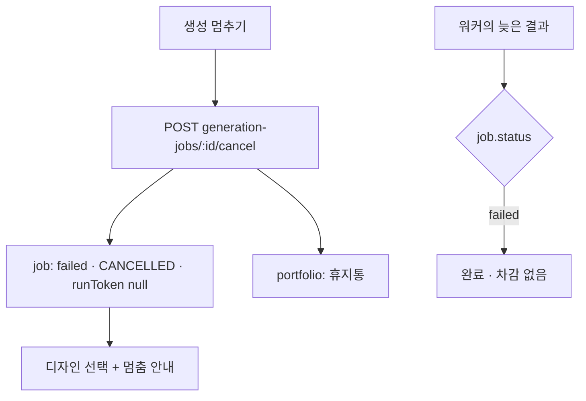

# 포트폴리오 생성 멈추기 — 명세

## 요구사항

1. 계약 `GENERATION_CANCELLED = "CANCELLED"`. 상태 값은 늘리지 않는다 — 멈춘 생성은 `failed` · `errorCode: CANCELLED` · `failureRetryable: false`. 스키마 · 마이그레이션 변경 없음.
2. `POST /v1/generation-jobs/:id/cancel` → `GenerationJobStatus`. 남의 것 404, `done` 409, 이미 `failed`면 그대로.
3. `GenerationService.cancel`: 한 트랜잭션에서 잡을 `failed`로, `runToken: null`. `portfolioId`가 있으면 그 포트폴리오에 `deletedAt` · `purgeAfter`(`PORTFOLIO_TRASH_RETENTION_MS`).
4. 늦은 결과: `completeFreeHtml` · `prepareFreeHtml`은 이미 `failed`를 건너뛴다. `process`는 `CANCELLED`인 잡을 다시 맡지 않는다. `attachRecipe`는 `queued`만 붙인다.
5. 돌던 AI 호출은 워커 프로세스에 있어 끊지 않는다. 끝나면 결과는 버려진다.
6. 웹: `Generating`에 「생성 멈추기」(`cancelGenerationAction`). 409 · 404는 다시 그리기만. 디자인 화면은 `CANCELLED`를 info 안내로 보인다.
7. MySQL 서비스도 같은 `cancel`(타입 `GenerationApi`가 MySQL 클래스에서 나온다).

## 설계

## Open questions

없음.
