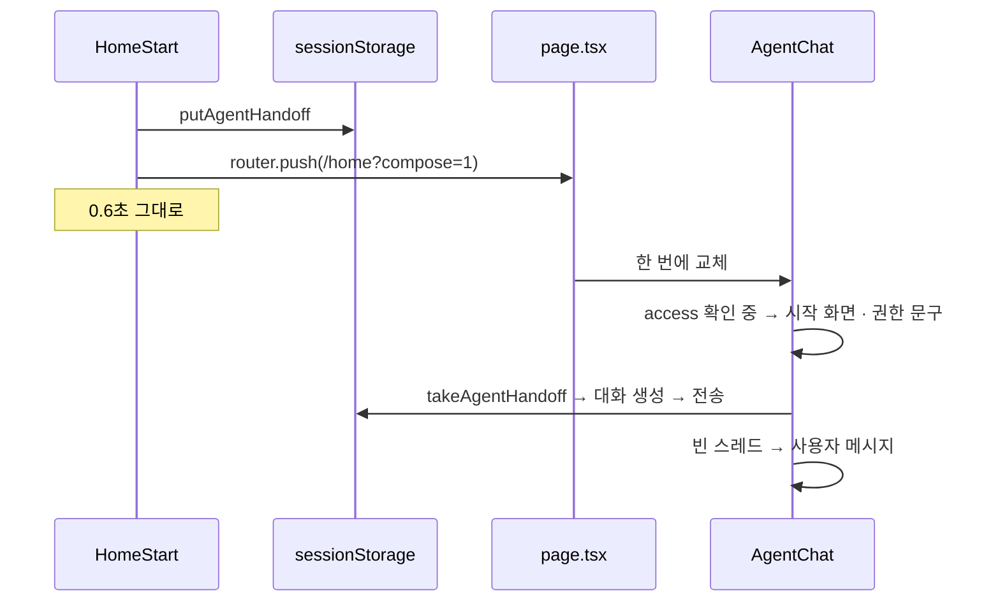
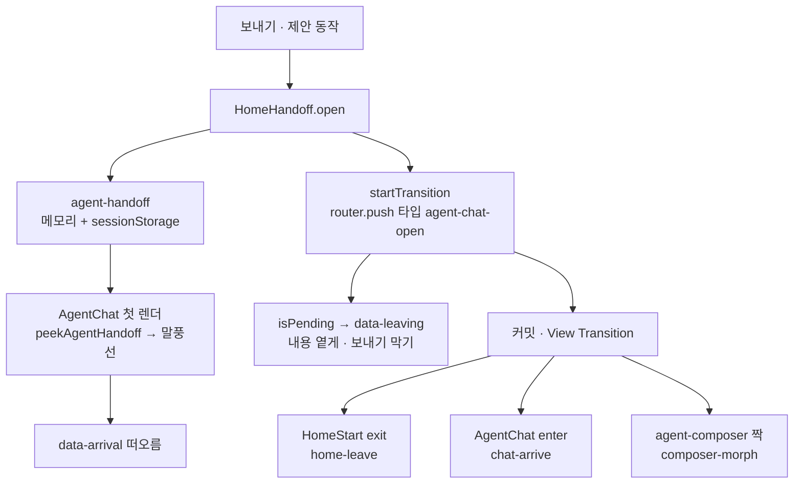

# 홈에서 대화로 넘어가는 전환 — 명세

## 요구사항

1. 홈에서 대화를 시작하는 이동(입력창 보내기 · 제안의 대화 동작)은 전환 타입 `agent-chat-open`을 단다. 다른 이동은 타입이 없다.
2. 타입이 `agent-chat-open`일 때만 홈 내용이 나가고, 대화 화면이 들어오고, 두 입력창이 한 요소로 옮겨 간다.
3. 이동이 진행 중인 동안 홈은 입력창 밖의 내용을 옅게 하고 보내기를 막는다.
4. 대화 화면의 첫 렌더에 넘겨받은 말이 사용자 말풍선으로 있다. 서버의 사용자 메시지가 오면 같은 말풍선(같은 key)으로 이어진다.
5. 넘겨받은 말이 있는 동안 시작 화면 · 기록 스켈레톤 · 권한 확인 문구를 그리지 않는다.
6. 보낼 수 없거나(동의 · 크레딧 · 권한 오류) 대화 생성 · 전송이 실패하면 말풍선을 거두고 입력창에 글을 둔다. 홈이 이미 보낼 수 없다고 알면 말풍선을 처음부터 그리지 않는다.
7. `prefers-reduced-motion: reduce`에서는 전환과 떠오름이 돌지 않는다.

## 지금의 흐름

## 설계

- **`src/components/motion/ViewTransition.tsx`**: React의 `ViewTransition`을 다시 내보낸다. 없으면(vitest의 `react` 19.2.8 안정판) 자식만 그린다. 근거: `next/dist/docs/01-app/02-guides/view-transitions.md` — App Router는 `ViewTransition`이 있는 React canary를 쓴다. 타입은 `@types/react/canary`.
- **`features/agent-chat/agent-handoff.ts`**: `AGENT_CHAT_OPEN = "agent-chat-open"`. `putAgentHandoff`가 메모리에도 둔다. `peekAgentHandoff()`는 메모리의 것을 지우지 않고 돌려준다(서버 렌더와 새로고침에서는 null이라 하이드레이션이 어긋나지 않는다). `AgentHandoff`에 `deliver: boolean`(홈이 보낼 수 있다고 아는가)을 더한다.
- **`app/(app)/home/HomeHandoff.tsx`**: 컨텍스트 `useHomeHandoff()` — `open(handoff)`가 넘겨주기를 쓰고 `startTransition` 안에서 `router.push("/home?compose=1", { transitionTypes: [AGENT_CHAT_OPEN] })`. `pending`을 함께 준다. `HomeStart`가 제공하고 입력창 · 제안 동작 두 곳 · `ProposalFeed`가 쓴다. `HomeStart`는 이미 받는 `/api/agent/access`로 `deliver`를 정한다.
- **`HomeStart`**: `.stage`에 `data-leaving`. 입력창(`.composer`)을 `ViewTransition name="agent-composer"`, `share={{ [AGENT_CHAT_OPEN]: "composer-morph", default: "none" }}`, `default="none"`으로 감싼다. 보내기는 `pending`이면 막는다.
- **`page.tsx`**: `HomeStart`를 `exit={{ [AGENT_CHAT_OPEN]: "home-leave", default: "none" }}`, `AgentChat`을 `enter={{ [AGENT_CHAT_OPEN]: "chat-arrive", default: "none" }}`로 감싼다(둘 다 `default="none"`).
- **`thread.aui.tsx`**: `Thread`에 `composerTransitionName`을 받아 `Composer`의 루트를 같은 `share`로 감싼다. 사용자 메시지 루트에 `metadata.custom.arrival`이면 `data-arrival`.
- **`AgentChat`**: `fresh`이고 `peekAgentHandoff()?.deliver`면 첫 렌더부터 `arrival = { id, text }`. 서버 메시지에 사용자 메시지가 없으면 `arrival` 말풍선을 덧붙이고, 오면 첫 사용자 메시지의 id를 `arrival.id`로 바꿔 변환한다(같은 key). `arrival`이 있는 동안 `isLoading` · 권한 확인 문구를 끈다. 실패 · 보낼 수 없음이면 `arrival`을 거둔다. `fresh`일 때만 `composerTransitionName="agent-composer"`.
- **`styles/global.css`**: `::view-transition-*(.home-leave · .chat-arrive · .composer-morph)` 규칙과 움직임 줄이기. **`AgentChat.module.css`**: `[data-arrival]` 떠오름.

## 움직임

| 요소 | 무엇 | 길이 · 곡선 |
|---|---|---|
| 홈 내용(대기 중) | 옅어짐 · 위로 6px | `--ex-motion-quick` |
| 홈 스냅샷 | 사라짐 | 160ms ease(quick) |
| 입력창 | 자리 · 크기 이동, 두 모습 교차 | 280ms `--ex-motion-panel` 곡선 |
| 대화 화면 | 나타남, 홈이 빠진 뒤 | 220ms glide 곡선, 80ms 뒤 |
| 첫 말풍선 | 아래 16px에서 떠오름 · 나타남 | 280ms panel 곡선, 120ms 뒤 |

`::view-transition-*`의 `animation-duration` · `animation-timing-function`은 토큰 단축값을 나눠 쓸 수 없어 값을 적고, 어느 토큰인지 주석에 둔다.

## 버린 대안

- 대화 화면 전체를 오른쪽에서 밀어 넣음: 같은 주소 안에서 같은 입력창이 이어지는데 「다른 곳으로 감」을 뜻한다.
- 홈 입력창의 글을 말풍선으로 모핑: 입력창 글과 말풍선은 폭 · 정렬이 달라 스냅샷 글자가 늘어난다.
- `startViewTransition`을 직접 부름: React의 커밋과 어긋나고, 문서는 `ViewTransition`과 `transitionTypes`를 쓴다.

## 함정

- 브라우저가 숨겨진 창에서는 전환을 건너뛴다. 검증은 Playwright의 Chromium 녹화로 한다.
- 같은 이름이 한 화면에 둘 있으면 전환이 깨진다. 대화 쪽 이름은 홈의 대화(`fresh`)에만 준다.
- 서버 메시지가 오며 말풍선 key가 바뀌면 다시 마운트되어 떠오름이 다시 돈다.

## 완료 기준

intent의 「개발 목표」 여섯 줄을 녹화 프레임과 시각 기록으로 확인한다.
