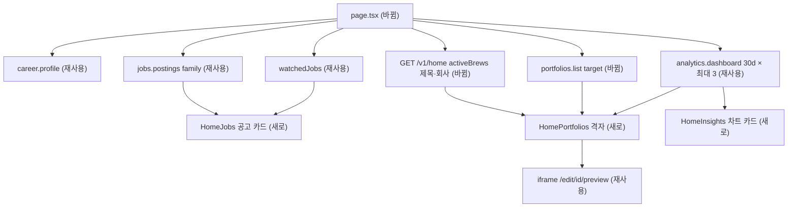

# 홈 화면 목적 기준 재구성 — 명세

## 요구사항

- [ ] 공고 카드 첫 탭은 `CareerProfile.targetRoles[0]`을 공고 직군으로 바꿔 `jobs.postings({ family, sort: "match", limit: 5 })`로 채운다. 대응하는 직군이 없거나 프로필이 없으면 탭 이름이 「전체 공고」가 되고 `sort: "recent"`로 채운다.
- [ ] 공고 카드 둘째 탭 「관심 N」은 `watchedJobs`로 채운다. 관심 공고가 0건이면 탭을 그리지 않는다. 탭 전환은 `?tab=interested` 링크로 하고 클라이언트 상태를 두지 않는다.
- [ ] 공고 행에는 `company.logoUrl`, `title`, 마감(`daysLeft`), `location` · `experienceLabel`을 보인다. 마감일을 모르면(`daysLeft` null) 아무것도 적지 않는다 — 06 공고 목록(`jobs/JobRows.tsx`의 `deadlineLabel`)이 정한 규칙을 그대로 쓴다. 모아 온 공고는 마감이 거의 비어 있어 「상시」라고 적으면 틀린 말이 된다. `match`가 있으면 `total`, `covered/required`, 네 축의 `missing`을 합친 앞쪽 태그를 보인다.
- [ ] `HomeReadModel.activeBrews` 항목에 `title`(string|null)과 `company`(`{ name, logoUrl }`|null)를 더한다. 제목은 `brews.freeTitle`, 공고 제목 순서로 고른다.
- [ ] `PortfolioSummary`에 `target`(`{ company: { name, logoUrl }, postingTitle }`|null)을 더한다. 경로는 포트폴리오 → 제작 → 공고 분석 → 공고 → 회사다. 공고 없이 만든 포트폴리오는 null이다.
- [ ] 포트폴리오 격자는 진행 중 제작과 최근 포트폴리오를 `updatedAt` 내림차순으로 섞어 5칸을 채우고, 마지막 칸에 「새 포트폴리오」를 둔다. 제작 카드는 `resumeStep(status)`의 경로로 가고, 단계 이름을 배지로 보인다.
- [ ] 포트폴리오 썸네일은 `/edit/{id}/preview`를 `loading="lazy"` iframe으로 1/4 축소해 보인다. 서버가 `page.latest`로 지면이 있는지 먼저 확인하고, 없으면 틀을 세우지 않고 빗금을 보인다(오류 문서가 축소되어 보이지 않게).
- [ ] 배포한 사이트(`status: "published"`, 최근 배포 순 최대 3개)마다 `analytics.dashboard(id, "30d")`를 부른다. 그 결과로 카드별 방문 · 연락처 수와 차트 카드 세 개를 만든다. 배포한 사이트가 0개면 차트 카드와 오른쪽 열을 그리지 않는다.
- [ ] 차트 카드는 8초마다 넘어간다. 포인터나 초점이 카드 안에 있으면 멈춘다. `prefers-reduced-motion: reduce`에서는 넘기지 않는다.
- [ ] 기록 0건이면 검색창을 그리지 않고 첫 기록 카드를 그린다. 「내 커리어」 칸, 「저장한 검색」 단추, 「추천 N」 단추, `/home`으로 가는 「전체 보기」, 검색창의 「⌘K」를 지운다.
- [ ] 날짜는 모두 `timeZone: "Asia/Seoul"`로 쓴다. 375px에서 `main` 안의 가로 넘침이 0이다.

## 설계

**재사용**
- 공고: `jobs.postings`(`family` · `sort` · `limit`), `watchedJobs`, `CompanyAvatar`, `analyzePostingAction`
- 제작 재개: `resumeStep`, `WIZARD_STEPS`
- 썸네일: `/edit/[portfolioId]/preview` 라우트. 세션으로 문서를 받고, CSP `sandbox`로 격리한다.
- 분석: `analytics.dashboard`의 `trend` · `sections` · `referrers` · `metrics` · `deployment.publishedAt`
- 사용자 목표: `career.profile`
- 스타일: `home/page.module.css`에 이미 옮겨 둔 정의서 부품(`segment` · `jobDeadline` · `jobCtaQuiet` · `draft*`)
- 차트 색: `--ex-chart-1~3`. dataviz 검증기로 밝은 · 어두운 지면을 모두 통과했다.

**새로 만드는 것**
- `packages/contracts`
  - `engagement.ts`: `activeBrews`에 `title` · `company` 필드를 추가한다.
  - `portfolios.ts`: `PortfolioSummary.target`을 추가한다.
  - `companyLogoUrl(companyId, checksum)`: 지금 세 군데에 같은 식이 따로 적혀 있다. 이 식을 함수 하나로 모은다.
- 백엔드
  - `engagement/service.ts`: `home` 집계의 brews 파이프라인에 `$lookup`(job_analyses → job_postings → companies)을 더한다.
  - `portfolios/service.ts`: `#summary`에 대상 공고를 읽는 단계를 더한다.
  - 두 모듈의 legacy MySQL 서비스는 새 필드를 null로 채운다.
- 웹 `app/(app)/home`
  - `page.tsx`: 데이터 읽기와 구획 배치를 맡는다.
  - `HomeJobs.tsx`: 공고 카드
  - `HomePortfolios.tsx`: 제작 카드와 포트폴리오 카드
  - `HomeInsights.tsx`: 클라이언트 컴포넌트. 차트 카드이고 시안의 `HomeCharts.tsx`를 옮긴다.
  - `home-model.ts`: 목표 직군 → 공고 직군 대응표, 예시 질문, 격자 병합, 섹션 이탈 지점 계산을 둔다. 순수 함수만 둔다.

## 버린 대안

- **지면 HTML을 `srcDoc`로 홈 응답에 넣기(시안 방식)**: 카드 하나가 약 60KB라서 5장이면 약 300KB가 홈 응답에 실린다. 지연 로드 iframe은 화면 밖 카드를 불러오지 않는다.
- **홈 전용 분석 집계 API 새로 만들기**: 사이트를 최대 3개로 자르면 기존 `dashboard` 3번으로 충분하다. 사이트가 3개를 넘는 사용자가 늘면 그때 다시 본다.
- **「요건 충족」 · 「최소 경력」 · 「채용 회사」 차트**: 요건 충족은 AI 요건 추출이 있어야 그릴 수 있다. 나머지 둘은 결정으로 이어지지 않는다.

## 함정

- **사이트 수 상한 3**: 검증한 차트 색이 3개(`--ex-chart-1~3`)라서 3으로 정했다. 4번째 색을 새로 만들지 않는다.
- **목표 직군과 공고 직군의 이름 차이**: 목표 직군(`TargetRole`)과 공고 직군(`jobFamily`)의 이름이 다르다. `DevOps`는 「인프라 · 플랫폼」으로 바꾼다. `기획 · PM` · `디자인`은 대응하는 공고 직군이 없다.
- **썸네일 iframe**: 미리보기 문서는 `script-src 'none'`으로 열린다. 등장 애니메이션이 스크립트에 기대면 내용이 숨은 채 그려질 수 있다. 그러면 `PagePreview reveal={false}` + `srcDoc`로 되돌린다(plan의 위험 단계).
- **미리보기 경로의 쿠키 확인**: 미리보기 경로는 `readAccessToken`으로 쿠키를 읽는다. iframe에 `sandbox` 속성을 붙이면 요청이 불투명 오리진에서 나가고 쿠키가 빠질 수 있다. 그래서 속성은 붙이지 않고 응답의 CSP에 맡긴다.
- **dashboard 실패**: 지면이 바뀌어 섹션을 못 찾는 경우 등으로 실패할 수 있다. 사이트 하나가 실패하면 그 사이트만 빼고 그린다.
- **다른 작업과 겹치는 곳**: `fix/record-threshold`가 같은 `page.tsx`의 첫 화면 문구를 고친다. 먼저 머지되는 쪽에 맞춰 충돌을 푼다.

## 완료 기준

- `pnpm typecheck` · `pnpm test` · `pnpm test:infra`가 통과한다.
- 체험 DB 복사본(`expresso_home_audit`)에서 dev01과 빈 계정으로 홈을 1440px · 375px로 열었을 때 다음을 만족한다.
  - 콘솔 오류 0건
  - `main` 안의 가로 넘침 0건
  - 개발 목표의 다섯 장면이 보인다.
