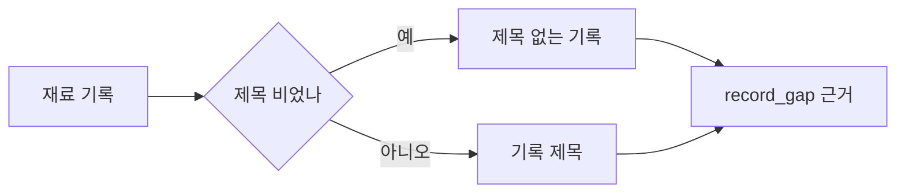

# 제목이 빈 기록의 AI 질문 근거 — 명세

## 요구사항

1. `interview/service.ts` 질문 선택지: `record_gap`의 `evidence`와 `label`은 `record.title.trim() || "제목 없는 기록"`.
2. 계약은 바꾸지 않는다(`evidence` 1–300자). 기록 제목은 이미 300자 이하다.

## 설계

## Open questions

없음.
