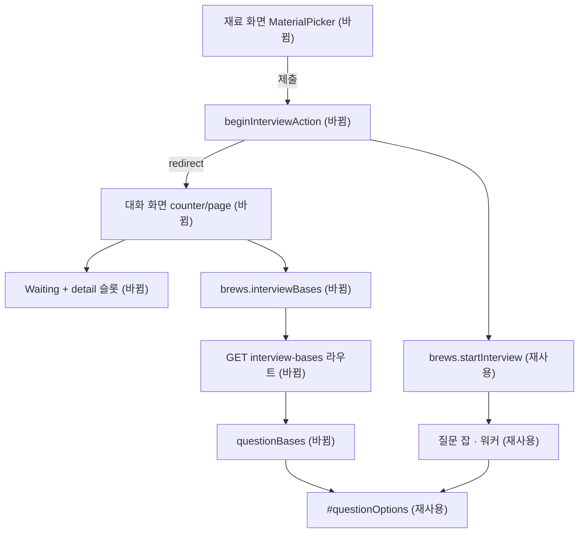

# 재료 고르기 → AI 대화 대기 단축 — 명세

## 요구사항

- [ ] 대화 세션이 없고 질문 잡이 돌고 있지 않은 제작물에서 재료 화면의 시작 버튼은 폼이다. 제출하면 `brews.startInterview`를 부르고 `/brew/{id}/counter`로 이동한다.
- [ ] 세션이 있거나 질문 잡이 `queued`·`running`이면 시작 버튼은 지금처럼 링크다. 잡을 새로 만들지 않는다.
- [ ] 멱등 키는 `brewJobKey("interview", brewId, basisJobId)`를 쓴다. `basisJobId`는 대화 화면이 보내는 값과 같다(`brew.latestJob?.jobId`).
- [ ] 체크 저장(`selectMaterialsAction`)이나 모드 저장이 진행 중이면 시작 버튼이 `disabled`다. 제출 중에도 `disabled`다.
- [ ] `GET /api/v1/brews/:id/interview-bases`가 질문 생성이 쓰는 것과 같은 근거 목록을 AI 없이 돌려준다. 다른 사용자의 제작물이면 404다.
- [ ] 대화 화면이 대기 카드를 그릴 때 근거 목록을 함께 그린다. 근거 조회가 실패해도 대기 카드는 그대로 뜬다.
- [ ] 대기 안내는 "보통 15초 안에 끝납니다. 이 화면을 닫아도 계속됩니다."다.

## 설계

**1 — 시작 버튼.** `materials/page.tsx`가 이미 읽는 `brew`에서 `beginsInterview = !brew.interviewSessionId && !(latestJob.type === "interview" && queued|running)`와 `basisJobId`를 계산해 `MaterialPicker`에 넘긴다. `brew-actions.ts`에 `beginInterviewAction`을 더한다. 기존 `startInterviewAction` 본문(키 계산 → `brews.startInterview` → `reload`)에 `redirect`를 붙인 형태이고, `continueToDesignAction`과 같은 방식이다. `MaterialPicker`는 `useActionState`의 세 번째 값(진행 중 여부)을 두 저장 액션에서 받아 버튼을 잠근다. 제출 중 잠금은 버튼을 작은 클라이언트 컴포넌트로 빼서 `useFormStatus`로 건다.

**2 — 근거 목록.** 근거 계산은 `MongoInterviewService.#questionOptions`가 이미 한다(재사용). 그 결과를 `{ basis, label }[]`로 바꿔 돌려주는 `questionBases(userId, brewId)`를 더한다. `label`은 요건이면 요건 이름, 기록이면 기록 제목이다. 계약은 `packages/contracts/src/interview.ts`에 `InterviewQuestionBasesResponseSchema`로 둔다. 라우트는 `modules/interview/routes.ts`, 웹 호출은 `lib/api/endpoints.ts`의 `brews.interviewBases`다. `InterviewApi`는 옛 MySQL 클래스의 키로 정해져 있어 새 메서드를 교차 타입으로 더한다.

대화 화면(`counter/page.tsx`)은 대기 상태일 때 근거를 읽어 `QuestionBases`(화면 컴포넌트, 도메인 → 표시 문구 변환)로 그리고 `Waiting`의 새 `detail` 슬롯에 넣는다. 표시 문구는 이미 근거 패널이 쓰는 것을 쓴다("공고 요건 · 아직 못 채움", "공고 요건 · 일부만 채움", "기록 · 수치가 빠짐").

## 버린 대안

- 재료 화면이 열릴 때 미리 생성: 한 번 만든 세션을 바꿀 수 없어(`start`가 있는 세션을 그대로 돌려준다) 선택을 바꾼 사용자가 틀린 질문을 받는다.
- 대화 화면 도착 시 자동 제출: 페이지 왕복 한 번이 더 들고, 서버 컴포넌트가 렌더 중에 잡을 만드는 부수 효과가 생긴다.
- 웹에서 근거를 직접 계산: "수치가 빠진 기록" 판정(`hasMetric`)이 백엔드에 있어 두 곳에서 갈린다.

## 함정

- 세션이 있는 제작물에서 잡을 새로 내면 `latestJob`이 `queued`가 되어 대화 화면이 잠깐 대기 카드로 돌아간다. 그래서 세션이 있으면 링크로 둔다.
- `useRefreshWhile`가 1.5초마다 화면을 다시 그리므로 근거도 그때마다 다시 읽는다. DB 조회만이라 받아들인다.
- 근거가 3개 미만이면 잡은 `BREW_INPUT_REJECTED`로 끝난다. 목록은 그때도 보여 무엇이 모자란지 드러낸다.

## 완료 기준

- `pnpm --filter @expresso/backend test`, `pnpm --filter @expresso/web test` 통과.
- `pnpm test:infra`에서 `interview-bases` 통합 테스트 통과.
- 브라우저에서 재료 → 「AI와 대화 시작」 한 번으로 대기 카드(근거 목록 포함)가 뜨고 질문이 나온다.
