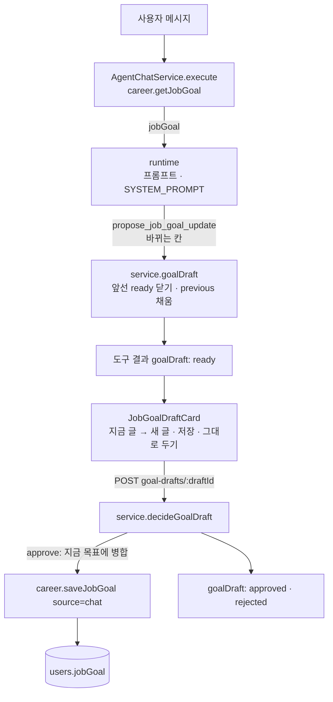

# 대화에서 구직 목표 읽기 · 고치기 — 명세

## 요구사항

1. 에이전트 실행은 매번 사용자의 구직 목표(`work` · `place` · `timing` 또는 null)를 읽어 프롬프트의 `jobGoal`로 넘긴다.
2. 도구 `propose_job_goal_update`는 바뀌는 칸만 받는다(`work?` · `place?` · `timing?`, 각 1~300자). 하나도 없으면 거절한다.
3. 도구는 저장하지 않는다. 초안(`goalDraft`)을 도구 결과에 남기고, 초안에는 바뀌는 칸의 새 글과 그때 적혀 있던 글(`previous`)이 들어간다.
4. 새 초안을 만들 때 같은 대화의 `ready` 목표 초안은 `replaced`로 닫고, 그 초안의 칸을 새 초안이 이어받는다(같은 칸은 새 입력이 이긴다). 거절 · 승인된 초안은 이어받지 않는다.
5. `POST /v1/agent/conversations/:id/goal-drafts/:draftId`가 승인 · 거절을 받는다. 승인하면 그 시점의 목표에 바뀌는 칸만 덮어 `source: "chat"`으로 저장한다.
6. 결정은 기록 초안과 같은 규칙을 따른다 — 남의 대화 404, 실행 중 409, 같은 결정 반복은 그대로 응답, 다른 결정은 409.
7. 모델에 넘기는 대화에는 초안의 새 글과 `status`를 싣는다.

## 설계

- **계약**(`packages/contracts/src/agent-chat.ts`): `AgentGoalDraftInputSchema`(세 칸 모두 선택), `AgentGoalDraftSchema`(`draftId`, `work` · `place` · `timing`은 바뀌지 않으면 null, `previous`는 세 글 또는 null, `status`: `ready` · `approved` · `rejected` · `replaced`), `AgentGoalDraftDecisionSchema`(`approve` · `reject`), `AgentToolResultSchema.goalDraft`.
- **실행부**(`platform/agent/runtime.ts`): `AgentInput.jobGoal` · `AgentInput.goalDraft`, 도구 등록과 이름 · 표시 문구, `conversationForModel`의 `goalDraft`, `SYSTEM_PROMPT`의 목표 문단.
- **서비스**(`modules/agent-chat/service.ts`): 생성자의 `career`에 `getJobGoal` · `saveJobGoal`. `execute`가 목표를 읽어 넘기고, `goalDraft` 처리기는 DB의 앞선 메시지와 지금 쓰는 답변 양쪽에서 `ready` 초안을 닫는다. `decideGoalDraft`는 `decideRecordDraft`와 같은 `arrayFilters` 갱신을 쓴다.
- **프롬프트 규칙**: 목표를 기준으로 조언한다. null이면 아는 것처럼 말하지 않는다. 사용자가 분명히 말하면 되묻지 않고 도구를 부른다(카드가 확인). 달라 보이기만 하면 한 번 묻는다. 말하지 않은 칸과 내용을 넣지 않는다. `approved` 전에는 고쳤다고 말하지 않는다. `rejected`는 되풀이하지 않는다.
- **웹**: 프록시(`app/api/agent/[...path]/route.ts`)의 `DRAFT_DECISIONS`에 `goal-drafts`, `useAgentConversation.decideGoalDraft`, `features/agent-chat/JobGoalDraftCard.tsx`(스타일은 `RecordDraftCard.module.css`의 카드 · 머리 · 버튼 · 끝난 상태를 쓰고 바뀌는 칸 줄만 더함), `AgentChat.tsx`의 도구 결과 분기.

## 버린 대안

- 출처 인용 검사(기록 초안의 `sources`): 에이전트가 문구를 정리해 묻고 사용자가 "네"라고만 답하는 흐름에서는 인용할 사용자 문장이 없다. 내용은 카드의 지금 글 → 새 글 비교로 사용자가 확인한다.
- 세 칸을 모두 받는 도구: 말하지 않은 칸을 모델이 다시 써서 바꾼다.
- 초안 시점에 병합해 저장할 글을 굳힘: 카드를 세운 뒤 `/goal`에서 고친 칸을 승인이 되돌린다.
- 승인 없이 바로 저장: 사용자가 확인을 받도록 정했다.

## 함정

- `inputSchema`에는 `.shape`를 넘기므로 `.refine`이 실리지 않는다. 「하나 이상」은 서비스가 `AgentToolRejection`으로 돌려준다.
- 실행 중의 답변은 `flush`가 메시지를 통째로 덮어쓴다. 같은 실행에서 초안을 두 번 만들면 DB만 고쳐서는 앞선 초안이 `ready`로 되살아난다.
- 계약이 `strictObject`다. `goalDraft`를 계약에 먼저 넣지 않으면 대화 응답 파싱이 멈춘다.
- 도구가 SDK의 init 목록에 실리지 않으면 실행부가 답을 실패로 끝낸다(누락 검사). 테스트가 아니라 실제 대화로 확인한다.

## 완료 기준

- `pnpm typecheck` · `pnpm test` · `pnpm test:infra`가 통과한다.
- 검증 서버의 실제 대화에서 목표 읽기, 변경 카드와 저장, 그대로 두기, 암시일 때의 질문을 확인한다.
