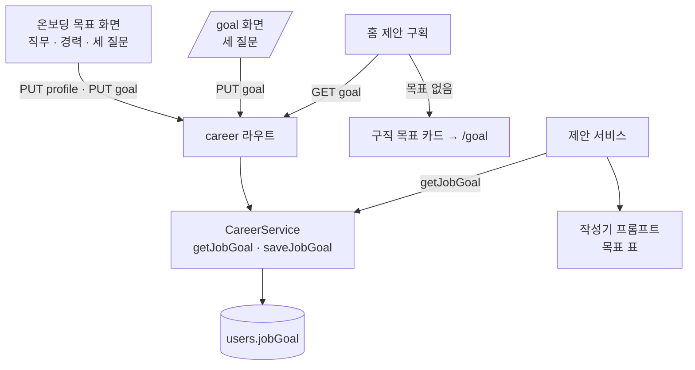

# 최종 구직 목표 기억 — 명세

## 요구사항

1. 구직 목표는 `work` · `place` · `timing` 세 글(각 300자 이하)과 `source`(`onboarding` · `app` · `chat`) · `updatedAt`이다. 세 글이 모두 비면 저장하지 않는다.
2. `GET /v1/career/goal`은 목표나 null을 준다. `PUT /v1/career/goal`은 통째로 덮어쓴다.
3. `CareerProfile`에서 `primaryGoal`을 없앤다. 그 값이 남은 옛 문서가 있어도 프로필 읽기가 실패하지 않는다.
4. 온보딩 목표 화면은 프로필(직무 · 경력)과 목표(세 답)를 함께 저장한다. 세 답을 모두 비우면 목표는 건드리지 않고 넘어간다.
5. 홈은 목표가 없을 때만 「구직 목표」 카드를 세운다. 제안을 켰는지와 상관없다.
6. 제안 작성기는 목표를 표의 다른 글과 같은 자료로 받는다. 목표가 없으면 「없음」을 받고 목표를 아는 것처럼 말하지 않는다.
7. 제안 켜기 대화상자의 「읽는 것」에 구직 목표를 적는다.

## 설계

- **계약**(`packages/contracts/src/career.ts`): `JobGoalSchema` · `SaveJobGoalSchema` · `JobGoalResponseSchema`를 더한다. `CareerProfileSchema` · `SaveCareerProfileSchema`에서 `primaryGoal`과 `CareerGoalSchema`를 지운다.
- **저장**: `users.jobGoal`에 둔다. users의 검증 규칙은 최상위에 모르는 칸을 막지 않고, 계정을 지울 때 따로 지울 것이 없다. 마이그레이션 `0033`이 users 검증 규칙에서 `profile.primaryGoal`의 필수와 정의를 빼고 `jobGoal`의 모양을 더한 뒤, 저장된 `profile.primaryGoal`을 지운다.
- **서비스**(`career/service.ts`): `getProfile`은 저장된 문서에서 계약의 칸만 골라 읽는다. `getJobGoal` · `saveJobGoal`을 더하고 `CareerApi`로 내보낸다.
- **제안**(`proposals`): 서비스가 후보와 함께 목표를 읽어 작성기에 넘긴다. 프롬프트에 「사용자의 구직 목표」 표를 더하고 판을 올린다.
- **화면**: 세 질문은 `features/job-goal/JobGoalFields.tsx` 하나로 그리고 온보딩과 `/goal`이 함께 쓴다. 글 입력은 기존 `components/ui/textarea`를 쓴다. 홈 카드는 `ProposalFeed`의 `FeedCard`를 쓴다.
- **페르소나**(`admin/personas`): 프로필에서 `primaryGoal`을 뺀다.

## 버린 대안

- 새 컬렉션에 저장: 계정 삭제 때 지울 곳과 컬렉션 수를 세는 테스트가 따라온다. 사용자당 값 하나라 users 문서로 충분하다.
- `primaryGoal`을 선택 칸으로 남김: 읽는 곳이 없는 값이 계약에 남는다.
- 질문을 하나씩 나오는 대화로 연출: 홈 시안에서 연출을 여러 번 반려했다. 온보딩의 기존 칸 모양을 따른다.
- 목표를 저장하면 제안을 바로 다시 만듦: 후보는 지난 실행 뒤 새로 들어온 것 위주라 다시 만들어도 대부분 권할 것이 없다. 다음 실행에 맡긴다.

## 함정

- `CareerProfileSchema`가 `strictObject`라 옛 칸이 남은 문서를 통째로 펼쳐 넣으면 파싱이 실패하고 홈의 공고 위젯이 멈춘다.
- users 검증 규칙이 `profile.primaryGoal`을 필수로 둔다. 규칙을 먼저 풀지 않으면 새 코드의 프로필 저장이 거절된다.
- 목표의 글은 사용자가 쓴 글이다. 프롬프트에서 지시로 읽히지 않도록 표의 칸으로 넣고 줄바꿈을 지운다.

## 완료 기준

- `pnpm typecheck` · `pnpm test` · `pnpm test:infra` 통과.
- 검증 서버에서: 온보딩 저장과 다시 보기, 목표 없는 계정의 홈 카드, `/goal` 저장 뒤 카드가 사라짐, 새로 만든 제안의 메시지.
