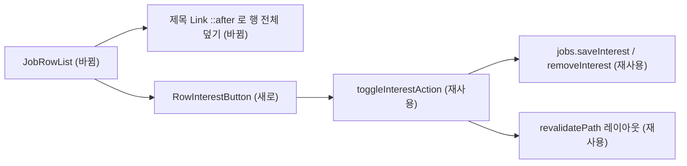

# 공고 목록 북마크로 관심 공고 담기 — 명세

## 요구사항

- [ ] 목록 행의 북마크는 `<button type="submit">`이고, 누르면 `toggleInterestAction`을 부른다(`next`는 담긴 상태면 `remove`, 아니면 `save`).
- [ ] 누르는 즉시 `aria-pressed`와 아이콘 무게(fill/regular)가 바뀐다(낙관적 갱신). 서버가 답하는 동안은 `disabled`다.
- [ ] 실패하면 원래 모양으로 돌아가고 아이콘이 `--ex-status-danger-text`로 바뀌며 `aria-label` · `title`이 실패 문구가 된다.
- [ ] 북마크를 눌러도 상세로 이동하지 않는다. 북마크 밖의 행 어디를 눌러도 상세로 이동한다.
- [ ] 북마크 버튼은 `<a>` 안에 들어가지 않는다(상호작용 요소 중첩 금지).
- [ ] 담긴 상태는 `job.interest !== null`로 정한다(계약상 `JobInterestSchema.nullable()`).
- [ ] 행의 배치 · 간격은 수정 전과 같다.

## 설계

- **재사용**: 서버 액션 `toggleInterestAction`(`[jobId]/interest-actions.ts`)을 그대로 쓴다. 성공 시 `revalidatePath("/", "layout")`가 목록 · 헤더 개수 · 사이드바 · 레일을 함께 새로 그린다. 상세의 `InterestButton`과 같은 `useOptimistic` + `useActionState` 패턴이다.
- **새로 만든다**: `RowInterestButton.tsx`(클라이언트 컴포넌트). `InterestButton`은 상세 머리의 크기 · 문구 · 오류 문구 배치가 달라 그대로 못 쓴다.
- **행 구조**: `JobRows.tsx`의 행을 `<Link>`에서 `
`로 바꾼다. 상세 링크는 제목 영역으로 옮기고 `::after`를 `inset: 0`으로 펼쳐 행 전체를 덮는다. 북마크 폼은 `position: relative; z-index: 1`로 그 위에 올린다.
- **누를 자리**: 아이콘은 15px 그대로, 버튼은 28px에 `margin: -6px`를 줘 행의 간격을 유지한다.
- **키보드**: 링크 자체의 포커스 윤곽은 끄고 `.row:has(.rowLink:focus-visible)`에 윤곽을 둔다.

## 버린 대안

- `<Link>` 안에 `<button>`을 두고 `preventDefault`: `<a>` 안의 `<button>`은 잘못된 HTML이고 키보드 · 스크린 리더 동작이 불안정하다.
- 목록용으로 `InterestButton`을 확장: 크기 · 문구 · 실패 표시 방식이 달라 속성이 늘어난다.

## 함정

- 행에 `overflow`가 걸린 `.rows` 안에서 `::after`가 행을 덮으려면 `.row`가 `position: relative`여야 한다.
- 같은 공고가 목록에 두 번 나오면 두 행의 북마크가 같은 서버 상태를 따른다(검증 중 실제로 확인).
- 개발 서버에서 상세 화면 첫 컴파일이 수 초 걸려 행 클릭 직후 이동이 늦게 보일 수 있다.

## 완료 기준

- `pnpm --filter @expresso/web typecheck` 통과
- `RowInterestButton.test.tsx` 3건(담기 · 해제 · 실패) 통과, 웹 테스트 전체 통과
- 브라우저에서 담기 · 새로고침 유지 · 빼기 · 행 클릭 이동이 확인된다.
