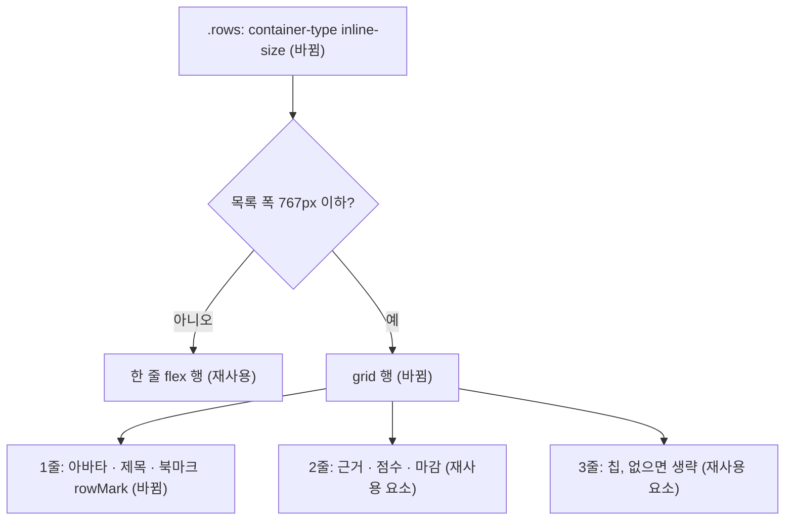

# 좁은 공고 목록 두 줄 행 배치 — 명세

## 요구사항

- [ ] `.rows` 폭이 767px 이하이면 `.row`가 grid로 바뀐다. 첫 줄은 아바타 · 제목(`.rowTitle`) · 북마크다. 둘째 줄은 근거(`.rowReason`) · 점수(`.rowScore`) · 마감(`.rowDeadline`)이다. 기술 칩(`.rowStack`)이 있으면 셋째 줄에 둔다.
- [ ] 칩이 없는 행(`.rowStack:empty`)에는 셋째 줄 여백이 생기지 않는다.
- [ ] 375 · 768 · 1024 · 1280px에서 `.rows`의 `scrollWidth === clientWidth`이다.
- [ ] 375px과 1024px에서 `.rowTitle` 폭이 목록 폭에서 아바타 · 북마크 · 간격 · 여백을 뺀 값이다.
- [ ] 1440px은 지금의 한 줄 배치와 같다.

## 설계

재사용: 행의 자식 요소와 클래스(`avatar` · `rowTitle` · `rowStack` · `rowReason` · `rowScore` · `rowDeadline`)를 그대로 쓴다. 마크업 순서는 바꾸지 않고 grid 배치만 바꾼다. 간격은 이 파일에 이미 있는 14px(행 gap)과 8px(`.rowScore` gap)을 쓴다.

- `.rows`에 `container-type: inline-size`를 둔다. 저장소의 앞선 사례로 `DesignCatalog.module.css`의 `@container (max-width: 480px)`와 공고 상세의 `@container document-header`가 있다.
- `@container (max-width: 767px)`: 한 줄 행은 고정 칸(여백 40, 아바타 30, 제목 236, 점수 96, 마감 42, 북마크 15, 간격 6개 × 14)만 543px이다. 칩과 근거까지 담으려면 800px 가까이 필요하다(1440px 화면의 목록 804px). `tokens.test.ts`가 중단점 표(480 · 768 · 1024 · 1280과 그 바로 아래 값) 밖의 폭을 막으므로, 543 위의 첫 경계인 `--ex-bp-md` 아래 값 767을 쓴다. 그래서 1280px 화면(목록 644px)도 두 줄 배치가 되고, 그 폭에서 칩과 근거가 잘리던 문제도 함께 사라진다. 컨테이너 쿼리 조건에는 CSS 변수를 쓸 수 없어 숫자로 적는다.
- grid: `grid-template-columns: 30px minmax(0, 1fr) auto auto`. 아바타는 1열의 모든 줄을 차지하고 위쪽에 붙는다. 제목은 2–3열, 북마크는 4열이다. 근거는 2열, 점수는 3열, 마감은 4열이다. 칩은 2–4열이다.
- 북마크 `Icon`에 `className={styles.rowMark}`를 주고 인라인 `flexShrink`를 그 클래스로 옮긴다. grid에서 위치를 정하려면 클래스가 있어야 한다.
- `@media (max-width: 767px)`의 `.rowTitle { width: auto; flex: 1 }`는 지운다. 그 역할을 컨테이너 쿼리가 맡는다. 같은 블록의 `.headNote` · `.headAction` 규칙은 목록 머리 것이라 그대로 둔다.

## 버린 대안

- 화면 폭 미디어 쿼리: 오른쪽 패널 때문에 1024px 화면의 목록이 768px 화면보다 좁아, 화면 폭으로는 배치를 고를 수 없다.
- 좁은 목록에서 칩 · 근거 숨기기: 제목은 살지만, 두 줄 배치로 보여 줄 수 있는 근거 문장까지 버린다.
- 오른쪽 패널 기준을 1280px로 올리기: 1024px의 목록은 넓어지지만 휴대폰 문제는 그대로이고, 화면 전체 배치를 바꾸는 별도 결정이다.

## 함정

- `container-type: inline-size`는 `.rows`의 인라인 크기를 내용과 떼어 놓는다. `.rows`의 폭은 부모(`.results`, 열 grid)가 정하므로 영향이 없다. `.row` 자체에 두면 자식 쿼리가 자기 자신을 볼 수 없다.
- grid에서는 `flex` 속성이 무시된다. 말줄임은 `min-width: 0`과 `minmax(0, 1fr)`이 맡는다.
- jsdom은 레이아웃을 계산하지 않는다. 검증은 브라우저에서 한다.

## 완료 기준

- `pnpm --filter @expresso/web test`, `pnpm --filter @expresso/web typecheck` 통과
- 내장 브라우저 375 · 768 · 1024 · 1280 · 1440px에서 `.rows`의 `scrollWidth`와 `clientWidth`, `.rowTitle` 폭, 배치(줄 수)를 잰다.
