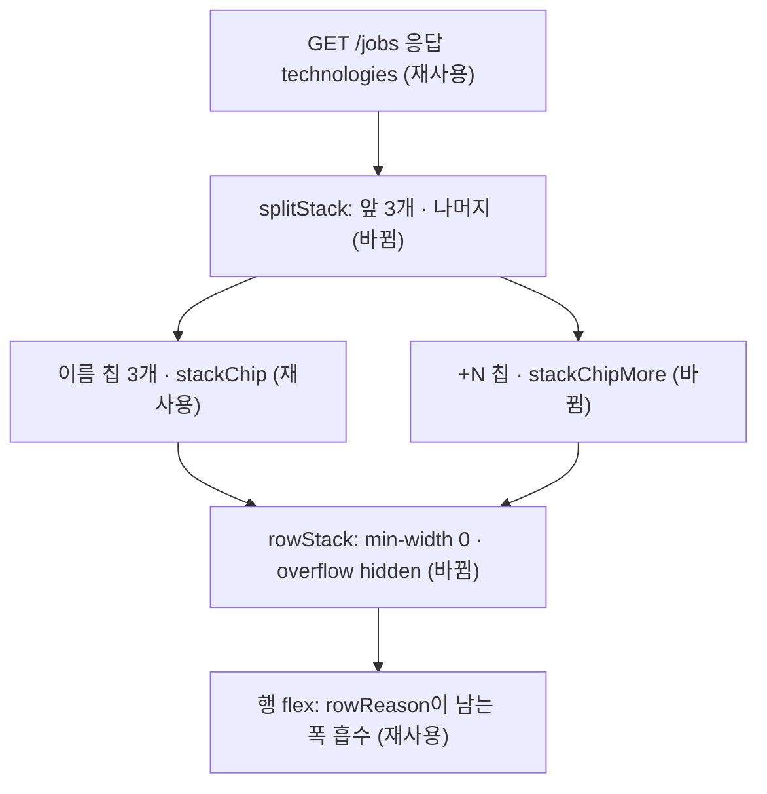

# 공고 목록 기술 칩 넘침 수정 — 명세

## 요구사항

- [ ] `JobRowList`의 각 행은 `job.technologies` 앞에서 최대 3개의 칩만 그린다. 순서는 API가 준 순서(공고 원문 순서) 그대로다.
- [ ] 기술이 4개 이상이면 세 칩 뒤에 「+N」 칩 하나를 그린다. N은 숨긴 개수다. `title`과 `aria-label`에 숨긴 기술 이름을 담는다.
- [ ] 기술이 3개 이하면 「+N」 칩을 그리지 않는다.
- [ ] 1440px 화면의 `/jobs`에서 `.rows`의 `scrollWidth`가 `clientWidth`와 같다.
- [ ] 칩 열이 남은 폭보다 넓으면 이름 칩이 말줄임표로 줄고 「+N」 칩은 줄지 않는다.

## 설계

재사용: `.stackChip` 모양(글자 크기·색·모서리·여백)을 「+N」 칩에도 그대로 쓴다. 새 색이나 크기 값은 만들지 않는다.

`JobRows.tsx`
- `STACK_LIMIT = 3`을 둔다. 근거는 화면 정의서 00b의 공고 행으로, 모든 예시 행이 칩 3개다.
- 순수 함수 `splitStack(technologies)`가 `{ shown, hidden }`을 돌려준다. 행은 `shown`을 칩으로, `hidden`이 있으면 「+N」 칩을 그린다.

`page.module.css`
- `.rowStack`: `flex-shrink: 0`을 지우고 `min-width: 0; overflow: hidden`을 둔다. 다른 행 요소(제목·점수·마감)는 `flex-shrink: 0`이고 근거 칸(`.rowReason`)은 `flex: 1; min-width: 0`이다. 그래서 남는 폭이 있는 동안에는 칩 열이 줄지 않고, 모자랄 때만 칩 열이 준다.
- `.stackChip`: `min-width: 0; overflow: hidden; text-overflow: ellipsis`를 더한다.
- `.stackChipMore`(새 클래스): `flex-shrink: 0`. 숨긴 개수는 잘리지 않는다.

## 버린 대안

- `.rows`에 `overflow-x: hidden`만 두기: 가로 스크롤은 사라지지만 칩 21개 행의 점수·마감·북마크가 잘린 채 보이지 않고 열도 어긋난다.
- 칩 열에 고정 너비와 그라데이션 가림: 토큰에 없는 너비 값을 새로 만들어야 하고, 몇 개가 가려졌는지 알 수 없다.
- 칩을 여러 줄로 감싸기: 행 높이가 공고마다 달라져 목록의 한 줄 리듬이 깨진다.

## 함정

- 홈(`HomeJobs.tsx`)은 `JobRows.tsx`에서 `deadlineLabel`만 가져온다. `JobRowList`를 쓰는 곳은 `/jobs`(`page.tsx`)뿐이라 홈 화면은 바뀌지 않는다.
- 767px 이하에서는 `.rowTitle`이 `flex: 1`(기준 0)이라 칩 열이 줄 때 제목 칸도 0에 가깝다. 이번 변경 전에도 칩 없는 행의 제목 칸이 19px다. 좁은 화면 배치는 범위 밖이다.
- 일치도를 계산하지 않은 공고는 `matched`가 `null`이다. 「+N」 칩은 경고색을 쓰지 않으므로 영향 없다.

## 완료 기준

- `pnpm --filter @expresso/web test`에서 `splitStack` 테스트가 통과한다.
- `pnpm typecheck`가 통과한다.
- 내장 브라우저 1440×900에서 `/jobs?country=한국` 첫 쪽의 `.rows` `scrollWidth === clientWidth`이고, 칩 21개 행에 칩 3개와 「+18」이 보인다.
