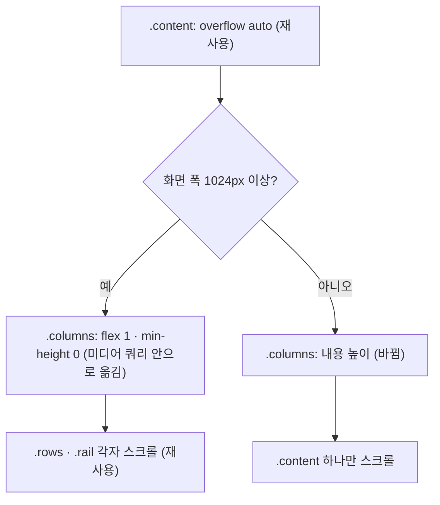

# 좁은 화면 공고 탐색 페이지 스크롤 — 명세

## 요구사항

- [ ] 1023px 이하에서 `.columns`는 높이를 내용에 맞춘다. `.results`는 공고 행을 모두 펼친 높이가 되고 `.rows`는 스크롤 상자가 아니다(`scrollHeight === clientHeight`).
- [ ] 1023px 이하에서 `.content`가 유일한 세로 스크롤 상자다(`scrollHeight > clientHeight`).
- [ ] 1024px 이상에서 `.columns`는 지금처럼 `.content`의 남은 높이를 채우고, `.rows`와 `.rail`이 각자 스크롤된다.
- [ ] `loading.tsx` 뼈대는 같은 클래스를 쓰므로 따로 고치지 않는다.

## 설계

재사용: `.content`는 이미 `overflow: auto`인 세로 flex 상자다. `.rows`의 `overflow: auto`와 `.rail`의 `overflow: auto`는 높이가 묶이지 않으면 스크롤하지 않으므로 그대로 둔다.

- 지금 `.columns`에는 화면 폭과 상관없이 `flex: 1; min-height: 0`이 있다. 그래서 `.columns`가 `.content`의 남은 높이에 묶인다. 한 열 grid에서는 `.results`(`overflow: hidden`)와 `.rail`(`overflow: auto`)의 최소 높이가 0이라 두 줄이 그 높이를 나눠 갖는다.
- `flex: 1; min-height: 0`을 `@media (min-width: 1024px)` 안으로 옮긴다. 조건 없는 규칙은 `display: grid`, 한 열, `gap: 16px`만 남긴다. 좁은 화면에서 `.columns`는 기본값 `flex: 0 1 auto`라 내용 높이가 되고, grid 항목의 자동 최소 높이 덕분에 줄어들지 않는다.

## 버린 대안

- 좁은 화면에서 `.results`에 최소 높이(예: `60vh`) 주기: 안쪽 스크롤 상자가 남아 페이지 스크롤과 겹치고, 숫자에 근거가 없다.
- 좁은 화면에서 오른쪽 패널 숨기기: 패널의 「공통으로 찾는 것」 · 관심 공고를 휴대폰에서 볼 길이 사라진다.

## 함정

- `.content`의 다른 자식(검색 상자, 분류 탭)은 `flex-shrink` 기본값이지만 `overflow`가 보이는 상태라 자동 최소 높이 아래로 줄지 않는다.
- jsdom은 레이아웃을 계산하지 않는다. 검증은 브라우저에서 한다.

## 완료 기준

- `pnpm --filter @expresso/web test`, `pnpm --filter @expresso/web typecheck` 통과
- 내장 브라우저 375 · 768 · 1024 · 1440px에서 `.content` · `.rows` · `.rail`의 `scrollHeight`/`clientHeight`와 `.results` 높이를 잰다.
