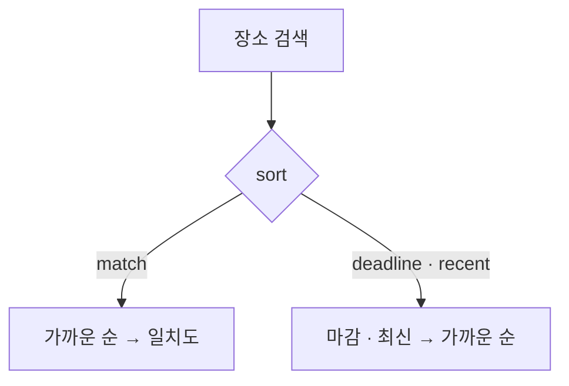

# QA 지적 세 건 — 명세

## 요구사항

1. `PropertyValueEditor` 일반 입력: `placeholder`는 `type === "title"`이면 「제목 없음」, 아니면 「비어 있음」. `.input::placeholder`는 `--ex-fg-subtle`. 포커스 테두리는 더하지 않는다(`tokens.test.ts`).
2. `similarSearches(recent, query, limit = 3)`: 지금 검색어 · `resultCount === 0` · 자모(U+3131–U+318E)가 든 검색을 뺀다. `RecentSearches`의 「비슷한 검색」이 쓴다.
3. `board-service.ts` `boardOrder`: 장소가 있고 `sort === "match"`면 `nearbyRank → nearbyDistanceKm → sortKey`, 그 밖이면 `sortKey → nearbyRank → nearbyDistanceKm`. 장소 반경 필터는 그대로.

## 설계

## Open questions

- QA 문구 「마감최신순을 눌렀을 경우 거리순 정렬이 제대로 안되는」을 「고른 정렬이 거리 순에 묻힌다」로 읽었다. 거리 순 자체가 틀렸다는 뜻이면 다른 원인을 찾아야 한다.
