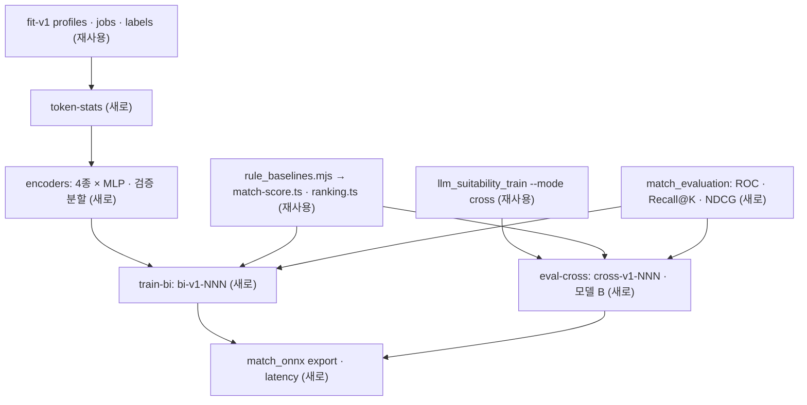

# 적합도 모델 인코더 비교 · 평가 · 지연 측정 실험 — 명세

## 요구사항

- [ ] 인코더 4종(`e5` · `kure` · `bge-m3` · `qwen3`)을 같은 `fit-v1` 데이터와 파일럿 MLP 하이퍼파라미터로 학습하고, **검증 분할만** 비교한다(설계서 4.4 · 9.2 「평가 분할에서 한 번만」).
- [ ] 인코더마다 pooling과 prompt는 저장소 설정 파일을 따른다. 최대 길이는 `min(모델 한도, fit-v1 텍스트의 그 토크나이저 최대 토큰 수)`이고, 잘린 텍스트 비율을 기록한다.
- [ ] 인코더 비교 행마다 임베딩 시간 · 처리량(텍스트/초) · GPU 최대 메모리 · 벡터 저장 용량을 남긴다(9.2 평가 조건).
- [ ] 정한 인코더로 학습한 모델은 `bi-v1-NNN/`에, Cross-Encoder 평가는 `cross-v1-NNN/`에 `metrics.json` · `metadata.json`을 쓴다(설계서 4.4 산출물 · 버전 형식).
- [ ] `metrics.json`에는 평가 분할의 기존 지표, 60점 양성 ROC 좌표와 AUC, 정답 차 5점 이상 공고쌍 순서 일치율, 규칙 baseline · Char TF-IDF 대비 부트스트랩 95% 구간이 들어간다.
- [ ] 스크리닝 Recall@K는 평가 프로필마다 평가 분할 공고 전체(파일럿 228건)를 채점해 K = 1…N 곡선으로 남긴다. 적합 공고는 라벨 60점 이상 쌍이다.
- [ ] 모델 B는 평가 분할 (공고, 프로필) 쌍마다 기록을 채점하고 NDCG@10을 낸다. 기록 정답은 교사가 그 기록을 연결한 요건 충족 점수의 최댓값, 연결이 없으면 0이다(9.2 시험내용). 정답이 모두 0인 쌍은 빼고 그 수를 기록한다.
- [ ] 규칙 baseline은 서비스 코드 `calculateExplainableMatch()` · `rankMaterials()`를 그대로 호출한다. Python으로 다시 짜지 않는다.
- [ ] ONNX 내보내기와 CPU 지연 측정은 4가지 요청(프로필 1건 임베딩 · 공고 N건 MLP 채점 · Cross-Encoder K쌍 · 기록 R건 채점)의 p50 · p95 · 처리량을 출력한다.
- [ ] 새 테스트는 다운로드 없이 맥에서 돌고 `pnpm ml:data:test`에 들어간다.

## 설계

재사용: `llm_suitability_train.py`의 `load_training_dataset` · `render_profile` · `render_record` · `render_job` · `build_selected_profile_text` · `pair_features` · `train_mlp` · `predict_mlp` · `ranking_metrics` · `run_lexical_baselines` · `_calibrate_model_scores`, Cross-Encoder 학습(`--mode cross`)은 그대로 쓴다. `ranking_evaluation.paired_bootstrap`, `llm_suitability_rubric.COVERAGE_POINTS`, `match_pilot_model._git_commit`도 쓴다.

새 파일(`scripts/ml-data/`):

- `match_encoders.py` — `ENCODERS` 표(모델 ID · 프로필 prompt · 공고 prompt · 모델 한도 · 출처)와 `SentenceEncoder`(sentence-transformers 래퍼). 길이순 배치, CUDA OOM이면 배치를 절반으로 줄여 다시 시도, 시간 · 메모리 기록.
  - E5: `query: ` / `passage: `(모델 카드, 파일럿과 같음). KURE · bge-m3: prompt 없음(`config_sentence_transformers.json`의 `prompts: {}`). Qwen3: 프로필에만 `Instruct: …\nQuery:`, 공고는 빈 prompt(같은 파일의 `query` · `document`). 지시문은 모델 카드 권고대로 과제에 맞춰 영어로 쓴다.
- `match_evaluation.py` — torch 없는 순수 함수. `roc_curve` · `pairwise_accuracy(min_gap)` · `screening_recall_curve` · `record_relevance` · `record_ndcg` · `rule_requirements(job)`(JTH 기술 필드를 `;`로 나눠 `technologies`, 필요 연차를 `roles`의 「N years」로) · `next_version` · `build_metadata`.
- `rule_baselines.mjs` — Node 24 타입 제거로 `services/backend/src/modules/jobs/match-score.ts` · `materials/ranking.ts`를 직접 import해 JSONL 요청을 채점한다. 요건을 못 읽은 공고(`null`)는 순위의 맨 뒤에 두고 건수를 기록한다.
- `match_experiments.py` — 하위 명령 `token-stats` · `encoders` · `train-bi` · `eval-cross`(모델 A 지표 + 모델 B).
- `match_onnx.py` — `export`(인코더 · MLP · Cross-Encoder를 ONNX로, 선택적으로 INT8 동적 양자화) · `latency`(입력 길이를 인자로 받아 무작위 토큰으로 측정. 지연은 내용이 아니라 길이로 정해진다).



## 버린 대안

- **인코더별 pooling을 직접 구현** — 저장소 설정(`1_Pooling/config.json`)을 그대로 읽는 sentence-transformers보다 틀릴 자리가 많다.
- **규칙 함수를 Python으로 이식** — 서비스와 갈라지면 baseline이 서비스 성능을 대표하지 못한다.
- **`llm_suitability_train.py`에 인코더 분기 추가** — 1,356줄 파일의 E5 전제(캐시 키 · 체크포인트 이름)가 곳곳에 있다. 함수만 가져다 쓴다.
- **모델 B를 새로 학습** — 설계서는 Cross-Encoder 재사용을 결정했고, 이 시험이 그 결정을 검증하는 자리다.

## 함정

- `scripts/ml-data/profile.py`가 표준 `profile`을 가린다. torch를 가져오기 전에 `_load_stdlib_profile()`을 부른다.
- 임베딩 캐시 키에 인코더 ID · prompt · 최대 길이를 넣는다. 빠지면 다른 인코더가 E5 벡터를 읽는다.
- 적합 공고가 있는 평가 프로필은 13명뿐이다(라벨 60점 이상 4.1%). ROC · Recall@K는 이 수와 함께 보고한다.
- Recall@K 풀의 공고 대부분은 그 프로필에 라벨이 없다. 라벨 없는 공고는 부적합으로 센다. 그래서 Recall@K는 낮은 쪽으로 치우친 값이다.
- JTH 공고 필드는 영어이고 프로필은 한국어다. 규칙 baseline이 매우 낮게 나와도 서비스 규칙의 실제 한계다.
- Qwen3는 `transformers>=4.51.0`이 필요하다(모델 카드). 고정 버전 4.55.4는 충족한다.

## 완료 기준

```
pnpm ml:data:test          # 새 테스트 포함 통과. match_onnx_test가 작은 XLM-R로 latency p50 · p95를 낸다
```

가짜 데이터로 `match_experiments.py train-bi --encoder fake`가 `bi-v1-001/metrics.json`에 `roc`(`auc` · `points`) · `screeningRecall` · 규칙 baseline(`rule-calculateExplainableMatch`) 모델 행을 쓴다.
