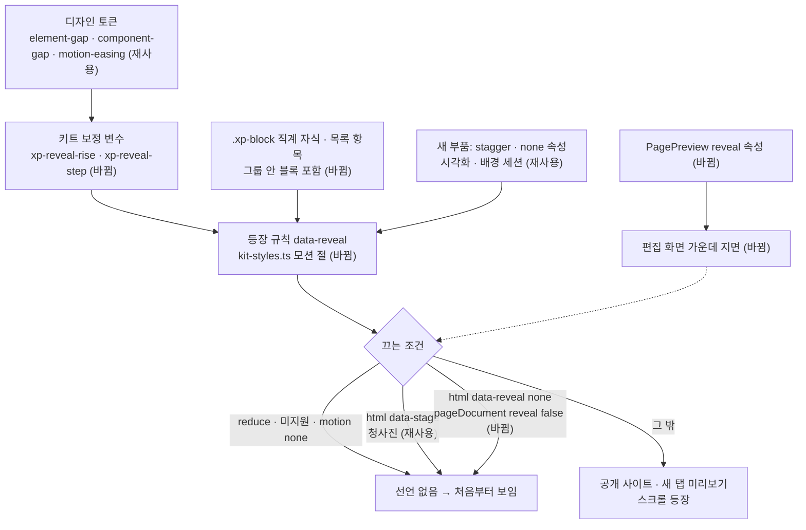

# 포트폴리오 스크롤 등장 애니메이션 공통 규칙 — 명세

## 요구사항

- [ ] 등장 단위는 `.xp-block`의 직계 자식이다. `.xp-block`이 `.xp-inner` 직계든 `.xp-group` 안이든 같다.
- [ ] 직계 자식이 `ul` · `ol` · `[data-reveal="stagger"]`이면 그 자식 대신 그 안의 항목이 등장 단위다.
- [ ] 같은 부모 안 2 · 3 · 4번째 이후 단위는 등장 구간 시작이 `--component-gap`의 1 · 2 · 3배씩 늦다.
- [ ] 단위마다 자기 `view()` 타임라인을 쓴다. 구간은 `cover 0` → `cover 25vh`(+ 차례 오프셋)이다. 단위는 화면 아래 4분의 1을 지나는 동안 나타난다.
- [ ] 문서 끝에서 더 내릴 수 없어 선을 넘지 못한 단위는 문서 스크롤 타임라인(`scroll(root)`)의 마지막 25vh 동안 `xp-settle`(끝 상태만 있는 키프레임)로 마저 불투명해진다. 끝까지 내리면 화면 안 단위는 모두 `opacity 1`이다.
- [ ] 떠오르는 거리는 `--element-gap`, 곡선은 `--motion-easing`이다. 키트 보정 변수 `--xp-reveal-rise` · `--xp-reveal-step`으로 둔다.
- [ ] 등장 규칙은 `@media (prefers-reduced-motion:no-preference)` 안의 `@supports (animation-timeline:view())` 안에서만 선언한다. 둘 중 하나라도 맞지 않으면 등장 선언이 없다. 그래서 시작 상태도 없다.
- [ ] `[data-reveal="none"]` 요소와 그 자손은 등장하지 않는다. `<html data-reveal="none">`은 문서 전체를 끈다.
- [ ] `:root[data-stage]`(청사진)에서는 스크롤 등장과 첫 화면 등장이 모두 꺼진다.
- [ ] `.xp-page[data-motion="none"]`이면 꺼진다. `subtle` · `showcase`는 같은 규칙이다.
- [ ] 기존 `.xp-page[data-motion="showcase"] .xp-inner>.xp-block` 블록 단위 규칙은 지운다.
- [ ] `pageDocument({ reveal: false })`는 `<html lang="ko" data-reveal="none">`을 낸다. 인자가 없으면 지금과 같은 문서다.
- [ ] 편집 화면 가운데 지면(`Editor.tsx`의 `PagePreview`)은 `reveal={false}`로 그린다. 새 탭 미리보기와 공개 사이트는 등장을 켠 채 둔다.
- [ ] 측정기(`reducedMotion: "reduce"`)의 결과는 바뀌지 않는다. `hiddenCases`는 0이다.

## 설계

공통 규칙의 이름은 **등장 규칙(`data-reveal`)**이다. `kit-styles.ts`의 모션 절이 단일 출처다.

```css
.xp-page{--xp-reveal-rise:var(--element-gap);--xp-reveal-step:var(--component-gap)}
@keyframes xp-rise{from{opacity:0;transform:translateY(var(--xp-reveal-rise))}to{opacity:1;transform:none}}
@media (prefers-reduced-motion:no-preference){
  /* 첫 화면: 지금 규칙에 끄는 조건만 더한다 */
  @supports (animation-timeline:view()){
    :root:not([data-stage],[data-reveal="none"]) .xp-page:not([data-motion="none"]) .xp-block>:not(ul,ol,[data-reveal]),
    … .xp-block>:is(ul,ol,[data-reveal="stagger"])>:not([data-reveal="none"]){
      animation:xp-rise var(--motion-easing) both;animation-timeline:view();
      animation-range:cover 0 cover 25vh}
    … :nth-child(2){animation-range:cover var(--xp-reveal-step) cover calc(25vh + var(--xp-reveal-step))}
    … :nth-child(3) ×2, :nth-child(n+4) ×3
  }
}
```

- 재사용: 모션 토큰(`cssVariables`의 `--motion-easing`), 간격 토큰(`--element-gap` · `--component-gap`), 첫 화면의 `xp-rise` 키프레임과 지연, 청사진의 `data-stage` 속성.
- 바뀜: `kit-styles.ts` 모션 절, `kit.tsx`의 `xp-evidence-list`에 `data-reveal="stagger"`. 이 목록은 `div`라 자동 판정에 걸리지 않는다.
- 바뀜: `pageDocument`의 `reveal` 인자, `PagePreview`의 `reveal` 속성, `Editor.tsx`의 한 줄.
- 25vh의 근거: 단위가 화면 아래 4분의 1을 지나는 동안 등장을 끝내면 위쪽 4분의 3(읽는 자리)에서는 늘 불투명하다. 높이가 화면보다 큰 단위도 같은 거리에서 끝난다. `entry` 백분율은 단위 높이에 따라 거리가 달라져 쓰지 않는다.



## 버린 대안

- 문서 끝 처리로 `.xp-inner` 아래 여백을 25vh 늘리기: 지면 끝에 빈 화면이 생긴다. 구간 끝을 `entry 100%`로 바꾸기: 짧은 단위가 몇 px 스크롤에 한꺼번에 나타난다.

- 블록 전체를 한 단위로 두기(지금 방식): 긴 사례에서 아래 그림이 화면 밖일 때 등장이 끝난다.
- `animation-delay`로 차례 만들기: Chrome 151 프로브에서 스크롤 타임라인 아래 `200ms` 지연이 값만 남고 진행에 영향이 없었다. 구간 시작을 미는 방식만 동작한다.
- `reduce`에서 `animation:none!important`로 덮기: 덮는 규칙이 빠지는 환경에서 시작 상태(투명)가 남을 수 있다. 선언 자체를 조건 안에 둔다.
- 디자인 시스템 계약에 등장 종류 토큰 추가: 계약 · 디자인 38종 · 설계 문서 컴파일러가 함께 바뀐다. 이번 변경에 넣지 않기로 했다(intent 열린 질문의 답).
- IntersectionObserver 스크립트: 공개 지면은 `script-src 'none'` 샌드박스다.

## 함정

- 저장된 지면은 생성 시점 CSS를 들고 있다(`generated_pages.css`). 검증은 새 생성이나 편집으로 다시 그린 판으로 한다.
- 넓은 여백 배치의 `.xp-head`는 `position:sticky`다. `transform:none`으로 끝나므로 등장 뒤 고정 동작은 같아야 한다. 화면에서 확인한다.
- `.xp-block` 자식이 `display:contents`이면 애니메이션이 적용되지 않는다. 지금 키트에는 없다.
- `vh`는 iframe 안에서 iframe 높이 기준이다. 공개 사이트 iframe은 `min-height:100dvh`라 문서 안에서 스크롤된다.
- 측정기는 `reducedMotion: "reduce"`로 연다(`page-measurer.ts:80`). 등장 선언이 없으므로 측정값이 그대로다.
- `verify-token-kit.mjs`가 움직임 줄이기에서 `introMotion === "none"`과 `hiddenCases === 0`을 단언한다.

## 완료 기준

- `pnpm typecheck`와 `pnpm test`가 통과한다. `kit.test.ts`가 등장 선언이 두 조건 블록 안에만 있음을 단언한다.
- 헤드리스 Chrome · WebKit에서 공개 지면을 390 · 926 · 1440 폭으로 스크롤하며 단위별 불투명도를 잰다. 위쪽이 화면 아래 25vh + `--xp-reveal-step` 3배보다 위로 올라온 단위는 모두 `opacity 1`이다. 그룹 안 블록과 수치 띠 항목에 `xp-rise`가 걸린다.
- 같은 지면을 `reducedMotion: "reduce"`와 `@supports`를 막은 문서로 열면 모든 단위가 스크롤 없이 `opacity 1`이다.
