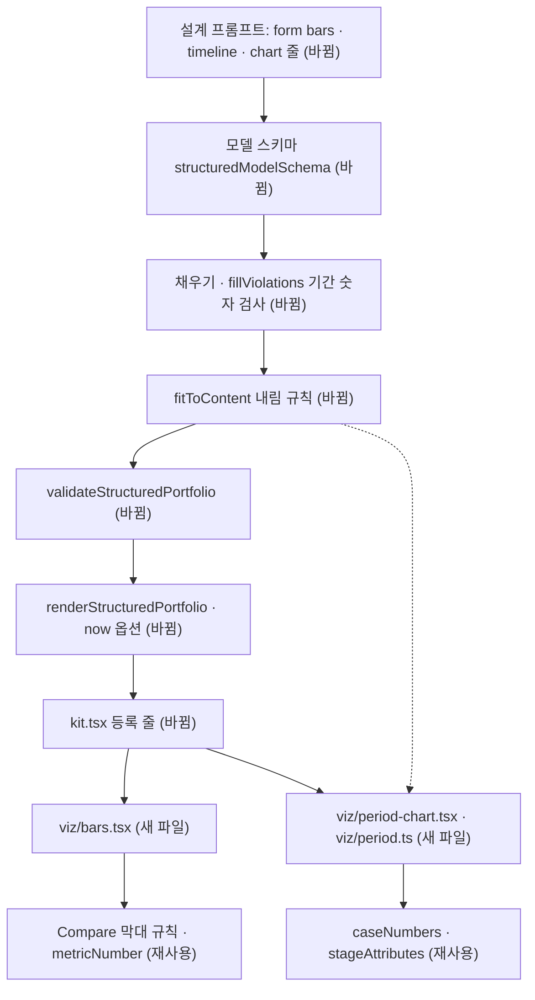

# 포트폴리오 차트 부품 세 종 추가 — 명세

## 요구사항

- [ ] 사례 유형 `CaseBars`(설계 form `bars`)가 계약 · 카탈로그 · 키트 · 수집 원본 렌더러에 있습니다. 섹션 `metrics`가 같은 단위로 시작하는 수치 2개 이상(`comparableMetrics`, 계약에 둠)일 때만 모델 스키마 · 편집 화면에 열리고, `validateStructuredPortfolio`가 그 밖이면 거절합니다. 설계 · 다듬기 · 편집이 같은 기준을 씁니다.
- [ ] `CaseBars`는 수치마다 이름 · 막대 · 값 글자 한 줄입니다. 막대 길이는 가장 큰 값을 100%로 둔 비율입니다. 값이 모두 `%`이면 0–100% 눈금을 채웁니다. 단위가 다르거나 숫자를 읽지 못하면 막대 없이 이름과 값만 그립니다(`data-bars="neutral"`).
- [ ] `ProjectIndex`의 `variant`에 `timeline`이 있습니다. 섹션 `period`를 두 개 이상 읽으면 작업 기간 차트로 그리고, 아니면 `rows`로 그립니다.
- [ ] `CareerTimeline`에 선택 속성 `variant: "list" | "chart"`가 있습니다. 기간을 두 개 이상 읽으면 경력 기간 차트로 그리고, 아니면 지금 목록으로 그립니다. 속성이 없는 옛 저장본은 목록입니다.
- [ ] 기간 차트는 기록의 기간 글자만 보입니다. 시간축 양 끝 글자는 가장 이른 시작과 가장 늦은 끝의 원문 조각입니다. 렌더러가 만든 숫자(연도 눈금 · 개월 수 · 증감률)는 지면에 없습니다.
- [ ] "현재" · "재직 중" · "진행 중"으로 끝나는 기간은 렌더 시각까지 막대를 그리고 끝을 열린 모양(`data-open`)으로 둡니다. 렌더 시각은 `RenderStructuredOptions.now`이고 기본값은 호출 시각입니다.
- [ ] 차트 글자는 모두 HTML입니다. SVG를 쓰는 곳에는 글자가 없습니다. 색은 `var(--action)` · `var(--border)` · `--xp-*`만 쓰고, `field` · `inverse` 면에서도 읽힙니다. 스크립트가 없습니다.
- [ ] 채우기 검사(`fillViolations`)가 섹션 `period`와 경력 `period`의 숫자를 `ungroundedNumbers`로 봅니다. 고쳐도 남으면 섹션 기간은 빼고 경력 기간은 빈 글로 둡니다.
- [ ] `fitToContent`가 조건을 못 채운 차트를 내립니다. `CaseBars` → `CaseTechnical`(같은 단위 수치 2개 미만), `timeline` → `rows`, `chart` → `list`.
- [ ] 설계 출력의 Spec이 정의만 하고 트리에 연결하지 않은 요소가 있으면, 설계 호출의 `check`가 `/spec/elements`를 같은 대화에서 고쳐 받습니다. 고쳐도 남으면 `fitToContent`가 선택 요소(컨테이너 · 큰 인용 · 수치 강조 줄)는 지우고 나머지는 페이지에 붙입니다. 실제 생성 확인 중에 이 빈틈으로 생성이 두 번 실패해 더했습니다.
- [ ] `services/backend/src/platform/ai/fixes.test.ts`의 「공급자 형식은 모양만」 검사를 새 출력 스키마가 통과합니다.

## 설계

부품 본문은 `packages/portfolio-renderer/src/viz/`에 파일마다 나눕니다. 공유 파일(`catalog.ts` · `kit.tsx` · `design-first.ts`)에는 등록 줄만 더합니다. 배경 오브젝트 세션과 같은 파일에서 겹치는 줄을 줄이려는 배치입니다.

- `viz/period.ts`: `parsePeriod(text, now)` → `{ start, end, open, startText, endText } | null`. 월 단위 정수로 읽습니다. 받는 모양은 `2024.04` · `2024-04` · `2024/04` · `2024년 4월` · `2024`이고 구분자는 `—` · `–` · `-` · `~`입니다. `readablePeriods(texts, now)`는 백엔드의 내림 판정과 렌더러가 함께 씁니다.
- `viz/bars.tsx`: `barScale(metrics)`(비율 · % 눈금)와 `Bars` 부품. 같은 단위 판정(`comparableMetrics`)과 값 읽기(`metricNumber` · `metricUnit`)는 계약으로 옮겨 렌더러 · 모델 스키마 · 편집 화면이 함께 씁니다. 단위는 앞자리 숫자 뒤의 나머지 글자입니다.
- `viz/period-chart.tsx`: `PeriodChart({ rows, now })`. 행마다 제목 · 기간 글자 · 막대(`left` · `width` %)입니다. 작업 기간 차트와 경력 기간 차트가 함께 씁니다.
- `viz/styles.ts`: `VIZ_CSS`. `kitCss`가 `KIT_CSS` 뒤에 붙입니다. 좁은 폭 전환은 키트와 같은 `@container (max-width:720px)`입니다.
- 재사용: `Compare`의 막대 구조와 `data-bars` 규칙, `stageAttributes`, `CaseHead`, `caseNumbers`(목차 순서), `ungroundedNumbers`.

## 버린 대안

- ECharts SSR: 390px에서 글자가 7–8px로 줄고 용량이 약 세 배라는 실측(d0fa958f)이 이번 부품에도 그대로 맞습니다. 세 부품 모두 축 눈금과 여러 계열이 없습니다.
- 차트를 사례와 별개 요소로 두기(`PullQuote`처럼 섹션을 한 번 더 참조): 같은 수치가 사례와 차트에 두 번 나옵니다. 설계 프롬프트의 배치 규칙도 늘어납니다.
- 비율 원형 그래프를 따로 두기: dev01 기록의 % 값이 한 건이고, 막대의 % 눈금으로 같은 뜻을 보일 수 있습니다.
- 시계열 추이 차트: 기록에 나열 데이터가 없어 확인할 수 없고 `StructuredSectionSchema`에 새 칸이 필요합니다.

## 함정

- 청사진(`blueprintContent`)은 기간 칸이 자리 표지라 읽지 못해 작업 기간 차트 대신 `rows`로 보입니다. 채운 뒤 차트로 바뀝니다.
- `metricNumber`는 앞자리 숫자만 읽습니다. "약 3배"는 읽지 못하므로 막대 없이 그려집니다.
- 모델 스키마의 목차 `variant`는 지금 `["rows","mosaic","rail"]`로 직접 적혀 있습니다. 여기에 `timeline`을 더해야 모델이 고를 수 있습니다.
- 렌더 결과가 `now`에 따라 달라집니다. 테스트는 `now`를 고정해 넘깁니다.
- 편집 화면(`StructuredPageProperties.tsx`)의 사례 유형 이름표는 다듬기 세션도 고칠 수 있습니다. 한 줄만 더합니다.

## 완료 기준

- `pnpm typecheck` · `pnpm test` · `pnpm test:infra`가 통과합니다.
- 체험 서버(웹 3202 · API 4202 · `viz.localhost`)에서 dev01로 생성한 지면에 새 차트가 하나 이상 있고, 1440 · 390 스크린샷에서 가로 스크롤과 글자 줄어듦이 없습니다. 생성 측정(`renderDefects`)에 새 결함이 없습니다.
