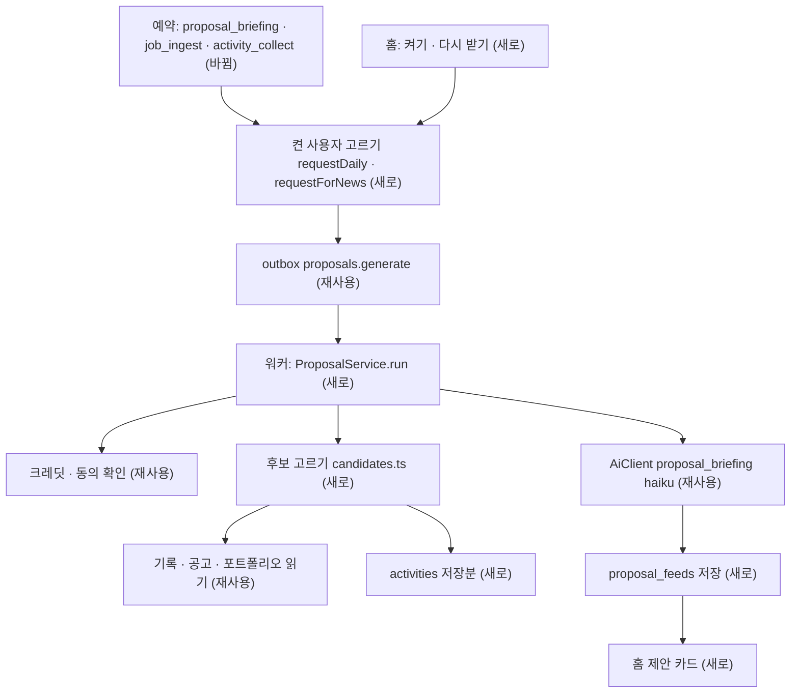

# 에이전트 능동 제안 — 명세

## 요구사항

- [ ] `GET /v1/proposals`가 `{ enabled, proposals, run }`를 준다. 꺼져 있으면 `proposals`는 비어 있다. 크레딧이 없어 실행하지 못했을 때(`run.reason = "no_credits"`) 화면은 규칙으로 센 제안을 대신 보인다.
- [ ] `POST /v1/proposals/enable`은 `career_records` 동의가 없으면 403(`ConsentError`)이고, 있으면 켜고 첫 실행을 줄에 넣는다. `POST /v1/proposals/disable`은 끄고 저장된 제안을 지운다.
- [ ] `POST /v1/proposals/refresh`는 실행 중이 아니면 실행을 줄에 넣는다. 실행 중이면 409다.
- [ ] `POST /v1/proposals/:id/dismiss`는 제안을 지우고 그 대상을 다시 제안하지 않는 목록에 넣는다.
- [ ] 실행은 워커가 한다(`proposals.generate`). 후보는 로직이 고르고(`candidates.ts`), 모델은 그 후보 안에서만 고른다. 후보에 없는 공고 · 공모전 · 기록을 짚은 항목은 저장하지 않는다.
- [ ] 모델은 행동을 닫힌 목록(`compare_job` · `start_portfolio` · `plan_activity` · `strengthen_record`)에서 고르고, 대화 요청문과 연결할 자료는 서버가 만든다.
- [ ] 실행 전에 이번 달 크레딧이 남았는지 본다. 없으면 실행하지 않고 `run.reason = "no_credits"`로 남긴다. AI가 꺼져 있으면 `"ai_unavailable"`이다.
- [ ] 자동 실행은 사용자당 종류마다 하루 한 번이다(매일 실행 1, 새 소식 실행 1). 같은 날 두 번째는 건너뛴다.
- [ ] 새 소식 실행은 새 항목이 그 사용자의 기술 용어와 하나 이상 맞을 때만 AI를 부른다. 이 판정은 실행의 첫 단계에서 로직으로 하고, 맞지 않으면 `nothing_new`로 끝내며 그날의 새 소식 실행으로 세지 않는다.
- [ ] 줄에 넣었거나 돌기 시작한 지 10분이 넘도록 끝나지 않은 실행은 실패로 보이고 다시 받을 수 있다.
- [ ] `activity_collect` 예약 잡이 위비티 두 분야를 읽어 `activities`에 넣고 처음 본 때(`firstSeenAt`)를 남긴다. `GET /v1/activities?kind=`가 접수 중인 것을 마감 순으로 준다.
- [ ] 계정을 지우면 `proposal_feeds`의 그 사용자 문서도 지워진다.

## 설계

재사용하는 것이 먼저다.

- AI 호출: `platform/ai`의 `AiClient.complete`. 계약 `proposal_briefing`을 `AI_CONTRACTS`에 더하고 `DEFAULT_MODEL_TIER`를 `haiku`로 둔다. 사용량은 `MeteredAiClient`가 `ai_usage_events`에 남긴다(`options.userId`).
- 동의: `CONTRACT_CONSENT.proposal_briefing = "career_records"`. 새 동의 범위를 만들지 않는다.
- 크레딧: `EntitlementService`에 `credits(userId)`를 더해 `check`가 쓰던 계산(`tokensUsedInPeriod` → `creditsFromTokens`)을 꺼낸다.
- 읽기: 기록은 `CareerApi.listRecords` · `listCategories`, 공고와 관심 공고는 `JobBoardApi.list`, 포트폴리오는 `PortfolioReadApi.list`. 다른 모듈의 컬렉션을 직접 읽지 않는다.
- 예약: `SCHEDULED_JOB_KEYS`에 `proposal_briefing`(86,400초) · `activity_collect`(86,400초)를 더하고 `SchedulingService#execute`에 분기를 둔다. `job_ingest` 분기는 새로 들어온 공고가 있으면 `proposals.requestForNews`를 부른다.
- 줄: outbox 토픽 `proposals.generate`(`addMongoOutboxEvent`), 워커의 `domain-jobs` 처리기에 분기 하나.
- 화면: 홈의 `ProposalAction`과 입력창 채우기(`useContext(ComposerContext)`), 규칙 제안 `briefing.ts`는 `fallback`일 때 쓴다.

새로 만드는 것.

- `packages/contracts/src/proposals.ts` — 제안 · 실행 상태 · 활동의 스키마.
- `packages/database` — 컬렉션 `proposal_feeds`(사용자당 한 문서: 켬 여부, 제안, 다시 제안하지 않는 대상, 마지막 실행, 종류별 마지막 자동 실행 날짜, 읽은 곳까지의 시각) · `activities`, 마이그레이션 0032.
- `services/backend/src/modules/activities/` — `wevity.ts`(읽기), `service.ts`(`collect` · `list`), `routes.ts`.
- `services/backend/src/modules/proposals/` — `candidates.ts`(기술 용어 뽑기 · 점수 · 후보 고르기, 순수 함수), `writer.ts`(계약 호출과 검사), `prompts.ts`(행동별 요청문), `service.ts`, `routes.ts`.
- `services/web` — `lib/api/endpoints.ts`의 `proposals` · `activities`, `home/ProposalFeed.tsx`(켜기 창 · 제안 카드 · 진행 표시), `home/proposal-actions.ts`.

후보 고르기(`candidates.ts`).

- 기술 용어: 스킬 · 도구 분류 기록의 제목과 다른 기록의 스택 속성을 구분자로 쪼갠 것.
- 공고: 국내의 진행 중인 공고를 최근 수집 순으로 100건까지 읽고, 그중 지난 실행 뒤에 수집된 것(첫 실행은 읽은 것 전부)에서 제목 · 기술 · 직군이 용어와 맞는 수로 순서를 매겨 위에서 여덟 건. 관심 공고 중 7일 안에 마감되는 것은 겹치는 용어가 없어도 넣는다.
- 공모전: 접수 중인 것 중 지난 실행 뒤에 처음 본 것(첫 실행은 접수 중 전체)에서 마감이 가까운 순으로 여섯 건.
- 다시 제안하지 않는 대상과 이미 제안에 있는 대상은 뺀다. 후보가 하나도 없으면 실행하지 않고 `nothing_new`로 남긴다.

## 버린 대안

- 홈을 열 때 그 자리에서 실행 — 제안이 나올 때까지 수십 초를 기다린다. 요청자가 미리 만들어 두는 쪽을 골랐다.
- 에이전트 채팅 런타임(`platform/agent`, 도구 호출)으로 제안 만들기 — 모델 단계가 sonnet으로 고정돼 있고 실행 한 번이 짧은 대화보다 비싸다. 후보를 로직으로 추려 계약 호출 한 번으로 끝낸다.
- 모델이 대화 요청문까지 쓰기 — 공고 · 공모전의 글이 요청문에 실려 쓰기 도구가 있는 다음 실행으로 넘어간다.
- 새 동의 범위 추가 — 고칠 곳이 열 곳이 넘고, 읽는 것이 이미 `career_records` 범위 안이다. 켬 여부는 `proposal_feeds.enabled`로 따로 둔다.
- 미머지 PR #180의 `career-coaching` 모듈에 얹기 — 다른 사람의 열린 브랜치다. 저장 모양(제목 · 근거 · 요청문 · 상태)만 맞춘다.

## 함정

- `AI_PROVIDER=off`면 `createAiClient`가 null이다. 워커는 null이면 실행하지 않고 `ai_unavailable`을 남긴다.
- 스키마에 글자 수 · 개수 제한을 두지 않는다(`platform/ai/fixes.test.ts`). 개수와 길이는 프롬프트 문장과 `check`로 다룬다.
- 마이그레이션 번호는 0032다. 열린 PR이 0025–0030을 쓰고 main이 0031까지 썼다.
- `scheduled_job_definitions`의 validator enum과 `SCHEDULED_JOB_KEYS`의 수를 통합 테스트가 맞춘다.
- `userId`를 가진 새 컬렉션은 `DOMAIN_COLLECTIONS`에 넣어야 계정 삭제 통합 테스트가 통과한다. `activities`는 사용자 것이 아니다.
- 위비티 응답 모양이 바뀌면 읽히는 줄이 0건이다. 0건이면 저장분을 지우지 않고 그대로 둔다.
- 검증 계정에는 목표 직군이 없다. 관련 사용자 판정을 목표 직군에만 기대면 대상이 없으므로 기록의 기술 용어로 판정한다.

## 완료 기준

- `pnpm typecheck`와 `pnpm test`가 통과한다.
- `pnpm test:infra`에서 `proposals` · `activities` 통합 테스트가 통과한다.
- 검증 서버(워커 포함, `AI_PROVIDER=claude-code`)에서 켜기 → 제안 생성 → 제안으로 대화 시작 → 관심 없음 → 다시 받기가 화면으로 확인되고, `ai_usage_events`에 `proposal_briefing` 행이 생긴다.
