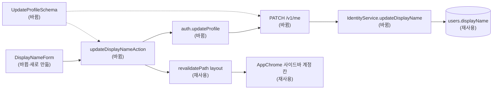

# 설정 프로필에서 표시 이름 변경 — 명세

## 요구사항

- [ ] `PATCH /v1/me`가 `{ displayName }`을 받아 로그인한 본인의 `users.displayName`을 바꾸고 `CurrentUserResponse`로 새 사용자를 돌려준다.
- [ ] 이름은 앞뒤 공백을 지운 뒤 1~200자다. 비거나 공백뿐이거나 201자 이상이면 400이다. 가입(`SignupSchema.displayName`)과 같은 규칙이며 스키마 한 곳에서 정의한다.
- [ ] 알 수 없는 키가 있으면 400이다(`strictObject`).
- [ ] 인증이 없으면 401, 삭제 요청 중인 계정이면 401이다(`requireActiveUser`·`deletionRequestedAt: null`과 같은 처리).
- [ ] 관리자가 더미 계정을 대신 보는 중(`principal.user.impersonation !== null`)에는 403이다. 더미 계정의 이름은 바뀌지 않는다.
- [ ] 이름을 바꿔도 이메일 · 요금제 · 인증 시각 · 세션은 그대로다.
- [ ] 설정 → 프로필의 표시 이름 줄에 「이름 바꾸기」가 있고, 저장하면 줄과 사이드바 계정 칸이 새 이름으로 바뀐다. 새로고침해도 유지된다.
- [ ] 입력이 잘못되면 저장하지 않고 입력칸 아래에 사유 한 줄이 보인다. 「취소」는 입력을 버리고 원래 이름으로 돌아간다.
- [ ] 대신 로그인 중인 화면에는 「이름 바꾸기」가 없다.

## 설계

재사용하는 것 — 같은 줄의 레이아웃(`.dataRow`·`.dataAction`·`.verifyResult`·`.dataError`), 서버 액션 + `useActionState` 패턴(`ResendVerificationForm`), 응답 파싱(`CurrentUserResponseSchema`), 인증 라우트 구성(`authenticateRequest` → `requireAuth`).

새로 만드는 것:

- **계약** `packages/contracts/src/identity.ts` — `DisplayNameSchema = z.string().trim().min(1).max(200)`를 만들어 `SignupSchema`가 이것을 쓰게 하고, `UpdateProfileSchema = z.strictObject({ displayName: DisplayNameSchema })`와 `UpdateProfile` 타입을 추가한다.
- **서비스** `IdentityService.updateDisplayName(userId, displayName): Promise<AuthenticatedUser>` — `users.findOneAndUpdate({ _id, deletionRequestedAt: null }, { $set: { displayName } })` 뒤 `#user()`로 응답을 만든다. 문서가 없으면 `IdentityError(401)`. `IdentityApi`는 레거시 서비스 타입에서 파생되므로 `legacy-mysql-service.ts`에는 다른 Mongo 전용 메서드와 같은 "지원하지 않음" 스텁을 둔다.
- **라우트** `PATCH ${API_PREFIX}/me` — 기존 `GET /me` 옆. `parseBody(UpdateProfileSchema)` → 대신 로그인이면 `HttpStatusError(403)` → 서비스 호출. 대신 로그인 중 `principal.user.id`는 더미 계정이고 세션 주인은 관리자이므로 403 판단은 `principal.user.impersonation`으로 한다.
- **웹 엔드포인트** `lib/api/endpoints.ts`의 `auth.updateProfile(accessToken, input)`.
- **웹 액션** `app/account-actions.ts`의 `updateDisplayNameAction` — `UpdateProfileSchema.safeParse` 실패와 400을 사유 문구로 돌려주고, 성공하면 `revalidatePath("/", "layout")`로 사이드바(`AppChrome`)까지 다시 그린다.
- **웹 화면** `(app)/account/DisplayNameForm.tsx` 클라이언트 컴포넌트 — 보기 상태(이름 + 「이름 바꾸기」)와 편집 상태(입력칸 + 「저장」「취소」). `page.tsx`는 `session.user.impersonation === null`일 때만 이것을 그리고, 아니면 지금처럼 글자만 둔다.
- **OpenAPI** `packages/contracts/src/openapi.ts`에 등록되는 경로 목록이 있으면 `PATCH /me`를 추가한다. 목록이 `/me`를 따로 세지 않으면 건드리지 않는다.

## 버린 대안

- `PUT /v1/me/profile` 같은 새 경로 — 사용자 읽기는 `GET /me`인데 쓰기만 다른 경로로 나누면 같은 자원이 두 곳에 있게 된다. `PATCH /me`로 같은 자원에 둔다.
- 이름을 수정 전용 페이지로 분리 — 프로필 줄에서 바로 고치는 것이 한 번 덜 이동한다.
- 대신 로그인 중에도 허용 — 관리자가 보는 더미 계정은 시연용 페르소나이고, 이름이 실수로 바뀌면 되돌릴 기록이 없다.

## 함정

- `AuthenticatedUser`는 `displayName`을 세션 응답 · `/me` · 가입 응답에서 모두 내보낸다. 값은 매번 DB에서 읽으므로 캐시된 이름은 없다. 단, 웹의 `requireSession`은 `cache()`로 요청 안에서만 묶이므로 서버 액션 뒤 `revalidatePath`가 없으면 사이드바가 옛 이름으로 남는다.
- `IdentityPrincipal.owner.displayName`(관리자 이름)은 세션 확인 때마다 읽는다. 따로 갱신할 곳이 없다.
- 포트폴리오 생성 입력의 `author.name`(`page/service.ts`)은 생성 시점의 `users.displayName`을 읽는다. 바뀐 이름은 다음 생성부터 쓰이고 이미 만든 본문은 그대로다.
- 이메일 대소문자 collation 때문에 `users` 조회는 `_id`로만 한다. 이름으로 조회하는 인덱스는 없고 만들지 않는다.
- 서버 액션에서 `trim()`을 한 번, 계약에서 한 번 더 하므로 입력 상태가 어긋나지 않게 액션이 파싱한 값을 그대로 보낸다.

## 완료 기준

- `pnpm typecheck` 통과.
- `pnpm test` 통과 — 계약 테스트에 `UpdateProfileSchema`(공백 trim · 빈 값 · 201자 · 알 수 없는 키)를 추가한다.
- `pnpm test:infra`의 `auth.integration.test.ts`에 추가한 케이스 통과: 200과 새 이름, 이어지는 `GET /me`가 새 이름, 400(빈 이름), 401(토큰 없음), 대신 로그인 중 403 및 더미 이름 불변.
- 개발 서버에서 `/account#profile`을 열어 이름을 바꾸고 사이드바 계정 칸이 바뀌는지, 새로고침 뒤에도 유지되는지, 빈 값 저장이 막히는지, 취소가 원래 이름으로 돌아가는지 직접 확인한다.
