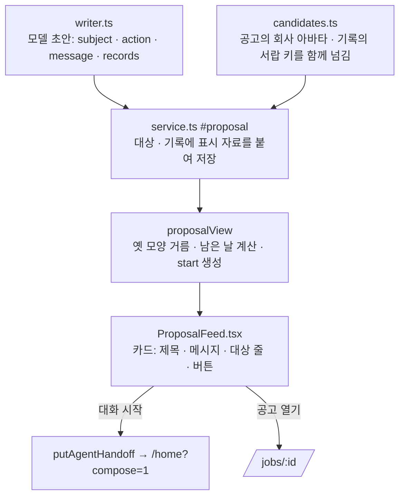

# 홈 제안 카드 재구성 — 명세

## 요구사항

1. 홈(`HomeStart`)은 위젯 구획을 제안 구획보다 먼저 그린다.
2. 제안 한 건은 `action` · `message` · `subject` · `records` · `start`를 가진다. `title` · `reason`은 없앤다.
3. `ProposalRef`는 화면이 대상을 그리는 데 필요한 것을 함께 가진다 — `sub`(회사 · 주최 · 서랍 이름), `company`(공고의 회사 아바타), `categoryKey`(기록의 서랍), `activityKind`(활동의 종류).
4. 카드 제목과 종류 색은 `action`(활동은 `activityKind`까지)에서 화면이 정한다. 모델이 쓰지 않는다.
5. 버튼의 문구와 넘기는 요청문은 지금처럼 서버가 정한다(`prompts.ts`). 메시지는 화면에만 쓰고 대화로 넘기지 않는다.
6. 대화를 여는 버튼은 입력창을 채우지 않고 대화를 바로 시작한다(`putAgentHandoff` → `/home?compose=1`).
7. 옛 모양(`message`가 없는)으로 저장된 제안은 읽을 때 걸러 낸다.

## 설계

- **계약**(`packages/contracts/src/proposals.ts`): `ProposalSchema`에서 `title` · `reason`을 지우고 `message`(1~400자)를 둔다. `ProposalRefSchema`에 `sub` · `company` · `categoryKey` · `activityKind`를 더한다(해당하지 않는 대상은 null). `company`는 `JobPostingCompanySchema`에서 아바타에 쓰는 다섯 칸만 고른다.
- **작성기**(`writer.ts`): 초안 스키마를 `{ subject, action, message, records }`로 바꾸고 프롬프트 판을 올린다. 메시지 지침은 프롬프트 문장으로 둔다 — 대상의 이름을 「」로, 기록에서 확인되는 사실 하나, 권하는 행동을 묻는 물음으로 끝, 목표를 아는 것처럼 말하지 않음. `check`는 빈 값과 길이(120자)만 본다.
- **후보**(`candidates.ts`): `JobInput`에 `avatar`(회사 아바타), `RecordBrief` · `WeakRecord`에 `categoryKey`를 싣는다. 고르는 로직은 바꾸지 않는다.
- **서비스**(`service.ts`): `#proposal`이 새 칸을 채운다. `proposalView`는 `message`가 문자열이 아닌 문서를 null로 돌려 옛 제안을 거른다.
- **요청문**(`prompts.ts`): 버튼 문구를 사용자의 말로 바꾼다 — 「요건을 대조해 주세요」 · 「참가 계획을 세워 주세요」 · 「네, 물어봐 주세요」. 「포트폴리오 만들기」는 공고 화면으로 가는 동작이라 「공고 열고 만들기」 그대로 둔다.
- **화면**(`ProposalFeed.tsx` · `home-start.module.css`): 카드는 위젯의 `.widget` · `.widgetHead` · `.widgetTitle` · `.rows` · `.row` · `.avatar`를 그대로 쓴다. 종류 표시의 색은 회사 아바타 틴트 규칙(`company-avatar-tint.ts`)에서 색상(hue)만 골라 쓴다. 켜기 전 안내 · 만드는 중 · 크레딧 소진 시 규칙 제안도 같은 틀로 그린다.

## 버린 대안

- 「포트폴리오 만들기」도 대화로 시작: 대화의 도구에 포트폴리오 생성이 없어 눌러도 만들지 못한다. 공고 화면으로 가는 지금 동작이 정직하다.
- 카드 제목을 모델이 쓰게 함: 종류는 `action`이 이미 정한다. 모델 출력을 줄이는 쪽이 싸고 덜 틀린다.
- 「말을 거는」 무대 연출(한 번에 한마디 · 화면 아래 입력창): 시안에서 사용자가 반려했다.

## 함정

- 계약이 `strictObject`라 옛 제안이 하나라도 응답에 섞이면 웹의 파싱이 멈춘다. 거르는 곳은 `proposalView` 한 곳이어야 한다.
- 공고 · 활동의 글은 바깥에서 온 글이다. 메시지를 대화의 요청문에 실으면 그 글이 쓰기 도구를 가진 대화로 넘어간다.
- 종류 색을 CSS에 색 값으로 적으면 `tokens.test.ts`가 막는다. 아바타처럼 인라인 스타일로 넣는다.

## 완료 기준

- `pnpm typecheck` · `pnpm test` · `pnpm test:infra`가 통과한다.
- 검증 서버에서 제안을 새로 만들어, 카드에 메시지 · 대상 줄(회사 로고 · 서랍 아이콘) · 버튼이 보이고 버튼이 대화를 시작한다.
